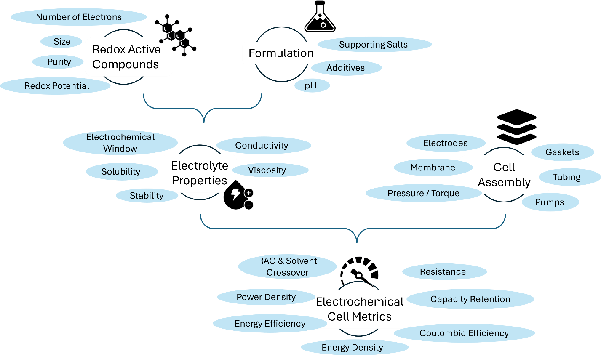

## 2. Electrolyte Properties and Preparation

This section surveys the key properties and performance metrics that determine the suitability of RACs and their formulated electrolytes for use in redox flow batteries. For each property, we discuss what it is, why it matters for battery performance, and how molecular design and electrolyte formulation can be used to improve it. In doing so, we also outline the major research thrusts in the field, drawing on pioneering and representative examples rather than attempting an exhaustive treatment. Readers seeking in-depth coverage of organic and coordination complex electrolyte development are directed to the reviews available on this topic.[@doi:10.1002/aenm.202400721; @doi:10.1039/D3CS00703K; @doi:10.1002/adma.202301898; @doi:10.1039/D2CS00765G]

### 2.1 Redox-Active Compounds

The development of new redox-active compounds is guided by a set of RAC properties: Redox potential, molar mass, size, solubility, number of transferrable electrons, electrochemical kinetics, and chemical stability. In fully organic RACs, each of these metrics can be addressed through synthetic modification of the molecular scaffold, whereas in metal coordination compounds both the choice of metal center and the design of the coordinating ligand environment provide largely independent handles on the same properties.[@doi:10.1021/acs.chemrev.9b00599; @doi:10.1039/D2CS00765G; @doi:10.1002/anie.202515639; @doi:10.1021/acsaem.5c01782] The organic component of both material classes is a genuine structural advantage: unlike vanadium or other critical minerals,[@doi:10.2873/725585] the feedstocks for organic RACs are widely distributed, and the diversity of available molecular scaffolds and ligands creates a large design space for continued optimization.[@doi:10.1016/j.cogsc.2024.100905; @doi:10.1021/acs.chemrev.9b00482; @doi:10.1002/adma.202507952] In line with broader sustainability goals, some researchers are also attempting to move away from petrochemical feedstocks for these organic components by turning to biological sources, such as amino acids,[@doi:10.1038/s41467-025-59962-1; @doi:10.1002/anie.202014610] fungi,[@doi:10.1002/batt.202200365] microorganisms,[@doi:10.1016/j.cej.2025.169515] or lignin derivatives from pulp and paper waste.[@doi:10.1016/j.cej.2025.169560; @doi:10.1002/sus2.70050; @wo-2020035138] The following paragraphs discuss how molecular design strategies target each of the aforementioned metrics, and what researchers should consider and report when evaluating new compounds (Figure {@fig:electrolyte-properties}). These metrics can vary depending, for example, on temperature, component age, or the state of charge of the battery.

{#fig:electrolyte-properties}

The redox potential of a RAC determines whether it functions as a negative electrolyte (negolyte) or a positive electrolyte (posolyte) and, together with the opposing half-cell potential, sets the thermodynamic cell voltage. At the molecular level, the potential is governed by the electron density of the redox-active core: Electron-poor scaffolds are reduced at higher potentials and are, therefore, better suited as posolytes, whereas electron-rich scaffolds are reduced at lower potentials and are better suited as negolytes.[@doi:10.1002/anie.201604925; @doi:10.1007/978-1-4684-8661-2; @doi:10.1039/C4SC03030C] Among quinones, this principle is illustrated by the contrast between anthraquinones, whose extended aromatic system and carbonyl groups create a relatively electron-rich core that makes them natural negolyte candidates, and benzoquinones, whose less aromatic, more electron-deficient core places their redox potential in the posolyte range.[@doi:10.1002/aenm.201702056; @doi:10.1002/admi.202300268] Anthraquinone disulfonate (AQDS) marked the launch of the field as a high-performing, inexpensive negolyte.[@doi:10.1002/admi.202300268; @doi:10.1038/nature12909; @doi:10.1039/D5TA03034J; @doi:10.1016/j.cocis.2022.101624] Bipyridinium salts (viologens),[@doi:10.1002/anie.201606472; @doi:10.1002/adma.202514004; @doi:10.1039/D4TA00753K; @doi:10.1021/acsaem.4c02259; @doi:10.1002/chem.202404122; @doi:10.1002/anie.202501458] phenazines,[@doi:10.1038/s41560-018-0167-3; @doi:10.1016/j.jpowsour.2025.236461] and quinoxalines[@doi:10.1021/acsaem.2c01978; @doi:10.3390/molecules26082227; @doi:10.1021/jacs.3c10454] are further examples of RACs that operate in the negolyte potential range. On the posolyte side, nitroxide radicals, such as TEMPO, operate at high potentials by virtue of their relatively stable radical oxidation chemistry.[@doi:10.1002/aenm.201501449; @doi:10.1016/j.jpowsour.2025.236529] The same electron-density logic applies to RACs based on metal coordination, where the redox potential is set by the inherent reduction potential of the metal center and is modulated by the electron-donating or electron-withdrawing character of the coordinated ligands, giving researchers an additional and largely independent handle on potential tuning.[@doi:10.1007/s41918-023-00205-6; @doi:10.1002/celc.202400574; @doi:10.1021/acsenergylett.7b00019] Within any scaffold family, the redox potential can be further tuned rationally by introducing electron-donating or electron-withdrawing substituents.[@doi:10.1002/anie.201606472; @doi:10.1021/acsaem.4c02259; @doi:10.1038/nenergy.2016.102; @doi:10.1002/cssc.202201984; @doi:10.1021/acsenergylett.1c02504; @doi:10.1016/j.jpowsour.2018.03.041; @doi:10.1002/aenm.201601488; @doi:10.1002/cssc.202300626] An additional consideration, particularly for RACs undergoing proton-coupled electron transfer (PCET), is that the redox potential is intrinsically pH-dependent. During cycling, proton consumption or release by the RAC, crossover through the membrane, or side reactions can drive significant shifts in electrolyte pH value which, in turn, shift the formal redox potential of the RAC, with implications for cell voltage, charge capacity, and long-term stability.[@doi:10.1002/aenm.201900039] Not all RACs undergo PCET: several important scaffold classes, including viologens and TEMPO derivatives, exhibit purely electronic redox processes whose formal redox potentials are pH-independent, making them particularly attractive for near-neutral pH electrolytes in which PCET-driven potential shifts and pH management during cycling are less of a concern.[@doi:10.1016/j.jechem.2024.04.031]

Electrochemical kinetics, i.e. the rate of heterogeneous electron transfer, affect overpotential losses during cycling and therefore matter to the overall system performance. Most RACs exhibit satisfactory kinetics, i.e. kinetics is not the source of substantial voltage loss in an operating flow cell, although this varies with scaffold and ligand environment and should not be assumed.[@doi:10.1002/batt.202500250] For example, small changes in functional groups have been observed to more than double the peak-to-peak separation in cyclic voltammetry.[@doi:10.1021/acsenergylett.1c02504]

RACs in flow battery electrolytes range from small organic molecules to coordination complexes and polymeric species. A key challenge is RAC crossover through the membrane, which causes capacity fade and electrolyte cross-contamination. This problem is generally more severe for smaller molecules that readily permeate conventional ion-exchange membranes. One strategy is to mitigate the impact of crossover by using amphoteric molecules, also referred to as symmetric or bipolar molecules, which use the same RAC in different redox states in both half-cells.[@doi:10.1021/acsenergylett.6b00413; @doi:10.1039/C6EE01883A; @doi:10.1021/acsaem.9b00691; @doi:10.1016/j.jechem.2024.08.016] A recent example of this design principle is a functionalized terthiophene capable of reversible oxidation and reduction on a single molecular platform, illustrating how ambipolar redox behavior can be engineered directly into a molecule's electronic structure rather than relying on a single, more limited redox couple.[@doi:10.1021/jacs.4c16003] Another strategy is to suppress crossover by increasing the molecular size through oligomer- and polymer-based redox-active materials, thereby enabling the use of size-exclusion membranes.[@doi:10.1021/jacs.4c14969; @doi:10.1021/acs.chemrev.6b00070; @doi:10.1002/macp.201700267; @doi:10.1021/acsapm.9b00864; @doi:10.1002/tcr.202500010; @doi:10.1002/anie.202507739] Larger species, however, introduce trade-offs as reduced crossover can come at the cost of lower solubility and higher electrolyte viscosity, with corresponding penalties in mass transport, pumping losses, and system efficiency. Ultimately, strategies used to suppress crossover should not unduly compromise other parameters, such as solubility.

Solubility sets an upper limit on volumetric energy density at a given cell voltage. This limit is meaningful only if cell testing is performed near the reported solubility, rather than at substantially lower concentrations, as is often the case. For fully organic RACs of a given size, functionalization with charged or hydrophilic groups is the primary molecular-level strategy for improving aqueous solubility, whereas in metal-coordination RACs solubility can be tuned through ligand selection and counter-ion choice.[@doi:10.1016/j.xcrp.2022.101215] A complementary approach applicable to both classes is to increase the number of electrons transferred per molecule, thereby delivering more charge per unit of dissolved active material without requiring a higher concentration. Recently demonstrated multi-electron scaffolds include a four-electron naphthoquinone dimer negolyte,[@doi:10.1021/acsenergylett.9b01321] a quinone-pyrazine conjoined-core negolyte,[@doi:10.1021/jacs.5c17809] a pyrene-4,5,9,10-tetraone derivative posolyte,[@doi:10.1021/jacs.4c12506] and a six-electron phenazine-based negolyte.[@doi:10.1002/advs.202514452] The utility of such approaches can be limited by the range of potentials across which the redox events occur, potentially leading to voltage efficiency losses.

Chemical stability, in both the discharged and charged states, is critical for long-term capacity retention, and improving it through molecular design has been a major focus of the field. The sensitivity of many negolyte RACs to atmospheric oxygen, causing spontaneous reversible discharge or irreversible degradation upon exposure, has motivated the development of air-tolerant molecules that simplify handling and extend electrolyte lifetime.[@doi:10.1038/s41586-023-06664-7; @doi:10.1002/anie.202214819; @doi:10.1021/jacs.5c05219] Beyond intrinsic molecular stability, unrecognized and pernicious degradation during storage and handling can produce misleading electrochemical results and should be ruled out before capacity loss is attributed to battery cycling. Alkaline solutions progressively carbonate upon exposure to air,[@doi:10.1016/j.xcrp.2022.101215] with consequences that include nucleophilic attack on nitroxide-based RACs,[@doi:10.1016/j.energy.2025.136811; @doi:10.1016/j.jpowsour.2016.04.136] suppression of AQDS capacity by shifting a two-electron process to a one-electron process,[@doi:10.1149/1945-7111/ad1ec3] and precipitation of ferrocyanide.[@doi:10.1016/j.xcrp.2022.101215] Light exposure is a further hazard: ferri/ferrocyanide decomposes under natural light,[@doi:10.1016/j.xcrp.2022.101215; @doi:10.1149/1945-7111/ace936; @doi:10.1016/j.solmat.2009.10.008] and ferrocene-ammonium derivatives undergo photolytic decomplexation.[@doi:10.1039/D1EE03251H] Accordingly, storage conditions should be documented and reported.

### 2.2 Electrolyte Formulation

The metrics discussed above are not determined by molecular structure alone: the surrounding electrolyte formulation can independently shift redox potential, dramatically alter solubility, and modulate viscosity. Therefore, a complete account of all electrolyte components, their concentrations, and the preparation protocol must be reported whenever results are published.[@doi:10.3390/batteries8100193]

The identity and concentration of the supporting salt can substantially modify a RAC's redox potential,[@doi:10.1002/admi.202300268; @doi:10.1016/j.jpowsour.2020.228453; @doi:10.1039/D5CC03825A] and define the accessible electrochemical window; the most common inorganic salts --- NaCl, KCl, NaOH, KOH, and H₂SO₄ --- differ meaningfully in this respect. For PCET-active RACs, the pH value is an additional and largely independent formulation lever for tuning the potential, as discussed above. However, the pH value must also be managed actively during cycling: osmotic balance agents help manage differential ion concentrations between half-cells and prevent pH drift,[@doi:10.1021/acsami.6b12068; @doi:10.1016/j.elecom.2021.107148; @doi:10.1021/acsami.0c16743] and buffers can help maintain the targeted pH value within ranges where RACs have higher stability.[@doi:10.1016/j.jpowsour.2022.231641] The influence of these formulation variables on performance can be substantial. Significant gains in vanadium electrolytes, for example, were achieved solely by adjusting proton concentration to reduce osmotic imbalance, without changing the active material at all.[@doi:10.1016/j.apenergy.2023.122262; @doi:10.1039/D5SU00532A] A related subtlety concerns *in situ* synthesis procedures of RACs which directly combine a metal halide precursor with a ligand and base to neutralize the resulting solution, which lead to a high residual halide concentration that is often not reported or discussed. This halide is not a passive spectator: it can affect solubility, ion pairing, electrochemical kinetics, and side reactions such as nucleophilic attack on the oxidized metal center,[@doi:10.1007/s41918-023-00205-6] as has been observed for ferrocenium species in the presence of chloride.[@doi:10.1021/acsaem.0c02259] Properties of an in-situ-synthesized RAC should therefore not be assumed to reflect the RAC in pure water, and the two should be clearly differentiated when reporting results.[@doi:10.1039/D0MA00881H; @doi:10.1016/j.jpowsour.2021.230877]

Electrochemical kinetics are similarly sensitive to formulation. The identity and concentration of the supporting salt can change heterogeneous electron-transfer rates,[@doi:10.1002/admi.202300268; @doi:10.1016/j.jpowsour.2020.228453; @doi:10.1039/D5CC03825A] and pH value can alter the charge-transfer mechanism itself. For PCET-active RACs, redox processes may shift, for example, from a 2e⁻/2H⁺ process to a 2e⁻/1H⁺ process or to a purely electronic process as the pH value increases, with direct consequences for the observed electrochemical kinetics and the associated overpotential losses during cell cycling.

Formulation has a profound effect on solubility and thereby on the accessible energy density. At the counter-ion level alone, switching from Na⁺ to Li⁺ increases ferri/ferrocyanide solubility from 0.56 to 2.3 mol L^-1^.[@doi:10.1016/j.xcrp.2022.101215] For 2,7-AQDS, solubility was observed to range from 0.74 mol L^-1^ (Na⁺) to 0.38 mol L^-1^ (K⁺) and as low as 2 mmol L^-1^ (Ca²⁺).[@doi:10.1149/1945-7111/ab7550] The solubility of non-functionalized TEMPO was increased from 0.07 to 5.6 mol L^-1^ simply by switching from water to a concentrated aqueous LiTFSI solution.[@doi:10.1002/aenm.202301929] Hydrotropes and other solubilizing agents, such as cyclodextrins, urea, and ammonium derivatives, can dramatically increase RAC solubility.[@doi:10.1039/D5TA00113G; @doi:10.1002/adma.202301898; @doi:10.1016/j.gee.2024.08.003] Mixed-RAC electrolytes offer another route to higher accessible energy density. A mixture of Alizarin and Alizarin Red S reached 0.7 M, compared with less than 0.3 M for either compound alone, and a three-component anthraquinone mixture yielded a 1.0 M negolyte.[@doi:10.1039/D5TA06073G] Additives must be selected carefully; their effects on solubility should be verified across the full SOC range and their crossover potential assessed, as loss of a solubilizing additive from one compartment will reduce RAC solubility in that half-cell. Their interactions with cell materials and the electrolyte of the opposing half-cell should also be evaluated before any benefit is assumed.[@doi:10.1016/j.elecom.2021.107148; @doi:10.1021/acselectrochem.5c00178; @doi:10.1021/acs.jpclett.5c01544; @doi:10.1039/D2EE03617G; @doi:10.1021/acsenergylett.5c00468] Purity is another formulation-level variable that affects both accessible energy density and the reliability of reported results. Impurities, whether synthetic by-products, isomers, or contaminants from supporting salts, can interact with electrodes, membranes, and electrolytes in ways that confound interpretation.[@doi:10.1021/acs.energyfuels.4c04194] In some cases the consequences are benign or even advantageous: 2,7-AQDS mixtures with 2,6-AQDS and 2-AQS performed comparably to purified material,[@doi:10.3390/membranes12100912] the 1,2-DHAQ co-product from synthesis of 2,3-DHAQ did not require removal provided its concentration remained below the precipitation limit,[@doi:10.1016/j.jpowsour.2022.231600] chromium complex isomers yielded higher accessible capacity when their potential gap was small,[@doi:10.3390/batteries9120573] and DHAQ/DBEAQ mixtures revealed an improved stability relative to either compound alone.[@doi:10.1021/acsenergylett.5c01503] In other cases, impurities may lead to erroneous interpretation of degradation mechanisms. For example, carbonate originating from atmospheric CO₂ absorption in commercial hydroxide solutions may hinder the evaluation of degradation mechanisms by ¹³C NMR.[@doi:10.1016/j.jpowsour.2020.228453]

Viscosity is a distinct but closely coupled constraint that is often underreported relative to its impact on battery performance. At the molecular level, the size, shape, and intermolecular interactions of the RAC influence the viscosity of concentrated solutions. At the high active-material concentrations desired for higher energy density,[@doi:10.1021/acs.chemrev.5c00332] viscosity rises sharply,[@doi:10.1016/j.est.2024.112429] degrading mass transport, ionic conductivity, and pumping efficiency.[@doi:10.1016/j.ijheatmasstransfer.2024.126627] Aggregation phenomena at high concentration can further reduce accessible capacity, as is well documented for AQDS.[@doi:10.1021/acs.chemmater.7b00616; @doi:10.1039/C7CP05881K; @doi:10.1149/2.0081601jes; @doi:10.1149/1945-7111/ad1ec3] The RAC itself is not the only determinant, however: the broader formulation, including solvent, supporting salts, and additives, such as hydrotropes, plays an important role.[@doi:10.1002/adma.202301898; @doi:10.1016/j.jpowsour.2018.03.041] Temperature provides a further handle by which viscosity can be meaningfully reduced without modifying the active material. Viscosity also evolves during cycling as SOC and osmotic dilution change.[@doi:10.3390/batteries8100193; @doi:10.1002/admi.202300268] Many concentrated aqueous electrolytes exhibit non-Newtonian behavior,[@doi:10.1039/D0MH01632B] which may need to be accounted for in transport modeling. Ionic conductivity is, in turn, primarily governed by the supporting electrolyte, the concentration of which is often the principal lever for ensuring adequate charge transport through the electrolyte phase.[@doi:10.1039/D5CC03825A]

A final consideration, which is often overlooked in early-stage reports, is the hazards. Even when molecules are designed primarily to generate fundamental knowledge, the safety and toxicity of the individual redox-active compounds and of the electrolyte system as a whole should be considered at every stage from synthesis through operation for the sake of the experimenter and laboratory environment. The hazard classification, e.g., NFPA, of all purchased and synthesized components should be checked before work begins, and the possible formation of hazardous by-products during synthesis, formulation, or battery operation must be anticipated. Many early-stage syntheses rely on hazardous solvents or catalysts,[@doi:10.1039/D1GC01333E] and while green chemistry is a secondary criterion at the exploratory stage, efforts to improve sustainability should be incorporated as a chemistry matures.[@doi:10.1039/D2CS00765G] Hazards can also emerge from component interactions: ferri/ferrocyanide in acidic media generates highly toxic free cyanide,[@doi:10.1149/1945-7111/ace936; @doi:10.1016/j.coelec.2024.101581; @doi:10.1016/j.joule.2018.10.010] and at near-neutral pH the risk is compounded by the fact that hydrogen cyanide (pKₐ = 9.2) is partially protonated and, with a boiling point of only 26 °C, can volatilize readily.[@pubchem-hydrogen-cyanide] We therefore strongly advise the use of an HCN sensor when working with this system, particularly at near-neutral pH. Additives that may cross the membrane and react with the opposite electrolyte should also be assessed for safety implications, as the extent of crossover depends on membrane type and thickness and must be determined empirically. Some RACs carry intrinsic toxicity, e.g., methyl viologen is toxic to aquatic life and harmful to humans; while others have been classified as harmful to the environment.[@doi:10.1002/cssc.202201818] Although toxicity can sometimes be tuned by modifying the core structure,[@doi:10.1002/cssc.202300626] an awareness of these hazards is a responsibility of all practitioners in the field.
