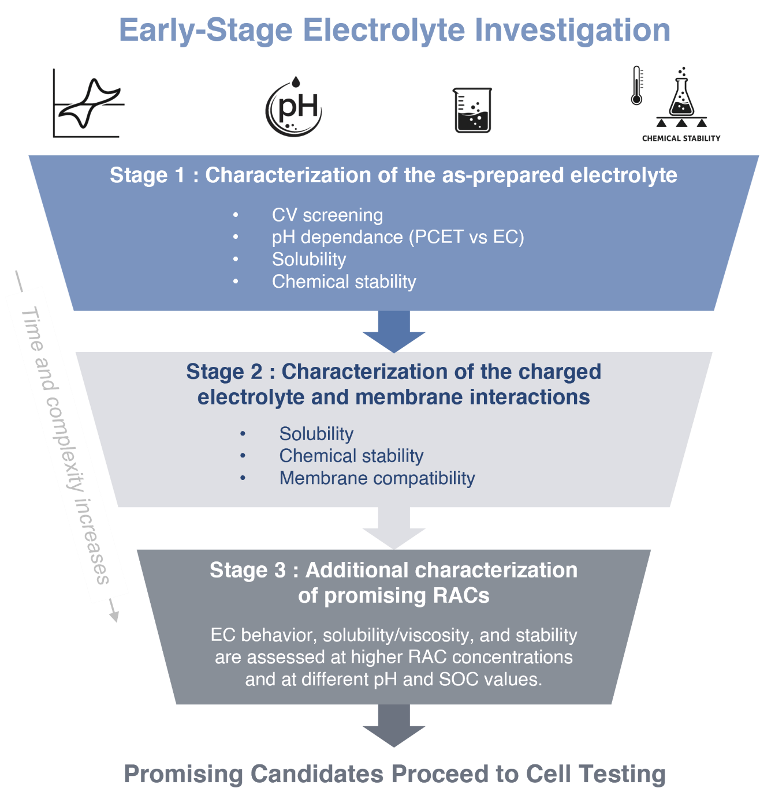

## 3. Electrolyte Characterization

A comprehensive evaluation of every redox-active compound or electrolyte formulation is impractical given the time and resource constraints of contemporary research. Even so, there remains a need to document findings appropriately, even when results are not promising. This is important not only for human researchers seeking to understand different systems, but also for emergent machine-learning approaches that require large and diverse datasets. Given the breadth of available design options, including molecular scaffolds, ligand environments, substituent groups, pH value, additives, and operating conditions, a compound that performs poorly under one set of conditions may perform very differently after targeted molecular modification or formulation optimization. Accordingly, we suggest the characterization strategy depicted in Figure {@fig:screening-workflow} that increases in complexity, time, and resource use as the compound of interest meets defined performance benchmarks, while still collecting enough data at each stage to document the findings and guide the next design iteration.

In all cases the same reporting standards apply: all reagents, electrolyte compositions, supporting electrolyte identity and concentration, liquid volumes, container material, electrode materials and preparation, atmospheric conditions including inert gas headspace and oxygen exposure, and storage and experimental temperature should be reported, as these can all affect the measured electrolyte properties. Specification of these parameters is essential to enable reproduction of characterization results across different laboratories.

The screening procedure described in this section is organized into two stages based on the nature of the species being characterized and on the complexity of the required experimental setup. Stage 1 focuses exclusively on the as-synthesized or commercially sourced RAC in its discharged form and requires no flow cell hardware, no chemical oxidants or reductants, and no counter electrolyte. In the absence of those elements, there is no risk of contamination from a second redox-active species, and the experiments are relatively accessible and with low-investment costs. If the discharged form demonstrates promising properties at the end of Stage 1, e.g., solubility exceeding 0.1 M of transferrable electrons, adequate electrochemical reversibility, and acceptable chemical stability, that prompts further investment in the more demanding Stage 2 experiments, which involve the generation and characterization of the charged form of the RAC and its interaction with an ion-conducting membrane. The order and even the necessity of individual steps within each stage will vary depending on prior knowledge of the material and the available resources. Electrolytes that pass both screening stages and perform promisingly in subsequent cell cycling may warrant the expanded characterization mentioned in Stage 3 at the end of this section.

{#fig:screening-workflow}

### 3.1 Stage 1: Characterization of the as-prepared electrolyte

Stage 1 screening requires no flow cell hardware and focuses on characterizing the discharged form of the active material through a sequence of electrochemical and analytical measurements of increasing complexity, beginning with cyclic voltammetry to assess redox potential and reversibility, and followed by pH-dependent electrochemical characterization, solubility determination, and chemical stability assessment.

#### 3.1.1 Cyclic voltammetry screening

Cyclic voltammetry (CV) is a foundational electrochemical technique that provides an initial assessment of the electrochemical properties of a RAC.[@doi:10.1021/acs.jchemed.7b00361] The theoretical framework of CV applies to dilute solutions (≤ 10^-2^ M active species) with an excess of supporting electrolyte (\> 10^-1^ M) to ensure sufficient ionic conductivity and to suppress electromigration. The exact electrolyte composition is at the discretion of the experimentalist, but it is advisable to follow good electroanalytical practice.[@bard-faulkner-2001; @doi:10.1021/acsnano.0c01281] Solutions should be prepared with deionized water and sparged with an inert gas. The choice of reference electrode should be guided by the pH and composition of the electrolyte.[@doi:10.3390/encyclopedia3020033; @doi:10.1016/j.nxener.2023.100053] Common choices include Ag/AgCl (3 M NaCl or saturated KCl) for near-neutral aqueous electrolytes, saturated calomel (SCE) for acidic to neutral aqueous systems, Hg/HgO for alkaline electrolytes, and Hg/Hg₂SO₄ where chloride contamination must be avoided.[@zoski-2007] Counter electrodes must be stable under the electrochemical conditions and should present a substantially larger area than the working electrode. A glassy carbon working electrode is often used because of its chemical similarity to the graphitic carbon electrodes in many flow cells.

CV peak currents and potentials provide quantitative information on the thermodynamic, kinetic, and transport properties of a RAC.[@doi:10.1021/acsnano.0c01281; @doi:10.1021/acs.jchemed.7b00361] Best practices such as background subtraction and IR correction should be applied in all cases. For an electrochemically reversible system, the peak-to-peak separation at 25 °C is expected to be close to 59/n mV, where n is the number of electrons transferred per RAC; the peak-current ratio (I~p,a~/I~p,c~) should be close to unity once the background has been subtracted; and both peak currents should scale proportionally with the inverse of the square root of the scan rate. For most RACs, the diffusion coefficient and electron transfer rates typically lie in satisfactory reversible or quasi-reversible ranges (*D* \> 10^-6^ cm^2^·s^-1^, k⁰ \> 10^-3^ cm s^-1^). It is therefore usually unnecessary to measure exact k⁰ values from CV or rotating-disk electrode (RDE) experiments[@doi:10.1126/science.aab3033] at the electrolyte screening stage. However, it should be noted that CV-derived values of D and k⁰ carry substantial uncertainty and that kinetic data obtained on glassy carbon in dilute solution do not necessarily translate to performance on porous graphitic electrodes at battery-relevant concentrations. Electrochemical reversibility should, therefore, not be used as a strict go/no-go criterion, because quasi-reversible and even irreversible kinetics can be improved through electrocatalysis,[@doi:10.1002/aenm.201900694] as demonstrated by the two commercialized systems - vanadium and iron/chromium.[@doi:10.1016/j.ensm.2020.06.012; @doi:10.1002/cssc.202101798] CV is equally well suited to screening families of RACs with different substituents,[@doi:10.1002/anie.202014610; @doi:10.1002/anie.201606472; @doi:10.1021/acsaem.4c02259; @doi:10.1038/nenergy.2016.102; @doi:10.1002/cssc.202201984; @doi:10.1021/acsenergylett.1c02504; @doi:10.1016/j.jpowsour.2018.03.041; @doi:10.1002/aenm.201601488; @doi:10.1002/cssc.202300626; @doi:10.1021/acsaem.9b00691; @doi:10.1002/aenm.202000340; @doi:10.1016/j.joule.2018.07.005; @doi:10.1002/aenm.202400022; @doi:10.1002/cssc.202000381; @doi:10.1039/D1OB01758F; @doi:10.1002/aenm.202203919; @doi:10.1021/acsaem.0c01336; @doi:10.1021/acsenergylett.9b00739] and to evaluating the influence of electrolyte formulation variables, such as supporting electrolyte identity and additives, on a given RAC.[@doi:10.1021/acsaem.5c00225; @doi:10.1021/acsaem.2c02114; @doi:10.1002/adma.201901052; @doi:10.1021/acsaem.9b00351; @doi:10.1039/D0RA03424J]

In summary, CV is the primary electroanalytical tool at Stage 1, establishing redox potential, reversibility, and suitability as a negolyte or posolyte. Where kinetic and mass-transport contributions require further resolution, RDE voltammetry and electrochemical impedance spectroscopy provide useful complementary approaches.

#### 3.1.2 pH-dependent electrochemical characterization

Many organic RACs undergo PCET and thereby exhibit redox potentials that are intrinsically pH-dependent. Construction of a Pourbaix diagram,[@doi:10.1016/j.est.2022.104152] by measuring and plotting the redox potential across a series of pH values, provides insight into the reversibility of the charge-transfer mechanism operating at a given pH value and into how the cell potential will shift during operation.[@doi:10.1002/aenm.202401635; @doi:10.1016/j.jpowsour.2019.03.098] The slope of the Pourbaix diagram identifies the underlying mechanism: a 2e⁻/2H⁺ process yields 59 mV per pH unit, a 2e⁻/1H⁺ process yields 30 mV per pH unit, and a purely electronic 2e⁻ process yields zero slope. This behavior has been demonstrated for anthraquinone derivatives, which transition from a 2e⁻/2H⁺ mechanism at acidic pH to a purely electronic process at alkaline pH,[@doi:10.1038/nature12909; @doi:10.1021/acsenergylett.9b00739; @doi:10.1002/adfm.202211338] and for phenazine derivatives, which maintain a 2e⁻/2H⁺ mechanism across the full pH range.[@doi:10.1021/acsenergylett.9b02676]

Pourbaix characterization is valuable even for compounds that do not themselves undergo PCET because crossover of protons or hydroxides from the counter-electrolyte can induce pH drift in the half-cell of interest and thereby shift the formal potential of even a purely electronic redox couple.[@doi:10.1021/acs.joc.7b02547] Many metal complexes are highly sensitive to pH changes, and pH drift can arise from side reactions, such as the disproportionation of nitroxide derivatives in acidic media.[@doi:10.1002/poc.1439] Buffered solutions are therefore recommended for electrolytes operating at intermediate pH values (approximately pH 3 to 11),[@doi:10.1021/ja0743083] and the Pourbaix diagram should be constructed over the full pH range expected during operation as opposed to a single nominal pH value, as demonstrated by Wu et al.[@doi:10.1002/batt.202200009]

#### 3.1.3 Chemical stability of the as-prepared electrolyte

Chemical stability is critical for long-term capacity retention and warrants early assessment. A 'cook-and-look' approach is well established for this purpose: the electrolyte is stored at elevated temperature, e.g., 40 °C, for approximately one week, under inert atmosphere if air sensitivity is a concern. It is subsequently analyzed by NMR, LC-MS, UV-Vis, and/or CV to identify degradation products and estimate their formation rates. Air sensitivity should be assessed explicitly at this stage because establishing air tolerance substantially simplifies subsequent experimentation.[@doi:10.1002/batt.202500852]

Because many decomposition mechanisms are higher-order in concentration,[@doi:10.1021/acs.chemrev.9b00599] stability testing at dilute conditions may underestimate degradation rates. For promising candidates, complementary testing as close to operationally relevant concentrations as possible is advisable. Aging conditions may be chosen to reflect the expected operating environment or to accelerate degradation under elevated temperature or defined atmospheric conditions. In either case, the complete specification of the electrolyte, including lot number, age, and composition, as well as its storage conditions, including headspace, container, and seal, should be documented and reported to enable reproducibility.

#### 3.1.4 Solubility of the as-prepared electrolyte

Solubility sets a limit on volumetric energy density and is strongly formulation-dependent; measurements should therefore be performed in the intended electrolyte rather than in pure water alone, because the difference can be substantial at near-neutral pH.[@doi:10.1016/j.ensm.2025.104379] At the screening stage, simple visual inspection for the absence of precipitates is often sufficient as a first pass, although filtration is recommended for more rigorous evaluation, particularly in colored solutions for which visual inspection is unreliable.[@doi:10.1021/acs.chemrev.5c00332] A minimum solubility metric should be established across the relevant pH range. Batch-to-batch variation in both commercial and laboratory-synthesized RACs should be anticipated, and each new batch should be characterized before use.

Viscosity may have an outsized impact on cell performance and is closely related to concentration, and therefore to solubility.[@doi:10.1021/acsenergylett.9b00739] For screening at Stage 1, a basic flow check at the target solubility, confirming that the solution moves adequately through a flow cell, is generally sufficient to justify proceeding to Stage 2.

### 3.2 Stage 2: Characterization of the charged electrolyte and membrane interactions

Having confirmed that the discharged form meets minimum criteria for further development, Stage 2 focuses on characterization of the charged form, i.e. the oxidized posolyte or reduced negolyte. Generating the charged form introduces complications absent from Stage 1: the need for chemical reagents or electrolytic processing and, for negolytes, the oxygen sensitivity of the resulting species. Two experimental challenges warrant emphasis at the outset. Some posolyte species, such as ferricyanide, can spontaneously oxidize carbonaceous electrodes or even oxidize water under conditions of high pH and low oxygen partial pressure.[@doi:10.1149/1945-7111/ace936; @doi:10.1016/j.jpowsour.2020.228453; @doi:10.1002/batt.202400086] On the other side of the cell, charged negolytes are typically susceptible to reversible chemical oxidation by atmospheric O₂,[@doi:10.1038/s41467-022-29791-7; @doi:10.1002/batt.202400086] and therefore require an inert environment for Stage 2 experimentation. Ideally, experiments are performed in an air-free glovebox, but other means of providing an inert atmosphere, e.g. a glove bag, may be acceptable if the oxygen partial pressure can be monitored and reported.

#### 3.2.1 Solubility of the charged electrolyte

The solubility of the charged form is important to characterize because precipitation during flow cell cycling typically leads to clogged electrodes and cell failure.[@doi:10.1016/j.xcrp.2022.101215; @doi:10.1016/j.jpowsour.2022.231600] Charging an electrolyte near the solubility limit of the discharged form therefore provides a quick indication of whether the charged form is less soluble. To avoid clogging and pressure buildup that may be hazardous to the experimentalist, charging at low current density, e.g., \< 10 mA cm^-2^, is advisable because the highest concentration of the charged form occurs within the porous electrode itself. In practice, a sample of the charged form may be filtered under an inert atmosphere to remove any solids before the filtrate is discharged and its concentration quantified analytically. As in Stage 1, reporting a lower bound on the solubility of the least soluble form is generally sufficient. For PCET-active RACs, pH measurements before and after conversion provide additional information on proton exchange during the charge-transfer process.

#### 3.2.2 Stability of the charged electrolyte

Stability of the charged form can be assessed by dividing the charged electrolyte into nominally identical samples, which are then removed sequentially from a temperature-controlled environment and analyzed over days to weeks by CV, NMR, and/or LC-MS. Because many charged species are sensitive to O₂, samples should be protected under an inert gas headspace, sealed in inert low-O₂-permeability containers, such as FEP, and stored with an oxygen scavenger such as aqueous sodium sulfite in a separate container. Aging temperatures from ambient to approximately 40 °C are typical.[@doi:10.1149/2.0891807jes; @doi:10.1016/j.joule.2018.07.005] Prior to NMR analysis, complete discharge may be necessary to eliminate paramagnetic interference from radical species. Including samples at approximately 50% SOC, prepared by mixing charged and discharged forms, is useful for identifying mixed-valence interactions, such as quinhydrone formation.[@doi:10.1021/acs.chemmater.7b00616; @doi:10.1039/C7CP05881K; @doi:10.1149/2.0081601jes] As in Stage 1, stability evaluations should be performed as close to operationally relevant concentrations as possible.

#### 3.2.3 Membrane compatibility and permeability

Membrane selection is dictated by electrolyte chemistry. The membrane must be chemically compatible with the electrolyte[@doi:10.1023/B:JACH.0000009931.83368.DC; @doi:10.1023/A:1018495722379] and permeable to the charge-carrying ion common to both half-cells, while preventing crossover of the RACs themselves. Selectivity is not absolute even for well-established commercial cation-exchange membranes. Characterization in single-salt systems (e.g., NaCl, KCl) shows that a measurable fraction of the ionic current, on the order of several percent, is carried by ions of the opposite charge to that of the current-carrying ion.[@doi:10.1039/C4CP03076A] This imperfect permselectivity should be kept in mind when interpreting RAC crossover measurements, as it sets a lower bound on apparent crossover independent of RAC-specific chemistry. Assessing membrane permeability before long-term cycling can inform selection and help distinguish the contributions of crossover and decomposition to capacity fade. To isolate the membrane as the variable of interest, we advise against simultaneous evaluation of a new RAC or electrolyte composition and a new membrane. Instead, a new molecule should be assessed using a well-known commercial membrane with an established performance history under similar pH conditions.

Permeability can be measured in an H-cell[@doi:10.1021/acsaem.5c00797; @doi:10.1002/anie.202510497] or in an operating flow cell.[@doi:10.1021/acs.jpclett.3c03482] Under an applied voltage, crossover rates may differ from passive diffusion experiments due to the superposition of voltage and concentration driving forces. Detection may be performed by periodic CV of the receiving solution or by UV-Vis spectrophotometry; experiments must run sufficiently long to exceed the analytical sensitivity threshold which, for typical RAC concentrations, may require on the order of one week. Permeability of the discharged form is generally accessible by these methods. The charged form presents additional challenges of reduced stability, higher reactivity, and difficulty of isolation outside the electrochemical cell, necessitating in situ or carefully controlled measurements. Charged-form permeability is consequently rarely reported, yet constitutes valuable information for understanding capacity fade mechanisms and informing membrane selection. In the absence of measurements, one might make arguments about the permeability of the charged form compared to that of the discharged form based on differences in charge state and solvation shell size.

#### 3.2.4 Initial cell performance assessment

The use of a flow cell to generate the charged species also affords an opportunity for initial evaluation of cell performance, such as electrochemical impedance spectroscopy and polarization measurements, without requiring optimization of cell design or operating conditions. The observed behavior informs the design of the more rigorous experiments described in Section 5.

### 3.3 Stage 3: Additional characterization of highly promising RACs

For electrolytes that have satisfactorily passed the tests described above and that have demonstrated promising performance in initial cell cycling, expanded characterization is encouraged to establish solution properties more fully under operationally relevant conditions. Solubility should also be revisited at this stage, as compounds that clear Stage 1 at concentrations near 0.1 M should ultimately be evaluated at levels more representative of practical deployment. Comprehensive speciation characterization of the electrolyte solution to establish the full species profile, can be particularly helpful when the source of performance limitations is not immediately apparent.[@doi:10.1039/D0MH01632B]

CV and potential window measurements performed under dilute conditions should be interpreted with caution when extrapolating to operationally relevant concentrations. This is particularly relevant for RACs with PCET mechanisms, where the larger pH changes associated with higher concentrations can alter the effective redox potential, shift the stability window, and increase the propensity for parasitic reactions, even when the underlying redox mechanism itself remains unchanged.[@doi:10.1002/aenm.201900039] If electrochemical kinetics and mass transport parameters were characterized under dilute conditions, the resulting values should be interpreted with caution: both are strongly concentration-dependent, and parameters derived from dilute-solution analysis do not necessarily apply under practical flow battery conditions.

Solubility should be assessed as a function of the pH value, supporting electrolyte concentration, and SOC, as precipitation during cycling represents a critical failure mode that would not be apparent under dilute screening conditions. Similarly, viscosity should be measured as a function of concentration and, where possible, SOC.[@doi:10.1002/admi.202300268] Concentrated aqueous electrolytes can exhibit non-Newtonian behavior;[@doi:10.1039/D0MH01632B] shear-rate-dependent measurements are preferable where instrumentation allows.

Finally, expanded stability assessment, including chemical decomposition, pH sensitivity, and long-term shelf stability, should be undertaken for candidates advancing toward extended cycling, as degradation pathways may become apparent only at higher concentrations or after prolonged operation.
