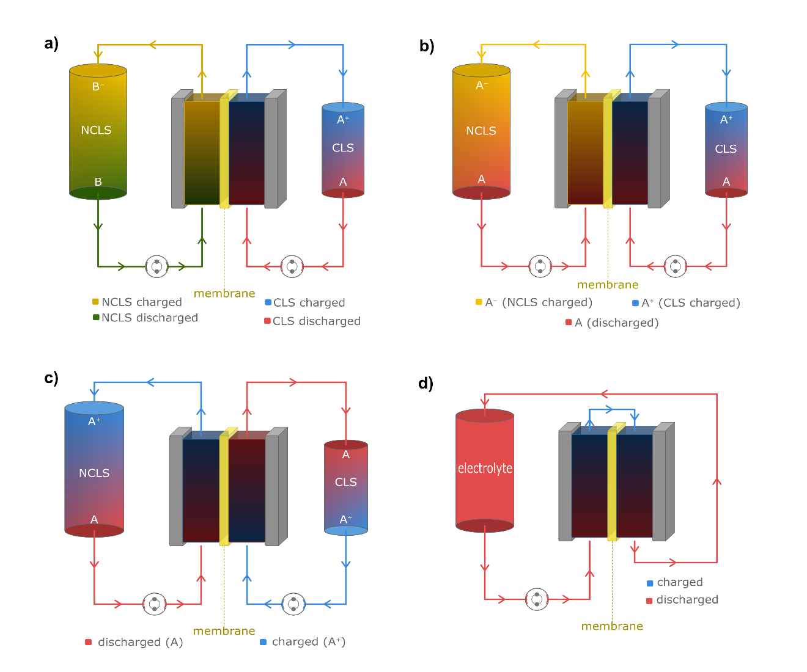

## 5. Cell Testing Protocols

Cell testing provides the first link between molecular design and practical battery performance by offering a structured approach to evaluating candidate materials beyond their intrinsic properties, such as redox potential, solubility, and chemical stability measured in isolation. Cell testing across a range of conditions probes electrochemical performance, including voltage response, Coulombic efficiency, lifetime, and impedance, and thereby identifies limitations, such as sluggish kinetics, RAC crossover, or rapid degradation, before more detailed testing is warranted. As materials mature and performance improves, cell testing can then be extended to more advanced protocols that assess capacity fade and long-term cycling behavior under realistic operating constraints.

Once assembled, flow cells can be checked for leakage with blank supporting electrolyte before redox-active electrolytes are introduced. In this case, the supporting electrolyte should subsequently be pumped out of the cell and the cell dried with an inert gas to avoid significant dilution of the redox-active electrolytes upon electrolyte exchange. Initial protocols are deliberately conservative: voltage limits are set from prior cyclic voltammetry to avoid irreversible processes, and galvanostatic cycling is conducted at low current densities to probe reversibility and transport under mild conditions. These tests establish baseline metrics, including Coulombic efficiency, accessible capacity, and short-term stability, before expanding to wider voltage windows, higher current densities, or long-duration cycling.

Flow cell testing represents a considerable investment in materials, equipment, and personnel time, and therefore warrants careful planning. Before any cell tests are conducted, conditioning (also referred to as 'break-in') of the cells is warranted. This is distinct from the pretreatment, described previously, of an individual component. Flowing electrolyte through the cell for a defined period, for example, helps equilibrate the membrane and other wetted components.[@doi:10.1149/2.0611910jes] In systems with extremely low fade rates, this step can also help prevent initial adsorption or absorption of RACs by cell components or their consumption by dissolved impurities, such as O~2~, from being misinterpreted as true capacity loss.[@doi:10.1021/acsenergylett.7b00019] When inert gas overpressure is used without a glovebox, the system should be purged before being flooded with electrolyte. Even a small, trapped bubble can supply enough O~2~ to discharge the negolyte over tens of cycles, causing Faradaic imbalance and pH drift. If the cell inlet/suction tubing is not submerged in the reservoir, briefly reversing the flow direction beforehand will purge the lines with the inert gas in the headspace.

Whether conditioning protocols or cycling parameters more broadly, complete and consistent reporting is essential to meaningful inter-laboratory comparison. This includes environmental conditions, such as temperature, atmospheric O~2~ partial pressure, current densities and applied voltages, charge and discharge cutoff values, potential hold durations, sequence of cycles, electrolyte volumes, flow rates, and any additions or adjustments made to either the CLS or NCLS during cycling, as even minor variations in any of these can substantially affect measured capacity, efficiency, and fade rate.

### 5.1 Cell configurations: Symmetric-cell *vs.* full-cell.

Because electrolytes are typically developed one at a time, the novel or lesser-known electrolyte is most appropriately treated as the analyte by designating it as the capacity-limiting side (CLS), i.e. the side with the lower theoretical discharge capacity than the non-capacity-limiting side (NCLS). This is typically accomplished with 'volumetrically unbalanced' cells, in which the CLS volume is smaller than that of the NCLS.[@doi:10.1149/2.0891807jes]

In a 'full cell', otherwise known simply as a flow battery, two separate electrolytes contain redox-active species with different formal potentials, producing a measurable potential difference that defines the accessible cell voltage (Figure {@fig:cell-configurations}a). In most cases, the two electrolytes contain entirely different redox-active species. An exception is a system in which a single redox-active species possesses enough accessible oxidation states to establish two electrolytes with sufficiently distinct redox potentials. The vanadium flow battery is the classic example: the four stable oxidation states of vanadium allow both electrolytes to be based on the same element while maintaining the potential difference required for a useful cell.[@doi:10.1149/1.2108706] Analogous behavior has recently been demonstrated with non-aqueous RACs possessing three accessible oxidation states.[@doi:10.1021/jacs.1c13543; @doi:10.1021/acsenergylett.3c00969; @doi:10.1021/acsenergylett.5c00150] These three-state full cells have been termed 'biredox' cells or 'symmetric flow batteries', and are shown in Figure {@fig:cell-configurations}b.

{#fig:cell-configurations}

In symmetric cells, the same electrolyte is placed on both sides, eliminating the need to assess compatibility between analyte and counter-electrolyte species or to identify a membrane compatible with two different electrolytes. Although both sides contain the same species, they may differ in concentration and/or average oxidation state. Such 'compositionally unbalanced' symmetric cells may be used as a diagnostic tool to study the differences in crossover rate between oxidation states.[@doi:10.1149/1945-7111/ace938] More often, however, symmetric cells are compositionally balanced so as to reduce concentration gradients and crossover, while remaining volumetrically unbalanced so that the capacity of the CLS can be isolated and tracked. Symmetric cells require the application of both positive and negative voltages, and therefore require cycling hardware capable of operating over that voltage range.[@doi:10.1149/1945-7111/ac91a8; @doi:10.1002/celc.202300525]

The volumetrically unbalanced symmetric cells shown in Figure {@fig:cell-configurations}c are typically started with a 50% SOC electrolyte divided unequally between the reservoirs. This is prepared by charging the novel electrolyte to 100% SOC and then mixing it in equal proportion with uncharged electrolyte.[@doi:10.1149/2.0891807jes] That charging step can be performed in a separate cell to minimize contamination by the counter-electrolyte: some crossover is unavoidable but can be suppressed by using thick or multiple membrane layers. Alternatively, if both the oxidized and reduced states of the novel RAC can be synthesized and protected, e.g., from O~2~, a 50% SOC analyte can be prepared deterministically by standard solution preparation methods.[@doi:10.1021/jacs.5c03524]

Although full cells can be used for CLS investigations, symmetric cells simplify both operation and analysis. More importantly, because the CLS and NCLS compositions are equivalent when averaged over multiple cycles, net crossover is typically negligible and the measured capacity retention represents the upper limit achievable with a given electrolyte, thereby isolating the effect of electrolyte stability. This is true only to a first approximation, however, and may not hold precisely if an imbalance builds up in the cell. Such imbalance might arise from (1) an initial SOC different from 50%, (2) markedly different permeabilities of oxidized and reduced species, (3) osmotic pressure differences between the half cells, (4) side reactions, and (5) asymmetric charging and discharging durations.[@doi:10.1039/D4YA00407H; @doi:10.1002/aenm.202100931] These effects can contribute to apparent capacity fade, which becomes increasingly important for electrolytes with low (≤ 0.1% d^-1^) and extremely low (≤ 0.02% d^-1^) capacity fade rates.[@doi:10.1021/acs.chemrev.9b00599] Because symmetric cells are useful primarily to establish the long-term cycling stability, thicker and more robust membranes are often advantageous, as they further mitigate possible crossover and also reduce the risk of membrane rupture during prolonged cycling.

A derivative of symmetric cells is the 'single electrolyte' or 'double half' cell seen in Figure {@fig:cell-configurations}d, which shares the same electrolyte between both electrodes. This is typically done to maintain the SOC of the electrolyte and measure performance parameters of the cell polarization,[@doi:10.1149/2.0941409JES; @doi:10.1039/D2TA00690A] or investigate electrode-electrolyte interaction.[@doi:10.1149/05307.0031ecst; @doi:10.1149/2.045406JES; @doi:10.1149/2.0201711jes]

Full cells are often used for the final demonstration of a new electrolyte chemistry, assembled with a counter-electrolyte and cell components chosen to maximize performance, with the novel electrolyte on the CLS and excess species on the NCLS. This automatically introduces the additional system complexity and crossover associated with the counter-electrolyte. Counter-electrolytes are chosen to maximize cell voltage while remaining compatible with the membrane and the pH value of the novel electrolyte. Capacity-balanced electrolytes are sometimes used to demonstrate the highest practical volumetric energy density.[@doi:10.1016/j.joule.2018.10.010] Such configurations offer limited mechanistic insight into capacity fade; however, if the fade mechanism has already been established by other experiments, it can then be reasonable to demonstrate the upper bounds of energy density in a high-concentration capacity-balanced cell.

Despite the pressure on researchers to publish fully functional novel batteries, delaying publication of results on new electrolytes until a high-performance counter-electrolyte has been identified is disadvantageous both to the individual researcher and to the broader community. New electrolytes can and should be judged on their own merits.

### 5.2 Performance Testing

When a suitable counter-electrolyte is available, a full cell is typically assembled for short-term performance testing to verify the feasibility of the battery chemistry. Even for performance testing, the novel electrolyte is typically made capacity-limiting, so that the measured capacity can be compared directly with its theoretical value. This is accomplished by fully charging at a potential at least 200 to 300 mV above equilibrium, depending on the number of electrons transferred per molecule,[@doi:10.1149/2.0891807jes; @doi:10.1039/D1TA08900E] until the current decreases to a steady-state value indicative of the background current. Strictly speaking, 'potential' refers to a single-electrode quantity requiring a reference electrode; in practice, most cell testing employs two-electrode configurations in which only the cell voltage, which is the potential difference between the two electrodes, can be controlled directly. This background current is typically due to side reactions, such as HER or OER, crossover of active species that discharge the electrolyte on the opposing side, or certain decomposition reactions, such as oxidative dimerization of the charged species.[@doi:10.1021/jacs.8b13295] Once the cell is substantially charged, further increases in the voltage cutoff contribute little additional capacity according to the Nernst equation, but may disproportionately increase background current by raising the overpotential available for side reactions. Charging should therefore continue at a given voltage until the steady-state background current can be estimated; the associated background capacity can then be subtracted to yield an estimate of the CLS SOC. If desired, the voltage limit can then be adjusted to access higher SOC. The cell is subsequently discharged completely, and the discharge capacity should be reported and compared with the theoretical capacity of the RACs in the CLS with any discrepancy discussed. Unlike during charging, crossover and side reactions do not cause significant background currents at low SOCs in such full cells. A very low current cutoff is therefore appropriate to ensure full (\> 99%) discharge of the CLS without risking significant distortion of the measured discharge capacity; the specific cutoff value depends on electrode area and active species concentration. Normalization of current by geometric area facilitates comparison across cell tests: a cutoff of 0.1 mA cm^-2^ is appropriate for a CLS containing 0.1 M electrons, and 1 mA cm^-2^ for 1 M electrons. The specific voltage and current cutoffs used should be reported.

Following a complete charge and discharge of the cell, impedance measurement of the Ohmic resistance at several SOC values is advisable to gauge its effect on subsequent measurements. Cell components, such as the membrane, may exhibit resistance variations over time due to temperature fluctuations or gradual equilibration; periodic impedance measurements allow these changes to be tracked and considered when interpreting performance data. At the same SOC values, cell discharge polarization data are typically acquired. Polarization data are best collected from OCV to the fully discharged voltage at the slowest practical sweep rate in order to approximate steady-state conditions. The sweep rate must nevertheless be fast enough to avoid significantly changing the reservoir SOC; larger CLS and NCLS volumes aid in this regard. Alternating charge and discharge steady-state potentiostatic tests can also be used to generate polarization curves while resetting the SOC to its intended initial value.[@doi:10.1007/s10800-011-0335-7; @doi:10.1016/j.jpowsour.2016.01.012; @doi:10.3390/batteries7030053] For example, a 50% SOC CLS can be discharged at a specified voltage until steady-state current is reached to generate one data point, and then recharged with an equal amount of charge in order to reset the SOC for the next data point. These curves are often transformed into power density vs. current density plots to assess the maximum power density. Although operation at peak Galvanic power density leads to an unacceptably low voltage efficiency, if the polarization curve is reasonably linear from OCV to peak power density then the ratio of peak power densities between cells equals the ratio of power densities at any given voltage efficiency (VE), e.g., 90% Galvanic VE.

Galvanostatic cycling is often used to evaluate round-trip energy efficiency, voltage efficiency, and Coulombic efficiency at relevant current densities, whereas some form of potentiostatic cycling or potential holds are recommended for lifetime testing (see Section 5.3). This captures the effect of cell resistance, including Ohmic resistance, which leads to voltage losses and limits accessible capacity and thereby provides insight into full-cell performance under variable real-world conditions. Such conditions typically include charge and discharge voltage limits chosen to avoid side reactions. Coulombic efficiency, $\eta_{C}$, which is often abbreviated as CE, is the ratio of the charge recovered on discharge to the charge spent on the immediately preceding charge step:

$$\eta_{C} = \frac{Q_{d}}{Q_{c}} = \frac{\int i_{d}(t)dt}{\int i_{c}(t)dt}$$

where $Q_{c}$ and $Q_{d}$ are the charge passed on charging and discharging, respectively, and $i_{c}$ and $i_{d}$ are the currents during charging and discharging, respectively. The CE falls below 100% in the presence of leakage current, self-discharge, RAC crossover, and side reactions during charging. Values consistently above 100% across many cycles are highly suspect and may indicate methodological artifacts.

Round-trip energy efficiency, $\eta_{E}$ often abbreviated as EE, is the ratio of the energy recovered on discharge to the energy expended on charge:

$$\eta_{E} = \frac{\int V_{d}dq_{d}}{\int V_{c}dq_{c}}$$

where $q_{c}$and $q_{d}$ are the charge coordinates along the charge and discharge half-cycles, respectively, such that $\int dq_{d} = Q_{d}$ and $\int dq_{c} = Q_{c}$. As a special case, when CE = 1, the limits of integration are identical. EE is the efficiency metric most directly relevant to grid-scale storage applications and is accessible in most battery cycling software via integration of the instantaneous power over time. Round-trip voltage efficiency, $\eta_{V}$, which is often abbreviated as VE, can be defined as:

$$\eta_{V} = \frac{\eta_{E}}{\eta_{C}} = \frac{\frac{\left( \int V_{d}dq_{d} \right)}{Q_{d}}}{\frac{\left( \int V_{c}dq_{c} \right)}{Q_{c}}} = \frac{ {\bar{V}}_{d}}{ {\bar{V}}_{c}}$$

where ${\overset{ˉ}{V}}_{d}$and ${\overset{ˉ}{V}}_{c}$are the charge-weighted mean discharge and charge voltages, respectively. This chain of equalities holds exactly and makes explicit that VE as derived from the ratio EE/CE is identical to the ratio of charge-weighted mean voltages. This falls below 100% due to kinetic, Ohmic, and mass-transport overpotentials. Some researchers instead report the one-way Galvanic voltage efficiency, $\eta_{V,\text{gal}}$, defined as the charge-weighted mean discharge voltage divided by the open-circuit voltage:

$$\eta_{V,gal} = \frac{\int V_{d}dq_{d}}{V_{OCV} \cdot Q_{d}} = \frac{ {\bar{V}}_{d}}{V_{OCV}}$$

Both $\eta_{V}$ and $\eta_{V,\text{gal}}$ are informative when clearly identified; authors should specify which is being reported in every instance. Note that $\eta_{V,\text{gal}}$ is not compatible with the definitions of CE and EE given above and should not be used to compute EE. Under galvanostatic cycling at constant current, charge-weighted and time-weighted voltage averages are identical; under potentiostatic or constant current followed by constant voltage (CCCV) protocols they are not, in which case the charge-weighted definition should be used throughout.

Symmetric or single-electrolyte cells can also isolate performance metrics attributable solely to the novel electrolyte.[@doi:10.1149/05307.0031ecst] For example, when a novel electrolyte has a redox potential close to HER or OER, it is useful to understand the relationship between the charging voltage imposed, the SOC targeted, and the magnitude of the background current. Performing such tests with symmetric or single-electrolyte cells minimizes the background current that may arise from crossover of the counter-electrolyte RACs normally used in the full cell.

### 5.3 Lifetime evaluation

Realizing the potential of flow batteries for cost-effective stationary storage requires the demonstration of decadal lifetimes. Although demonstration of decadal operation is largely an industrial endeavor, academic studies play a critical role in establishing credible projected lifetimes grounded in well-controlled laboratory measurements.

The primary degradation metric is the discharge capacity tracked over time, from which a capacity fade rate is obtained. Reversible losses, e.g., from electrolyte imbalance, can be recovered by rebalancing (see Section 5.6); irreversible losses reflect true chemical degradation. Coulombic efficiency often serves as an early indicator of degradation, revealing problems before significant capacity loss becomes apparent. Even a CE value that appears high, e.g., 99.9%, is not 100%, and the shortfall should not be dismissed as negligible. It reflects charge unaccounted for on every cycle and understanding its origin matters. Coulombic efficiency losses can be associated with mechanisms leading to capacity fade, but they may instead be associated with mechanisms leading only to SOC imbalance which, in principle, can be recovered.[@doi:10.1149/2.0081601jes] For example, O~2~ permeation into the posolyte may be recoverable by driving the oxygen evolution reaction.[@doi:10.1038/s41467-022-29791-7] Reliable evaluation of fade rate requires cycling until a stable trend emerges from the cycle-to-cycle noise. As discussed below, capacity fade in most systems is better characterized on a temporal basis rather than on a per-cycle basis because the underlying degradation mechanisms are predominantly homogeneous chemical reactions. Because RAC stability is frequently concentration-dependent,[@doi:10.1038/s41586-023-06664-7; @doi:10.1021/acs.chemmater.7b00616] testing at more than a single concentration is also informative.

Cell cycling data are highly variable and sensitive to experimental conditions, such as temperature,[@doi:10.1039/D3TA05809C; @doi:10.1149/1945-7111/ad3855] and ambient O~2~ concentration.[@doi:10.1021/jacs.8b13295] Careful control of these conditions is therefore essential, and independent reproduction of key experiments is important before conclusions are drawn, particularly when the performance is unusually promising and active-material availability is not limiting.

Both symmetric cells and full cells can be used to assess the lifetime of the capacity-limiting electrolyte. Regardless of cell type, however, potentiostatic cycling (i.e., constant voltage or CV cycling) or galvanostatic cycling with voltage holds (i.e., CCCV cycling) should always be used for these tests. Measurements of the long-term evolution of the capacity of the CLS from purely galvanostatic (i.e., constant current or CC cycling) cycling between prescribed voltage limits are subject to artifacts because the measured discharge capacity is influenced by the various resistances in the circuit, which may change over time.[@doi:10.1149/2.0891807jes] For example, membrane resistance fluctuates due to equilibration, aging, or temperature variations, causing apparent capacity fluctuations under purely galvanostatic cycling. Cells loaded with dry membranes of initially high resistance can even show apparently constant or increasing capacity as resistance drops, masking the true electrolyte fade rate. These artifacts may be insignificant for electrolytes with moderate (\> 0.1%/day) fade rates but they must be avoided when reporting the behavior of electrolytes with low (≤ 0.1%/day) fade rates.[@doi:10.1021/acs.chemrev.9b00599] More generally, whenever cycling is performed to demonstrate or understand the intrinsic stability of a novel electrolyte, every effort should be made to remove unrelated factors. Attempts to correct for resistance variations post hoc, for example via periodic impedance measurements, introduce additional complexity and uncertainty. It is simpler and more rigorous to adopt CV or CCCV cycling protocols from the outset.

Where large current spikes must be avoided, e.g., due to cycler current limits, voltage holds at the end of galvanostatic segments (CCCV cycling) ensure full access to the intended capacity despite resistance variations. Holds should continue until current drops to near zero on discharge, or near the background current on charge. Where voltage limits may accelerate degradation or specific SOC targets are required, a repeating sequence of purely galvanostatic cycles, e.g., 20 cycles, followed by 2 to 3 CCCV cycles can be used; only the CCCV-segment capacity is a reliable indicator of fade. Limited-SOC cycling, e.g., CC cycling confined to a 50-70% SOC window, can be a useful complementary approach for isolating degradation mechanisms specific to a particular SOC range or for avoiding voltage extremes that might otherwise accelerate unrelated degradation pathways. However, it should not be used as a standalone substitute for full-range CCCV testing when the goal is to quantify absolute capacity fade. Although strictly galvanostatic cycling is not appropriate for capacity measurements during lifetime testing, occasional galvanostatic cycles at low current densities (i.e.: ~0.1-10 mA/cm^2^, the choice of current density being dependent on concentration) has proven useful for elucidation of reaction potentials and monitoring the formation and conversion of redox active degradation products.[@doi:10.1021/acsami.4c06073; @doi:10.1038/s41557-022-00967-4; @doi:10.1149/1945-7111/ada064]

Electrolyte lifetime testing aims to quantify true capacity fade, i.e., irreversible RAC loss. Even when the methodology is otherwise optimal, several factors can introduce error. Side reactions or crossover unrelated to the RAC can cause Faradaic imbalance or shift the counter-electrolyte SOC, thereby shifting the cell OCV. Provided that the NCLS is in sufficient excess, the CLS discharge capacity remains accessible despite ongoing side reactions or crossover until the NCLS eventually becomes capacity-limiting if these processes outpace the intrinsic CLS fade rate. Dissolved O₂, for example, will typically oxidize a negolyte. Even if this negolyte is in large excess with an initial non-zero SOC to permit evaluation of a novel capacity-limiting posolyte, the homogeneous reaction of O~2~ with the negolyte will eventually consume that excess and dominate the measured fade rate, assuming O~2~ is continuously diffusing into the system.[@doi:10.1149/2.0891807jes] Depending on the relative rates, this produces either a sharp or a gradual rollover in discharge capacity---termed 'apparent capacity fade'---which does not reflect true irreversible RAC loss. This situation, represented in Figure {@fig:apparent-fade}, is typically revealed by refreshing the NCLS with additions of initial electrolyte until the discharge capacity reaches a maximum.

![Simulated demonstration of 'apparent capacity fade': in a symmetric cell where the non-capacity-limiting side (NCLS) self-discharges faster than the capacity-limiting side (CLS) genuinely degrades, the NCLS eventually becomes limiting and produces a capacity rollover that mimics true CLS fade even though no irreversible RAC loss has occurred. The simulation assumes 1^st^ order capacity fade of CLS in addition to 1^st^ order self-discharge of NCLS with 10 times larger rate constant. a) CCCV cycling curves of cell potential and current vs. time, b) schematic (adapted from Goulet & Aziz[@doi:10.1149/2.0891807jes]) of NCLS becoming limiting due to self-discharge, c) simulated SOC accessed by CLS during cycling and d) simulated discharge capacity that would be measured in this scenario. Simulation performed with open source RFBzero from Fell et al.[@doi:10.21105/joss.06537]](images/fig8-apparent-capacity-fade.png){#fig:apparent-fade}

In addition to the confounding effects from apparent capacity fade, Faradaic imbalance due to side reactions may also indirectly affect the true capacity of the limiting electrolyte. For example, neutral-pH electrolytes can be particularly sensitive to pH drift.[@doi:10.1016/j.chempr.2019.04.021; @doi:10.1021/acsmaterialslett.2c01105] Hence, along with oxidation of negolyte, the same dissolved oxygen situation discussed above can increase the pH value of the electrolyte and trigger unwanted molecular degradation, leading to accelerated capacity fading. In industrial flow battery systems, such sources of Faradaic imbalance would be mitigated by engineering controls, such as nitrogen blanketing and airtight sealing. Moreover, the effects of Faradaic imbalances can, in general, be reversed by chemical[@doi:10.1149/05307.0093ECST; @wo-1989005363] and electrochemical rebalancing treatments[@corcuera-2012; @doi:10.1016/j.cej.2020.126583; @doi:10.1038/s41467-022-29791-7; @doi:10.1016/j.jpowsour.2025.237272; @doi:10.26599/CF.2026.9200066] on the electrolytes.

Taken together, these measures, namely symmetric cell testing of a capacity-limiting novel electrolyte with a thick membrane, controlled environmental conditions, potentiostatic cycling with potentials that avoid side reactions, and periodic NCLS refreshing, maximize the fidelity of intrinsic cycling stability measurements via the temporal evolution of discharge capacity. There is little evidence to date that organic molecules or coordination complexes degrade due to changing oxidation states during cycling, i.e.: electrochemical reduction or oxidation reactions.[@doi:10.1557/s43581-025-00140-7] In most systems studied, intrinsic capacity loss within the CLS has instead been attributed to chemical processes, such as molecular decomposition of the charged state of the RAC. The extent of progress along these degradation pathways depends not on the number of charge-discharge cycles; rather, it depends on time (Figure {@fig:fade-vs-time}), although the rate itself can depend on SOC.[@doi:10.1149/2.0891807jes] Consequently, unless experiments demonstrate that the amount of lost capacity depends on the amount of charge passed rather than the amount of time passed, capacity-fade metrics normalized per cycle, e.g., % lost per cycle, are not meaningful. In such cases, it is necessary to report capacity fade as a function of time, e.g., % lost per day, with cycle count as an optional add-on. Presenting performance solely in terms of the fraction or percentage of capacity retained over a selected interval can obscure the true degradation rate.

![Schematic representation of capacity fade as a function of time rather than cycle number. Despite different current densities producing different cycle durations and cycle counts (N = 2, 4, and 5), the local fade rate estimate ($\mathrm{\Delta}Q\mathrm{\Delta}t^{- 1}$), extracted from initial and final discharge capacity within each segment, remains the same across segments (i.e., $\mathrm{\Delta}Q_{L}\mathrm{\Delta}t_{L}^{- 1} = \mathrm{\Delta}Q_{M}\mathrm{\Delta}t_{M}^{- 1} = \mathrm{\Delta}Q_{H}\mathrm{\Delta}t_{H}^{- 1}$), illustrating that capacity loss tracks elapsed time rather than cycle count.](images/fig9-fade-vs-time.png){#fig:fade-vs-time}

Discharge capacity *vs.* time may initially appear linear, but curvature characteristic of exponential decay often becomes apparent only after ~20% of the initial capacity has been lost. The instantaneous capacity fade rate, defined as the discrete analogue of the time derivative of the natural logarithm of the discharge capacity, would be time-independent in the case of first-order decomposition kinetics, which give rise to strictly exponential decay. In practice, the fade rate frequently varies with the remaining capacity expressed as a fraction of the initial value, indicating departures from simple first-order behavior. Semi-logarithmic plots of capacity *vs.* time are therefore informative for a visual assessment of first-order kinetics or deviations therefrom.[@doi:10.1149/1945-7111/acfcde] Additionally, on the semi-log plot the slope connecting initial (after transient behavior subsides) and final capacity yields the average fade rate, and local slope values at selected time points reveal the evolution of the degradation rate.

### 5.4 Accelerated Lifetime Testing

In deployment, RFBs operate on variable power profiles and often remain nearly fully charged, unlike laboratory cycling, for which the average CLS SOC is typically near 50%. Understanding how capacity fade varies with SOC is therefore important for predicting practical longevity. Long pauses in cycling at various SOC values are typically the starting point for determining how the fade rate depends on SOC.[@doi:10.1149/2.0891807jes] One may also gain insight by restricting the SOC range experienced by the CLS.[@doi:10.1021/jacs.8b13295; @doi:10.1021/acsami.4c06073] The hold duration must be long enough to distinguish SOC-dependent effects from the baseline cycling fade rate; repetition is often required for cells with very low fade rates. Moreover, the offset between the capacity *vs.* time trend before the pause should be compared to the offset after the pause, rather than relying only on the fade rate from the two cycles immediately at either end.[@doi:10.1149/2.0891807jes] SOC-dependent fade rates that exceed that of the cycling baseline serve as accelerating factors and thereby allow degraded samples to be generated more rapidly for chemical analysis and decomposition pathway identification. In many chemistries, the fully-charged RAC is the least stable form, making 100% SOC the most aggressive condition. Because both the charged species concentration and the SOC decline as the RAC decomposes, holding a continued charging voltage can maintain approximately 100% SOC for longer periods of time and serve as a further accelerator of degradation.

Although elevated-temperature cycling accelerates degradation to rates convenient for post-mortem analysis, a change in predominant degradation mechanism with temperature must be considered. For an unambiguous interpretation of the fade rate, the entire system, including reservoirs, electrolyte paths/tubing, and the cell, should be at the same temperature.[@doi:10.1039/D3TA05809C] An Arrhenius plot of capacity fade rates *vs.* temperature can enable the detection of changes in degradation regime.[@doi:10.1039/D3TA05809C; @doi:10.1149/1945-7111/ad3855]

Lastly, imposing stronger potentials during the charging of the CLS increases the concentration of the charged species and may also be sufficient to initiate unintended reactions that lead to RAC decomposition, just as elevated temperature can. This may be desirable when simulating the potentials that may inadvertently be applied to parts of the extended electrodes used in large system stacks under real-world conditions. Such spatial variations in potential can be measured with segmented flow plates and electrodes.[@doi:10.1149/2.0241601jes]

### 5.5 Failure analysis

Failure analysis seeks to attribute capacity losses to specific causes. Gradual fade reflects continuous loss mechanisms, whereas abrupt changes in either capacity or fade rate often indicate discrete events, such as membrane rupture, leakage, clogging, or electrolyte droplet loss, though these can also develop gradually alongside intrinsic stability-related fade. Isolating electrolyte-specific failure mechanisms therefore requires mitigating cell-related mechanisms as much as possible. Depending on the intrinsic fade rate of the electrolyte, this can be a substantial challenge.

The following steps are drawn from our collective experience and, when properly carried out during cycling pauses at OCV, can aid in elucidating capacity fade mechanisms:

- In addition to routine visual inspection of the cells for bubbles, significant volume changes, or leaks, the first recommended step is to add fresh portions of the initial NCLS electrolyte at partial SOC to that side of the cell, repeating this process until no significant change in capacity is observed, as described previously. This ensures that the NCLS is in excess during both charging and discharging of the CLS and so has not become limiting, ruling out many sources of 'apparent capacity fade'.

- Continuous or periodic pH monitoring provides additional mechanistic insight. Any electrolyte treatments or pH adjustments, e.g., through the addition of acid or base, can significantly influence the observed stability and should therefore be documented clearly in order to permit meaningful comparison across studies. For long-term measurements of concentrated electrolytes, where reference-electrode fill solution can gradually leak into and contaminate the bulk electrolyte, pH probes should be periodically (e.g., weekly to monthly) recalibrated or cross-checked against an independent measurement to catch drift or contamination early.

- If the novel electrolyte is relatively viscous, or if the charged and discharged forms have density differences, insufficient mixing in the reservoir may become problematic. Ideally, the reservoir should behave either as a continuous stirred tank reactor with a single SOC or as a plug flow reactor with a monotonically varying SOC distribution with no dead zones. Cell outlet tubing should be positioned at the top of the liquid to accommodate HER/OER bubble release while remaining sufficiently submerged to avoid splattering and droplet formation; this should be verified throughout cycling in case the volume changes. The cell intake, in contrast, should be positioned at the bottom of the reservoir.

- Gently stirring or shaking the reservoir can help recover sequestered droplets.

- Volume tracking: although volume measurements are often imprecise (~ ± 100 μL) and may be complicated by density changes during cycling, recording the initial volumes or reservoir heights of both CLS and NCLS at defined SOC values, e.g., by marking the meniscus position, remains worthwhile. This permits determination of the direction in which solvent or bulk electrolyte may be crossing. Even with low precision, tracking volume during cycling is generally more informative than measuring electrolyte volume only after cycling, because appreciable electrolyte can remain trapped in the pumps, tubing and electrodes. Where enough RAC is available, increasing the initial electrolyte volumes can also help identify and mitigate cell-related apparent capacity fade associated with electrolyte volume loss.

Post-mortem analysis is typically conducted after long-term cycling. The CLS is first fully discharged, both electrolytes are drained into their reservoirs, cells are disassembled (with appropriate PPE and secondary containment), and components are inspected visually. Membrane discoloration may indicate electrolyte interactions; precipitated solids tend to accumulate in the smallest pores, most often in flow-through electrodes, and can be visible to the naked eye when no rinsing step has been performed.

Electrolyte analysis should be selected according to the type of degradation under investigation, and more than one method should be used to confirm a proposed mechanism. To relate capacity fade to the CLS, both the electrolyte volume and the original RAC concentration must be measured; concentrations should be corrected for solvent crossover estimated from volume measurements.[@doi:10.1016/j.est.2024.113700] Common methods include:

- CV: Often the first method used to confirm whether the electrolyte still exhibits the same redox activity. It is indirect, however, because decomposition products may themselves remain redox-active. Precision is low (~10%) when peak heights are used. CV is often used to detect whether the CLS RAC is present in the NCLS. A more reliable approach might be to use RDE or microelectrodes, although the required equipment may not be available.

- UV-vis: Can be quite accurate but is less so when species other than the charged and discharged forms are present in the electrolyte. Dilution is often required to permit enough light to reach the spectrophotometer for an acceptable signal-to-noise ratio. Be aware, however, that dilution can alter the composition if mechanisms such as dimerization are occurring.

- IR: Of limited utility for aqueous electrolytes because of strong water background absorption; decomposition products may further skew the spectra.

- NMR: Presently the most tried-and-tested method for quantifying RACs and their decomposition products. Its sensitivity is often insufficient to detect small amounts of accumulated decomposition products. Cycling until capacity fade has reached at least 5-10% is typically required before NMR peaks can be well quantified. NMR is not suitable if paramagnetic species are present and should be replaced by EPR in these cases.

The combination of electrochemical cycling with ex situ chemical analysis of cycled electrolytes has proved valuable for elucidating the relationship between capacity fade and molecular decomposition. This approach is generally more compelling for symmetric cells than for full cells because there is no potential contamination from reactant crossover. Its applicability becomes more challenging for electrolytes exhibiting extremely low fade rates because of the long experimental durations required to reach the detection limits of most chemical analysis techniques. In addition, primary decomposition products may have lifetimes shorter than those of the RACs and may therefore fail to accumulate to detectable levels. Under such conditions, highly sensitive techniques, such as high-performance liquid chromatography--mass spectrometry (HP-LCMS), might detect the decomposition products. When feasible, experimental configurations that couple electrochemical measurements with *in-situ* or *in-operando* physicochemical characterization methods, e.g., UV--Vis, IR, EPR, NMR, as well as conventional sensors, e.g., pH, temperature, dissolved O₂, are particularly valuable, and many examples can be found in the recent literature.[@doi:10.3390/batteries7030053; @doi:10.1038/s41557-022-00967-4; @doi:10.1039/D5EE01311A; @doi:10.1002/anie.8798664; @doi:10.1016/j.jpowsour.2026.239510; @doi:10.1016/j.jpowsour.2023.233919; @doi:10.1021/acsaem.3c02223] The principal challenge lies in designing cells and experimental setups that remain representative of the operating conditions relevant to redox flow batteries.

### 5.6 Electrolyte Rebalancing and Regeneration

Capacity regeneration is well established for vanadium flow batteries, for which fade arises from electrolyte imbalance due to crossover, side reactions, and O~2~ ingress, rather than from true RAC loss. Because the vanadium itself is conserved, this 'apparent capacity fade' can be recovered by redistributing charge through remixing (physically combining and redividing the two electrolytes, which corrects crossover-driven imbalance but not net oxidation), electrochemical rebalancing (a dedicated cell that selectively reduces or oxidizes vanadium species, e.g., via H₂ gas or a catalytic counter-reaction, to correct imbalance that remixing alone cannot fix), or the automated SOC-based systems demonstrated at scale.[@doi:10.1016/j.cej.2020.126583; @doi:10.1007/s10800-021-01572-Y; @doi:10.1016/j.jpowsour.2015.10.021] This inherent recoverability is one of the practical advantages that has helped vanadium systems reach commercial maturity,[@doi:10.1016/j.jpowsour.2020.227958] and it sets a useful benchmark for system lifetime against which organic electrolyte systems must ultimately be measured.

While rebalancing strategies have also been demonstrated with organic RACs,[@doi:10.1021/acselectrochem.5c00520; @doi:10.1002/batt.202400086] true chemical degradation presents a fundamentally different problem: covalent bond transformations render molecules redox-inactive, and thus destroy electrochemical capacity rather than redistributing it. Simple rebalancing, as for vanadium, is therefore insufficient; the decomposed molecule must be converted back to a redox-active form. Whether this is feasible depends on the reversibility of the degradation pathway, a question that has driven detailed mechanistic investigations and elevated regeneration to a complementary research direction alongside molecular engineering. For 2,6-dihydroxyanthraquinone, the dominant degradation pathway appears to involve disproportionation of the reduced quinone to an anthrone intermediate, which is over-reduced, followed by dimerization. Goulet *et al.* showed that this process could be suppressed substantially by oxidizing the anthrone intermediate with O~2~ before dimerization proceeds.[@doi:10.1021/jacs.8b13295] Jing *et al.* later reported that, although the dimer contributes to capacity loss, it can still be converted reversibly back to active DHAQ if addressed before further decomposition occurs: electrochemical oxidation at an appropriate potential regenerates both anthrone and its dimer, providing a viable route to electrolyte recovery without the introduction of additional reagents.[@doi:10.1038/s41557-022-00967-4] This degradation pathway and the associated regeneration strategy have recently been shown to be relevant to other dihydroxyanthraquinones.[@doi:10.1039/D5TA06073G]

Beyond quinones, regeneration strategies have also been demonstrated for metal complexes, such as Fe(II) tris-bipyridine, which is an attractive posolyte candidate because of its high redox potential. Its oxidized Fe(III) form is susceptible to dimerization via a sequential electrochemical-chemical process, resulting in a significant voltage drop during discharge. Burghoff and Holubowitch showed that the associated capacity losses could be recovered both by the use of activated carbon and by controlled overcharge.[@doi:10.1021/jacs.3c13828] Examples such as these represent an encouraging and increasingly realistic prospect for extending operational lifetimes beyond what intrinsic molecular stability alone can achieve. Rebalancing or regeneration strategies are therefore worth exploring before a given electrolyte is deemed unsuitable for long-term operation. For organic flow batteries in particular, electrolyte lifetime is a primary driver of levelized cost of storage, and the ability to recover degraded active material, rather than replace it, could therefore materially affect the economics of the technology.[@doi:10.1021/acs.chemrev.9b00599; @doi:10.1002/aenm.201702056; @doi:10.1021/acsenergylett.0c00140; @doi:10.1038/s41467-023-42450-9] Realizing this potential depends ultimately on accurate identification of degradation mechanisms, making rigorous failure analysis and post-mortem characterization an essential prerequisite to the development of effective regeneration or lifetime extension strategies.
