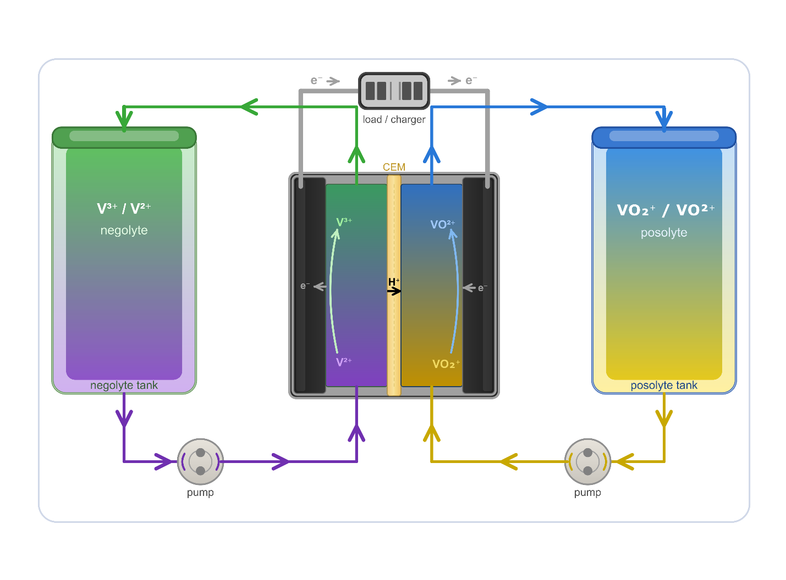
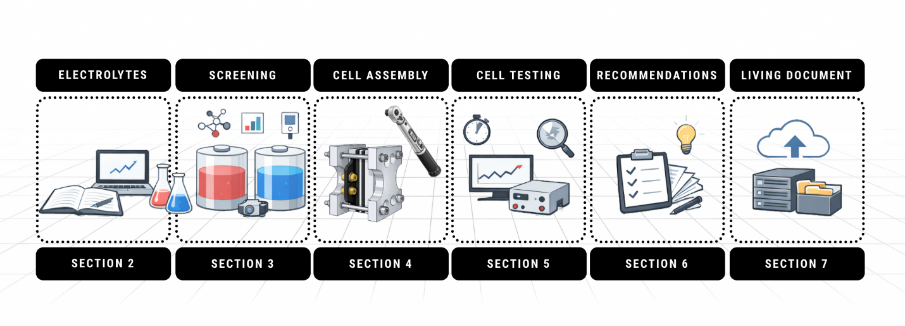

---
title: Good Practices and Common Pitfalls in the Research and Development of New Electrolytes for Flow Batteries
keywords:
- Redox flow batteries
- redox-active compounds
- electrolytes
- flow cells
- lifetime testing
- recommendations
- experimental protocols
- practical guidelines
lang: en-US
date-meta: '2026-10-29'
author-meta:
- Marc-Antoni Goulet
- Christian Stolze
- Solène Guihéneuf
- Steven Le Vot
- Edgar Ventosa
- Ulrich S. Schubert
- Fikile Brushett
- Michael J. Aziz
header-includes: |
  <!--
  Manubot generated metadata rendered from header-includes-template.html.
  Suggest improvements at https://github.com/manubot/manubot/blob/main/manubot/process/header-includes-template.html
  -->
  <meta name="dc.format" content="text/html" />
  <meta property="og:type" content="article" />
  <meta name="dc.title" content="Good Practices and Common Pitfalls in the Research and Development of New Electrolytes for Flow Batteries" />
  <meta name="citation_title" content="Good Practices and Common Pitfalls in the Research and Development of New Electrolytes for Flow Batteries" />
  <meta property="og:title" content="Good Practices and Common Pitfalls in the Research and Development of New Electrolytes for Flow Batteries" />
  <meta property="twitter:title" content="Good Practices and Common Pitfalls in the Research and Development of New Electrolytes for Flow Batteries" />
  <meta name="dc.date" content="2026-10-29" />
  <meta name="citation_publication_date" content="2026-10-29" />
  <meta property="article:published_time" content="2026-10-29" />
  <meta name="dc.modified" content="2026-10-29T18:48:19+00:00" />
  <meta property="article:modified_time" content="2026-10-29T18:48:19+00:00" />
  <meta name="dc.language" content="en-US" />
  <meta name="citation_language" content="en-US" />
  <meta name="dc.relation.ispartof" content="Manubot" />
  <meta name="dc.publisher" content="Manubot" />
  <meta name="citation_journal_title" content="Manubot" />
  <meta name="citation_technical_report_institution" content="Manubot" />
  <meta name="citation_author" content="Marc-Antoni Goulet" />
  <meta name="citation_author_institution" content="Department of Chemical and Materials Engineering, Concordia University, Montreal, Quebec, Canada" />
  <meta name="citation_author_orcid" content="0000-0002-9146-6759" />
  <meta name="citation_author" content="Christian Stolze" />
  <meta name="citation_author_institution" content="Laboratory of Organic and Macromolecular Chemistry (IOMC), Friedrich Schiller University Jena, Humboldtstraße 10, 07743 Jena, Germany" />
  <meta name="citation_author_institution" content="Center for Energy and Environmental Chemistry Jena (CEEC Jena), Friedrich Schiller University Jena, Philosophenweg 7a, 07743 Jena, Germany" />
  <meta name="citation_author_institution" content="Helmholtz-Institute for Polymers in Energy Applications Jena (HIPOLE Jena), Lessingstrasse 12–14, 07743 Jena, Germany" />
  <meta name="citation_author_institution" content="Helmholtz-Zentrum Berlin für Materialien und Energie (HZB), Hahn-Meitner-Platz 1, 14109 Berlin, Germany" />
  <meta name="citation_author_orcid" content="0000-0001-5358-7181" />
  <meta name="citation_author" content="Solène Guihéneuf" />
  <meta name="citation_author_institution" content="Kemiwatt, Rennes 35708, France" />
  <meta name="citation_author_orcid" content="0000-0003-0164-5436" />
  <meta name="citation_author" content="Steven Le Vot" />
  <meta name="citation_author_institution" content="ICGM, University of Montpellier, CNRS, ENSCM, Montpellier 34095, France" />
  <meta name="citation_author_institution" content="Réseau sur le Stockage Electrochimique de l&#39;Energie (RS2E), CNRS, Amiens 80000, France" />
  <meta name="citation_author_orcid" content="0000-0001-8752-7590" />
  <meta name="citation_author" content="Edgar Ventosa" />
  <meta name="citation_author_institution" content="Department of Chemistry, University of Burgos, Pza. Misael Bañuelos s/n, E-09001 Burgos, Spain" />
  <meta name="citation_author_orcid" content="0000-0002-8993-4285" />
  <meta name="citation_author" content="Ulrich S. Schubert" />
  <meta name="citation_author_institution" content="Laboratory of Organic and Macromolecular Chemistry (IOMC), Friedrich Schiller University Jena, Humboldtstraße 10, 07743 Jena, Germany" />
  <meta name="citation_author_institution" content="Center for Energy and Environmental Chemistry Jena (CEEC Jena), Friedrich Schiller University Jena, Philosophenweg 7a, 07743 Jena, Germany" />
  <meta name="citation_author_institution" content="Helmholtz-Institute for Polymers in Energy Applications Jena (HIPOLE Jena), Lessingstrasse 12–14, 07743 Jena, Germany" />
  <meta name="citation_author_institution" content="Helmholtz-Zentrum Berlin für Materialien und Energie (HZB), Hahn-Meitner-Platz 1, 14109 Berlin, Germany" />
  <meta name="citation_author_orcid" content="0000-0003-4978-4670" />
  <meta name="citation_author" content="Fikile Brushett" />
  <meta name="citation_author_institution" content="Department of Chemical Engineering, Massachusetts Institute of Technology, Cambridge, Massachusetts 02139, United States of America" />
  <meta name="citation_author_orcid" content="0000-0002-7361-6637" />
  <meta name="citation_author" content="Michael J. Aziz" />
  <meta name="citation_author_institution" content="Harvard John A. Paulson School of Engineering and Applied Sciences, Cambridge, Massachusetts 02138, United States of America" />
  <meta name="citation_author_orcid" content="0000-0001-9657-9456" />
  <link rel="canonical" href="https://regcs.github.io/guidelines-living-doc/" />
  <meta property="og:url" content="https://regcs.github.io/guidelines-living-doc/" />
  <meta property="twitter:url" content="https://regcs.github.io/guidelines-living-doc/" />
  <meta name="citation_fulltext_html_url" content="https://regcs.github.io/guidelines-living-doc/" />
  <meta name="citation_pdf_url" content="https://regcs.github.io/guidelines-living-doc/manuscript.pdf" />
  <link rel="alternate" type="application/pdf" href="https://regcs.github.io/guidelines-living-doc/manuscript.pdf" />
  <link rel="alternate" type="text/html" href="https://regcs.github.io/guidelines-living-doc/v/ee0dd17fd49b195bd06e272b319608575bdd5abb/" />
  <meta name="manubot_html_url_versioned" content="https://regcs.github.io/guidelines-living-doc/v/ee0dd17fd49b195bd06e272b319608575bdd5abb/" />
  <meta name="manubot_pdf_url_versioned" content="https://regcs.github.io/guidelines-living-doc/v/ee0dd17fd49b195bd06e272b319608575bdd5abb/manuscript.pdf" />
  <meta property="og:type" content="article" />
  <meta property="twitter:card" content="summary_large_image" />
  <link rel="icon" type="image/png" sizes="192x192" href="https://manubot.org/favicon-192x192.png" />
  <link rel="mask-icon" href="https://manubot.org/safari-pinned-tab.svg" color="#ad1457" />
  <meta name="theme-color" content="#ad1457" />
  <!-- end Manubot generated metadata -->
bibliography:
- content/manual-references.json
manubot-output-bibliography: output/references.json
manubot-output-citekeys: output/citations.tsv
manubot-requests-cache-path: ci/cache/requests-cache
manubot-clear-requests-cache: false
...

<small><em>
This manuscript
([permalink](https://regcs.github.io/guidelines-living-doc/v/ee0dd17fd49b195bd06e272b319608575bdd5abb/))
was automatically generated
from [regcs/guidelines-living-doc@ee0dd17](https://github.com/regcs/guidelines-living-doc/tree/ee0dd17fd49b195bd06e272b319608575bdd5abb)
on October 29, 2026.
</em></small>

## Authors

+ **Marc-Antoni Goulet**
  ^[✉](#correspondence)^ 
    {.inline_icon width=16 height=16}
    [0000-0002-9146-6759](https://orcid.org/0000-0002-9146-6759)
     
  <small>
     Department of Chemical and Materials Engineering, Concordia University, Montreal, Quebec, Canada
  </small>

+ **Christian Stolze**
   
    {.inline_icon width=16 height=16}
    [0000-0001-5358-7181](https://orcid.org/0000-0001-5358-7181)
     
  <small>
     Laboratory of Organic and Macromolecular Chemistry (IOMC), Friedrich Schiller University Jena, Humboldtstraße 10, 07743 Jena, Germany; Center for Energy and Environmental Chemistry Jena (CEEC Jena), Friedrich Schiller University Jena, Philosophenweg 7a, 07743 Jena, Germany; Helmholtz-Institute for Polymers in Energy Applications Jena (HIPOLE Jena), Lessingstrasse 12–14, 07743 Jena, Germany; Helmholtz-Zentrum Berlin für Materialien und Energie (HZB), Hahn-Meitner-Platz 1, 14109 Berlin, Germany
  </small>

+ **Solène Guihéneuf**
   
    {.inline_icon width=16 height=16}
    [0000-0003-0164-5436](https://orcid.org/0000-0003-0164-5436)
     
  <small>
     Kemiwatt, Rennes 35708, France
  </small>

+ **Steven Le Vot**
   
    {.inline_icon width=16 height=16}
    [0000-0001-8752-7590](https://orcid.org/0000-0001-8752-7590)
     
  <small>
     ICGM, University of Montpellier, CNRS, ENSCM, Montpellier 34095, France; Réseau sur le Stockage Electrochimique de l'Energie (RS2E), CNRS, Amiens 80000, France
  </small>

+ **Edgar Ventosa**
   
    {.inline_icon width=16 height=16}
    [0000-0002-8993-4285](https://orcid.org/0000-0002-8993-4285)
     
  <small>
     Department of Chemistry, University of Burgos, Pza. Misael Bañuelos s/n, E-09001 Burgos, Spain
  </small>

+ **Ulrich S. Schubert**
   
    {.inline_icon width=16 height=16}
    [0000-0003-4978-4670](https://orcid.org/0000-0003-4978-4670)
     
  <small>
     Laboratory of Organic and Macromolecular Chemistry (IOMC), Friedrich Schiller University Jena, Humboldtstraße 10, 07743 Jena, Germany; Center for Energy and Environmental Chemistry Jena (CEEC Jena), Friedrich Schiller University Jena, Philosophenweg 7a, 07743 Jena, Germany; Helmholtz-Institute for Polymers in Energy Applications Jena (HIPOLE Jena), Lessingstrasse 12–14, 07743 Jena, Germany; Helmholtz-Zentrum Berlin für Materialien und Energie (HZB), Hahn-Meitner-Platz 1, 14109 Berlin, Germany
  </small>

+ **Fikile Brushett**
  ^[✉](#correspondence)^ 
    {.inline_icon width=16 height=16}
    [0000-0002-7361-6637](https://orcid.org/0000-0002-7361-6637)
     
  <small>
     Department of Chemical Engineering, Massachusetts Institute of Technology, Cambridge, Massachusetts 02139, United States of America
  </small>

+ **Michael J. Aziz**
  ^[✉](#correspondence)^ 
    {.inline_icon width=16 height=16}
    [0000-0001-9657-9456](https://orcid.org/0000-0001-9657-9456)
     
  <small>
     Harvard John A. Paulson School of Engineering and Applied Sciences, Cambridge, Massachusetts 02138, United States of America
  </small>

::: {#correspondence}
✉ — Correspondence possible via [GitHub Issues](https://github.com/regcs/guidelines-living-doc/issues)
or email to
Marc-Antoni Goulet \<marcantoni.goulet@concordia.ca\>, 
Fikile Brushett \<brushett@mit.edu\>, 
Michael J. Aziz \<maziz@harvard.edu\>.

:::

## Abstract {.page_break_before}

Redox flow batteries represent one of the most actively investigated platforms for grid-scale electrochemical energy storage. The rapid expansion of electrolyte chemistries has broadened the field, but has also introduced significant inconsistencies in experimental methods, testing protocols, and reporting practices. This variability impedes inter-laboratory comparison and, in some cases, produces misleading assessments of electrolyte performance and stability. This article presents structured, practical guidance for researchers working with novel flow battery electrolytes, organized around four core activities: electrolyte formulation and physicochemical characterization, electroanalytical screening, flow cell assembly and hardware selection, and performance and lifetime evaluation. Key topics include staged characterization of redox-active compounds from dilute cyclic voltammetry through operationally relevant conditions, component selection and compatibility checks, the distinction between symmetric and full cell configurations for performance versus lifetime testing, and the role of potentiostatic cycling protocols in generating reliable capacity fade data. Finally, the reporting of capacity fade is discussed with consideration of the underlying degradation mechanisms. The guidance is condensed into ten practical recommendations, and the article is published as a living document on GitHub, open to continuous community revision and peer review to work toward a community consensus on experimental and reporting practices in our field.

## 1. Introduction

The global transition to renewable energy, combined with surging electricity demand driven by energy-intensive computing infrastructure, has reinforced the need for reliable and cost-effective large-scale electrical energy storage. Among the technologies under development, redox flow batteries (RFBs) are being investigated as stationary energy storage solutions because of their distinctive architecture. As depicted in Figure {@fig:vanadium-rfb}, RFBs store energy in liquid electrolytes held outside the cell stack and pumped through electrochemical cells where the electrolytes can be reversibly charged and discharged without phase change. This decoupled design allows the energy capacity to be scaled independently from the power capacity and makes RFBs well suited to the long-duration storage required by intermittent renewable energy sources, such as wind and solar.

Although the concept of storing energy in a liquid electrolyte dates back to the pioneering work of Doyle,[@us-patent-224404] Renard,[@doi:10.1149/1945-7111/acb8de] and Bradley[@us-patent-312802] in the late 19^th^ century, those early zinc-halide batteries relied on solid zinc dissolution at the non-flowing negative electrode and a single flowing halide electrolyte at the positive electrode, qualifying them as 'hybrid flow batteries' that lack the decoupled power and energy scaling that defines true RFBs. It was not until 1949 that the full flow battery concept, based on dissolved transition metal ions in two separate electrolytes, was proposed by Kangro.[@de-patent-914264] Practical interest in flow battery technology did not gain momentum until the oil crisis of the 1970s, which prompted concerted efforts to develop grid-capable electrochemical storage, including work by Exxon and Gould on the zinc-bromine hybrid system, by Thaller et al. on the iron-chromium redox couple,[@thaller-1975] and by Savinell et al. on the hybrid all-iron system.[@doi:10.1149/1.2127366] A pivotal advance came in the 1980s when Skyllas-Kazacos and colleagues at the University of New South Wales introduced the all-vanadium RFB,[@doi:10.1149/1.2100321] which employs vanadium ions across all four oxidation states to avoid cross-contamination, a chemistry that remains the most commercially mature flow battery system to date (Figure {@fig:vanadium-rfb}). Vanadium systems have reached industrial scale, including installations in the hundreds-of-MW range in China. In the decades since the introduction of the all-vanadium RFB, researchers have explored a broad range of transition metal and inorganic couples, as well as metal coordination complexes, a landscape documented comprehensively in several reviews.[@doi:10.1149/1945-7111/acb8de; @doi:10.1016/j.jpowsour.2006.02.095; @doi:10.1149/1.3599565; @doi:10.1007/s10800-011-0348-2; @doi:10.1016/j.electacta.2012.09.067; @doi:10.1002/anie.201410823; @doi:10.1021/cr500720t; @doi:10.1021/acsenergylett.4c00773]

{#fig:vanadium-rfb}

The falling cost of intermittent renewable energy has renewed market pressure for grid-scale electrochemical storage, as reflected in the growth of research output from just 6 publications per year in 2000 to 1,079 in 2025.[@scifinder-flow-battery] Although the all-vanadium system remains the state-of-the-art chemistry, its limitations in cost and availability (as well as the utilization of concentrated sulfuric acid) have motivated a broader shift toward the synthetic design of purpose-built redox-active compounds.[@doi:10.1002/anie.201604925; @doi:10.1002/aenm.202400721] The most consequential expression of this shift has been the development of redox-active organic molecules built on synthetically accessible cores such as quinones, viologens, nitroxide radicals, phenazines, metallocenes, and other molecular scaffolds which offer tunable redox potential, solubility, and stability across a wide range of aqueous and non-aqueous chemistries.[@doi:10.1039/D5TA00113G; @doi:10.1002/tcr.202300284; @doi:10.1039/D3CS00703K; @doi:10.1002/adma.202301898; @doi:10.1021/acs.chemrev.2c00374] This approach has, in turn, reinvigorated interest in metal-coordination compounds, with researchers applying the same design philosophy to ligand customization in pursuit of analogous control over properties.[@doi:10.1002/9783527832767.ch41; @doi:10.1007/s41918-023-00205-6] The resulting landscape of flow battery chemistries is vast, rapidly evolving, and increasingly diverse in its scientific origins. For the sake of convenience, in this review we use the term 'redox-active compound' (RAC) to refer to either metal coordination compounds or organic redox-active molecules. Beyond vanadium, several organic-molecule chemistries have also progressed from laboratory demonstration to pilot- or commercial-scale deployment (by e.g., Kemiwatt, Quino Energy, Jena Flow Batteries, Rivus Batteries, and others), indicating that the electrolyte-development challenges discussed throughout this review are becoming increasingly relevant to systems approaching real-world operation.

RFBs are inherently complex systems, and their performance reflects an interplay of electrochemistry, fluid dynamics, membrane transport, and system engineering. The recent proliferation of novel organic molecules and metal-coordination complexes has broadened the field further, bringing synthetic and physical chemists into a space once occupied primarily by engineers and materials scientists. This diversity of perspectives is a strength, but it has also resulted in a lack of uniformity in experimental practice, testing protocols, and reporting habits. The problem is particularly evident in the subfield of organic flow batteries, where the variety of redox chemistries, cell components, cell designs, and laboratory conditions generates wide variation in reported performance metrics, making direct comparison between studies difficult and sometimes misleading. For example, the assessment of electrolyte longevity is of particular importance for organic-containing compounds with finite lifetimes and often complex decomposition pathways. Current methods for quantifying changes in charge capacity (i.e., the amount of charge the battery can deliver during discharge) often suffer from limited accuracy and poor cross-laboratory reproducibility, especially for moderately to highly stable electrolytes, for which reliable early-stage lifetime determination is critical to prioritizing future molecular design efforts. Over the years, a number of valuable methodological contributions have addressed specific aspects of this problem,[@doi:10.1007/s10800-011-0335-7; @doi:10.1149/05307.0031ecst; @doi:10.1149/2.0891807jes; @doi:10.1149/1945-7111/abb7e9; @doi:10.3390/batteries8100193; @doi:10.1039/D3TA05809C; @doi:10.1016/j.snb.2023.135101; @doi:10.1002/adfm.202506275; @doi:10.1557/s43581-025-00140-7; @doi:10.1002/smtd.202401670; @doi:10.1021/acsaem.1c02580; @doi:10.1002/aesr.202400318] but that guidance is difficult to identify among the more than 9,000 flow-battery-related publications and is increasingly difficult for newcomers to locate and contextualize.[@scifinder-flow-battery]

Accordingly, voices from within the community have repeatedly and increasingly called for: (1) Consistency in testing procedures and assessment metrics;[@doi:10.1002/smtd.202401670; @doi:10.1039/C7CP02581E; @doi:10.1039/D0MH01632B; @doi:10.1038/s41560-020-00772-8; @doi:10.3390/batteries8110207; @doi:10.1039/D5DT00830A] (2) greater awareness of experimental pitfalls;[@doi:10.1149/2.0891807jes; @doi:10.1039/D3TA05809C; @doi:10.1039/D0DT02462G; @doi:10.1021/acs.chemrev.9b00599; @doi:10.1039/D4YA00407H] (3) rigorous quantification of repeatability and reproducibility;[@doi:10.1021/acsaem.2c02959; @doi:10.1149/1945-7111/acfcde; @doi:10.1007/s44373-025-00036-8; @doi:10.1039/D5EE07103H] and (4) improved reporting of experimental parameters and procedures.[@doi:10.1007/s44373-025-00036-8; @doi:10.1039/D5EE07103H] A natural consequence of these demands is the establishment of a harmonized, modular framework for testing and reporting practices, a step that has been started or completed in other maturing fields, including supercapacitors,[@doi:10.1149/2.0851707jes; @doi:10.1039/C8CS00581H; @doi:10.1016/j.jpowsour.2023.233637] and perovskite solar cells,[@doi:10.1038/s41560-019-0529-5] but has yet to be achieved for flow batteries.

Drawing on the collective experience of several research groups in the field, this article aims to help initiate such a process by providing practical guidance on experimental procedures, screening strategies, and reporting of key experimental parameters. We expect it to serve as a useful reference for both incoming practitioners and experienced researchers working with novel flow battery electrolytes. In this context, Section 2 discusses properties and metrics relevant to redox-active electrolytes and their formulation. Section 3 describes screening protocols and electroanalytical characterization methods. Section 4 covers cell components and configurations. Section 5 discusses experimental methods for characterizing electrolytes in electrochemical cells with respect to performance and lifetime, including typical failure modes and means of addressing them. Section 6 distills the guidance throughout the article into a concise set of key recommendations. Although most of the practices discussed here apply broadly to organic and inorganic, aqueous and non-aqueous flow batteries, the focus of this work is on aqueous electrolytes with organic RACs. Hybrid systems involving a gas or solid phase in one or both half-cells, and redox-mediated batteries with solid energy-storage media, present additional characterization challenges that fall outside of this scope. Readers interested in these systems are directed to the relevant literature.[@doi:10.1002/aenm.201801396; @doi:10.1016/j.est.2024.115014]

This article, whose structure is outlined in Figure {@fig:document-structure}, and its accompanying documentation are intended to contribute to a clearer and more coherent framework for experimental practice in the field. We do not claim to provide a comprehensive or prescriptive account of experimental procedures but, rather, intend to offer a nucleation point for establishing a community-wide consensus on a harmonized, modular testing framework and defined reporting metrics. To facilitate this process, the present manuscript is also provided as a living document on GitHub, where it can be critically discussed, improved, and extended through a continuous, versioned, public peer-review process open to the community.[@doi:10.5281/ZENODO.20277368; @github-living-document; @github-reporting-template] Section 7 details this process further.

{#fig:document-structure}

## 2. Electrolyte Properties and Preparation

This section surveys the key properties and performance metrics that determine the suitability of RACs and their formulated electrolytes for use in redox flow batteries. For each property, we discuss what it is, why it matters for battery performance, and how molecular design and electrolyte formulation can be used to improve it. In doing so, we also outline the major research thrusts in the field, drawing on pioneering and representative examples rather than attempting an exhaustive treatment. Readers seeking in-depth coverage of organic and coordination complex electrolyte development are directed to the reviews available on this topic.[@doi:10.1002/aenm.202400721; @doi:10.1039/D3CS00703K; @doi:10.1002/adma.202301898; @doi:10.1039/D2CS00765G]

### 2.1 Redox-Active Compounds

The development of new redox-active compounds is guided by a set of RAC properties: Redox potential, molar mass, size, solubility, number of transferrable electrons, electrochemical kinetics, and chemical stability. In fully organic RACs, each of these metrics can be addressed through synthetic modification of the molecular scaffold, whereas in metal coordination compounds both the choice of metal center and the design of the coordinating ligand environment provide largely independent handles on the same properties.[@doi:10.1021/acs.chemrev.9b00599; @doi:10.1039/D2CS00765G; @doi:10.1002/anie.202515639; @doi:10.1021/acsaem.5c01782] The organic component of both material classes is a genuine structural advantage: unlike vanadium or other critical minerals,[@doi:10.2873/725585] the feedstocks for organic RACs are widely distributed, and the diversity of available molecular scaffolds and ligands creates a large design space for continued optimization.[@doi:10.1016/j.cogsc.2024.100905; @doi:10.1021/acs.chemrev.9b00482; @doi:10.1002/adma.202507952] In line with broader sustainability goals, some researchers are also attempting to move away from petrochemical feedstocks for these organic components by turning to biological sources, such as amino acids,[@doi:10.1038/s41467-025-59962-1; @doi:10.1002/anie.202014610] fungi,[@doi:10.1002/batt.202200365] microorganisms,[@doi:10.1016/j.cej.2025.169515] or lignin derivatives from pulp and paper waste.[@doi:10.1016/j.cej.2025.169560; @doi:10.1002/sus2.70050; @wo-2020035138] The following paragraphs discuss how molecular design strategies target each of the aforementioned metrics, and what researchers should consider and report when evaluating new compounds (Figure {@fig:electrolyte-properties}). These metrics can vary depending, for example, on temperature, component age, or the state of charge of the battery.

{#fig:electrolyte-properties}

The redox potential of a RAC determines whether it functions as a negative electrolyte (negolyte) or a positive electrolyte (posolyte) and, together with the opposing half-cell potential, sets the thermodynamic cell voltage. At the molecular level, the potential is governed by the electron density of the redox-active core: Electron-poor scaffolds are reduced at higher potentials and are, therefore, better suited as posolytes, whereas electron-rich scaffolds are reduced at lower potentials and are better suited as negolytes.[@doi:10.1002/anie.201604925; @doi:10.1007/978-1-4684-8661-2; @doi:10.1039/C4SC03030C] Among quinones, this principle is illustrated by the contrast between anthraquinones, whose extended aromatic system and carbonyl groups create a relatively electron-rich core that makes them natural negolyte candidates, and benzoquinones, whose less aromatic, more electron-deficient core places their redox potential in the posolyte range.[@doi:10.1002/aenm.201702056; @doi:10.1002/admi.202300268] Anthraquinone disulfonate (AQDS) marked the launch of the field as a high-performing, inexpensive negolyte.[@doi:10.1002/admi.202300268; @doi:10.1038/nature12909; @doi:10.1039/D5TA03034J; @doi:10.1016/j.cocis.2022.101624] Bipyridinium salts (viologens),[@doi:10.1002/anie.201606472; @doi:10.1002/adma.202514004; @doi:10.1039/D4TA00753K; @doi:10.1021/acsaem.4c02259; @doi:10.1002/chem.202404122; @doi:10.1002/anie.202501458] phenazines,[@doi:10.1038/s41560-018-0167-3; @doi:10.1016/j.jpowsour.2025.236461] and quinoxalines[@doi:10.1021/acsaem.2c01978; @doi:10.3390/molecules26082227; @doi:10.1021/jacs.3c10454] are further examples of RACs that operate in the negolyte potential range. On the posolyte side, nitroxide radicals, such as TEMPO, operate at high potentials by virtue of their relatively stable radical oxidation chemistry.[@doi:10.1002/aenm.201501449; @doi:10.1016/j.jpowsour.2025.236529] The same electron-density logic applies to RACs based on metal coordination, where the redox potential is set by the inherent reduction potential of the metal center and is modulated by the electron-donating or electron-withdrawing character of the coordinated ligands, giving researchers an additional and largely independent handle on potential tuning.[@doi:10.1007/s41918-023-00205-6; @doi:10.1002/celc.202400574; @doi:10.1021/acsenergylett.7b00019] Within any scaffold family, the redox potential can be further tuned rationally by introducing electron-donating or electron-withdrawing substituents.[@doi:10.1002/anie.201606472; @doi:10.1021/acsaem.4c02259; @doi:10.1038/nenergy.2016.102; @doi:10.1002/cssc.202201984; @doi:10.1021/acsenergylett.1c02504; @doi:10.1016/j.jpowsour.2018.03.041; @doi:10.1002/aenm.201601488; @doi:10.1002/cssc.202300626] An additional consideration, particularly for RACs undergoing proton-coupled electron transfer (PCET), is that the redox potential is intrinsically pH-dependent. During cycling, proton consumption or release by the RAC, crossover through the membrane, or side reactions can drive significant shifts in electrolyte pH value which, in turn, shift the formal redox potential of the RAC, with implications for cell voltage, charge capacity, and long-term stability.[@doi:10.1002/aenm.201900039] Not all RACs undergo PCET: several important scaffold classes, including viologens and TEMPO derivatives, exhibit purely electronic redox processes whose formal redox potentials are pH-independent, making them particularly attractive for near-neutral pH electrolytes in which PCET-driven potential shifts and pH management during cycling are less of a concern.[@doi:10.1016/j.jechem.2024.04.031]

Electrochemical kinetics, i.e. the rate of heterogeneous electron transfer, affect overpotential losses during cycling and therefore matter to the overall system performance. Most RACs exhibit satisfactory kinetics, i.e. kinetics is not the source of substantial voltage loss in an operating flow cell, although this varies with scaffold and ligand environment and should not be assumed.[@doi:10.1002/batt.202500250] For example, small changes in functional groups have been observed to more than double the peak-to-peak separation in cyclic voltammetry.[@doi:10.1021/acsenergylett.1c02504]

RACs in flow battery electrolytes range from small organic molecules to coordination complexes and polymeric species. A key challenge is RAC crossover through the membrane, which causes capacity fade and electrolyte cross-contamination. This problem is generally more severe for smaller molecules that readily permeate conventional ion-exchange membranes. One strategy is to mitigate the impact of crossover by using amphoteric molecules, also referred to as symmetric or bipolar molecules, which use the same RAC in different redox states in both half-cells.[@doi:10.1021/acsenergylett.6b00413; @doi:10.1039/C6EE01883A; @doi:10.1021/acsaem.9b00691; @doi:10.1016/j.jechem.2024.08.016] A recent example of this design principle is a functionalized terthiophene capable of reversible oxidation and reduction on a single molecular platform, illustrating how ambipolar redox behavior can be engineered directly into a molecule's electronic structure rather than relying on a single, more limited redox couple.[@doi:10.1021/jacs.4c16003] Another strategy is to suppress crossover by increasing the molecular size through oligomer- and polymer-based redox-active materials, thereby enabling the use of size-exclusion membranes.[@doi:10.1021/jacs.4c14969; @doi:10.1021/acs.chemrev.6b00070; @doi:10.1002/macp.201700267; @doi:10.1021/acsapm.9b00864; @doi:10.1002/tcr.202500010; @doi:10.1002/anie.202507739] Larger species, however, introduce trade-offs as reduced crossover can come at the cost of lower solubility and higher electrolyte viscosity, with corresponding penalties in mass transport, pumping losses, and system efficiency. Ultimately, strategies used to suppress crossover should not unduly compromise other parameters, such as solubility.

Solubility sets an upper limit on volumetric energy density at a given cell voltage. This limit is meaningful only if cell testing is performed near the reported solubility, rather than at substantially lower concentrations, as is often the case. For fully organic RACs of a given size, functionalization with charged or hydrophilic groups is the primary molecular-level strategy for improving aqueous solubility, whereas in metal-coordination RACs solubility can be tuned through ligand selection and counter-ion choice.[@doi:10.1016/j.xcrp.2022.101215] A complementary approach applicable to both classes is to increase the number of electrons transferred per molecule, thereby delivering more charge per unit of dissolved active material without requiring a higher concentration. Recently demonstrated multi-electron scaffolds include a four-electron naphthoquinone dimer negolyte,[@doi:10.1021/acsenergylett.9b01321] a quinone-pyrazine conjoined-core negolyte,[@doi:10.1021/jacs.5c17809] a pyrene-4,5,9,10-tetraone derivative posolyte,[@doi:10.1021/jacs.4c12506] and a six-electron phenazine-based negolyte.[@doi:10.1002/advs.202514452] The utility of such approaches can be limited by the range of potentials across which the redox events occur, potentially leading to voltage efficiency losses.

Chemical stability, in both the discharged and charged states, is critical for long-term capacity retention, and improving it through molecular design has been a major focus of the field. The sensitivity of many negolyte RACs to atmospheric oxygen, causing spontaneous reversible discharge or irreversible degradation upon exposure, has motivated the development of air-tolerant molecules that simplify handling and extend electrolyte lifetime.[@doi:10.1038/s41586-023-06664-7; @doi:10.1002/anie.202214819; @doi:10.1021/jacs.5c05219] Beyond intrinsic molecular stability, unrecognized and pernicious degradation during storage and handling can produce misleading electrochemical results and should be ruled out before capacity loss is attributed to battery cycling. Alkaline solutions progressively carbonate upon exposure to air,[@doi:10.1016/j.xcrp.2022.101215] with consequences that include nucleophilic attack on nitroxide-based RACs,[@doi:10.1016/j.energy.2025.136811; @doi:10.1016/j.jpowsour.2016.04.136] suppression of AQDS capacity by shifting a two-electron process to a one-electron process,[@doi:10.1149/1945-7111/ad1ec3] and precipitation of ferrocyanide.[@doi:10.1016/j.xcrp.2022.101215] Light exposure is a further hazard: ferri/ferrocyanide decomposes under natural light,[@doi:10.1016/j.xcrp.2022.101215; @doi:10.1149/1945-7111/ace936; @doi:10.1016/j.solmat.2009.10.008] and ferrocene-ammonium derivatives undergo photolytic decomplexation.[@doi:10.1039/D1EE03251H] Accordingly, storage conditions should be documented and reported.

### 2.2 Electrolyte Formulation

The metrics discussed above are not determined by molecular structure alone: the surrounding electrolyte formulation can independently shift redox potential, dramatically alter solubility, and modulate viscosity. Therefore, a complete account of all electrolyte components, their concentrations, and the preparation protocol must be reported whenever results are published.[@doi:10.3390/batteries8100193]

The identity and concentration of the supporting salt can substantially modify a RAC's redox potential,[@doi:10.1002/admi.202300268; @doi:10.1016/j.jpowsour.2020.228453; @doi:10.1039/D5CC03825A] and define the accessible electrochemical window; the most common inorganic salts --- NaCl, KCl, NaOH, KOH, and H₂SO₄ --- differ meaningfully in this respect. For PCET-active RACs, the pH value is an additional and largely independent formulation lever for tuning the potential, as discussed above. However, the pH value must also be managed actively during cycling: osmotic balance agents help manage differential ion concentrations between half-cells and prevent pH drift,[@doi:10.1021/acsami.6b12068; @doi:10.1016/j.elecom.2021.107148; @doi:10.1021/acsami.0c16743] and buffers can help maintain the targeted pH value within ranges where RACs have higher stability.[@doi:10.1016/j.jpowsour.2022.231641] The influence of these formulation variables on performance can be substantial. Significant gains in vanadium electrolytes, for example, were achieved solely by adjusting proton concentration to reduce osmotic imbalance, without changing the active material at all.[@doi:10.1016/j.apenergy.2023.122262; @doi:10.1039/D5SU00532A] A related subtlety concerns *in situ* synthesis procedures of RACs which directly combine a metal halide precursor with a ligand and base to neutralize the resulting solution, which lead to a high residual halide concentration that is often not reported or discussed. This halide is not a passive spectator: it can affect solubility, ion pairing, electrochemical kinetics, and side reactions such as nucleophilic attack on the oxidized metal center,[@doi:10.1007/s41918-023-00205-6] as has been observed for ferrocenium species in the presence of chloride.[@doi:10.1021/acsaem.0c02259] Properties of an in-situ-synthesized RAC should therefore not be assumed to reflect the RAC in pure water, and the two should be clearly differentiated when reporting results.[@doi:10.1039/D0MA00881H; @doi:10.1016/j.jpowsour.2021.230877]

Electrochemical kinetics are similarly sensitive to formulation. The identity and concentration of the supporting salt can change heterogeneous electron-transfer rates,[@doi:10.1002/admi.202300268; @doi:10.1016/j.jpowsour.2020.228453; @doi:10.1039/D5CC03825A] and pH value can alter the charge-transfer mechanism itself. For PCET-active RACs, redox processes may shift, for example, from a 2e⁻/2H⁺ process to a 2e⁻/1H⁺ process or to a purely electronic process as the pH value increases, with direct consequences for the observed electrochemical kinetics and the associated overpotential losses during cell cycling.

Formulation has a profound effect on solubility and thereby on the accessible energy density. At the counter-ion level alone, switching from Na⁺ to Li⁺ increases ferri/ferrocyanide solubility from 0.56 to 2.3 mol L^-1^.[@doi:10.1016/j.xcrp.2022.101215] For 2,7-AQDS, solubility was observed to range from 0.74 mol L^-1^ (Na⁺) to 0.38 mol L^-1^ (K⁺) and as low as 2 mmol L^-1^ (Ca²⁺).[@doi:10.1149/1945-7111/ab7550] The solubility of non-functionalized TEMPO was increased from 0.07 to 5.6 mol L^-1^ simply by switching from water to a concentrated aqueous LiTFSI solution.[@doi:10.1002/aenm.202301929] Hydrotropes and other solubilizing agents, such as cyclodextrins, urea, and ammonium derivatives, can dramatically increase RAC solubility.[@doi:10.1039/D5TA00113G; @doi:10.1002/adma.202301898; @doi:10.1016/j.gee.2024.08.003] Mixed-RAC electrolytes offer another route to higher accessible energy density. A mixture of Alizarin and Alizarin Red S reached 0.7 M, compared with less than 0.3 M for either compound alone, and a three-component anthraquinone mixture yielded a 1.0 M negolyte.[@doi:10.1039/D5TA06073G] Additives must be selected carefully; their effects on solubility should be verified across the full SOC range and their crossover potential assessed, as loss of a solubilizing additive from one compartment will reduce RAC solubility in that half-cell. Their interactions with cell materials and the electrolyte of the opposing half-cell should also be evaluated before any benefit is assumed.[@doi:10.1016/j.elecom.2021.107148; @doi:10.1021/acselectrochem.5c00178; @doi:10.1021/acs.jpclett.5c01544; @doi:10.1039/D2EE03617G; @doi:10.1021/acsenergylett.5c00468] Purity is another formulation-level variable that affects both accessible energy density and the reliability of reported results. Impurities, whether synthetic by-products, isomers, or contaminants from supporting salts, can interact with electrodes, membranes, and electrolytes in ways that confound interpretation.[@doi:10.1021/acs.energyfuels.4c04194] In some cases the consequences are benign or even advantageous: 2,7-AQDS mixtures with 2,6-AQDS and 2-AQS performed comparably to purified material,[@doi:10.3390/membranes12100912] the 1,2-DHAQ co-product from synthesis of 2,3-DHAQ did not require removal provided its concentration remained below the precipitation limit,[@doi:10.1016/j.jpowsour.2022.231600] chromium complex isomers yielded higher accessible capacity when their potential gap was small,[@doi:10.3390/batteries9120573] and DHAQ/DBEAQ mixtures revealed an improved stability relative to either compound alone.[@doi:10.1021/acsenergylett.5c01503] In other cases, impurities may lead to erroneous interpretation of degradation mechanisms. For example, carbonate originating from atmospheric CO₂ absorption in commercial hydroxide solutions may hinder the evaluation of degradation mechanisms by ¹³C NMR.[@doi:10.1016/j.jpowsour.2020.228453]

Viscosity is a distinct but closely coupled constraint that is often underreported relative to its impact on battery performance. At the molecular level, the size, shape, and intermolecular interactions of the RAC influence the viscosity of concentrated solutions. At the high active-material concentrations desired for higher energy density,[@doi:10.1021/acs.chemrev.5c00332] viscosity rises sharply,[@doi:10.1016/j.est.2024.112429] degrading mass transport, ionic conductivity, and pumping efficiency.[@doi:10.1016/j.ijheatmasstransfer.2024.126627] Aggregation phenomena at high concentration can further reduce accessible capacity, as is well documented for AQDS.[@doi:10.1021/acs.chemmater.7b00616; @doi:10.1039/C7CP05881K; @doi:10.1149/2.0081601jes; @doi:10.1149/1945-7111/ad1ec3] The RAC itself is not the only determinant, however: the broader formulation, including solvent, supporting salts, and additives, such as hydrotropes, plays an important role.[@doi:10.1002/adma.202301898; @doi:10.1016/j.jpowsour.2018.03.041] Temperature provides a further handle by which viscosity can be meaningfully reduced without modifying the active material. Viscosity also evolves during cycling as SOC and osmotic dilution change.[@doi:10.3390/batteries8100193; @doi:10.1002/admi.202300268] Many concentrated aqueous electrolytes exhibit non-Newtonian behavior,[@doi:10.1039/D0MH01632B] which may need to be accounted for in transport modeling. Ionic conductivity is, in turn, primarily governed by the supporting electrolyte, the concentration of which is often the principal lever for ensuring adequate charge transport through the electrolyte phase.[@doi:10.1039/D5CC03825A]

A final consideration, which is often overlooked in early-stage reports, is the hazards. Even when molecules are designed primarily to generate fundamental knowledge, the safety and toxicity of the individual redox-active compounds and of the electrolyte system as a whole should be considered at every stage from synthesis through operation for the sake of the experimenter and laboratory environment. The hazard classification, e.g., NFPA, of all purchased and synthesized components should be checked before work begins, and the possible formation of hazardous by-products during synthesis, formulation, or battery operation must be anticipated. Many early-stage syntheses rely on hazardous solvents or catalysts,[@doi:10.1039/D1GC01333E] and while green chemistry is a secondary criterion at the exploratory stage, efforts to improve sustainability should be incorporated as a chemistry matures.[@doi:10.1039/D2CS00765G] Hazards can also emerge from component interactions: ferri/ferrocyanide in acidic media generates highly toxic free cyanide,[@doi:10.1149/1945-7111/ace936; @doi:10.1016/j.coelec.2024.101581; @doi:10.1016/j.joule.2018.10.010] and at near-neutral pH the risk is compounded by the fact that hydrogen cyanide (pKₐ = 9.2) is partially protonated and, with a boiling point of only 26 °C, can volatilize readily.[@pubchem-hydrogen-cyanide] We therefore strongly advise the use of an HCN sensor when working with this system, particularly at near-neutral pH. Additives that may cross the membrane and react with the opposite electrolyte should also be assessed for safety implications, as the extent of crossover depends on membrane type and thickness and must be determined empirically. Some RACs carry intrinsic toxicity, e.g., methyl viologen is toxic to aquatic life and harmful to humans; while others have been classified as harmful to the environment.[@doi:10.1002/cssc.202201818] Although toxicity can sometimes be tuned by modifying the core structure,[@doi:10.1002/cssc.202300626] an awareness of these hazards is a responsibility of all practitioners in the field.

## 3. Electrolyte Characterization

A comprehensive evaluation of every redox-active compound or electrolyte formulation is impractical given the time and resource constraints of contemporary research. Even so, there remains a need to document findings appropriately, even when results are not promising. This is important not only for human researchers seeking to understand different systems, but also for emergent machine-learning approaches that require large and diverse datasets. Given the breadth of available design options, including molecular scaffolds, ligand environments, substituent groups, pH value, additives, and operating conditions, a compound that performs poorly under one set of conditions may perform very differently after targeted molecular modification or formulation optimization. Accordingly, we suggest the characterization strategy depicted in Figure {@fig:screening-workflow} that increases in complexity, time, and resource use as the compound of interest meets defined performance benchmarks, while still collecting enough data at each stage to document the findings and guide the next design iteration.

In all cases the same reporting standards apply: all reagents, electrolyte compositions, supporting electrolyte identity and concentration, liquid volumes, container material, electrode materials and preparation, atmospheric conditions including inert gas headspace and oxygen exposure, and storage and experimental temperature should be reported, as these can all affect the measured electrolyte properties. Specification of these parameters is essential to enable reproduction of characterization results across different laboratories.

The screening procedure described in this section is organized into two stages based on the nature of the species being characterized and on the complexity of the required experimental setup. Stage 1 focuses exclusively on the as-synthesized or commercially sourced RAC in its discharged form and requires no flow cell hardware, no chemical oxidants or reductants, and no counter electrolyte. In the absence of those elements, there is no risk of contamination from a second redox-active species, and the experiments are relatively accessible and with low-investment costs. If the discharged form demonstrates promising properties at the end of Stage 1, e.g., solubility exceeding 0.1 M of transferrable electrons, adequate electrochemical reversibility, and acceptable chemical stability, that prompts further investment in the more demanding Stage 2 experiments, which involve the generation and characterization of the charged form of the RAC and its interaction with an ion-conducting membrane. The order and even the necessity of individual steps within each stage will vary depending on prior knowledge of the material and the available resources. Electrolytes that pass both screening stages and perform promisingly in subsequent cell cycling may warrant the expanded characterization mentioned in Stage 3 at the end of this section.

{#fig:screening-workflow}

### 3.1 Stage 1: Characterization of the as-prepared electrolyte

Stage 1 screening requires no flow cell hardware and focuses on characterizing the discharged form of the active material through a sequence of electrochemical and analytical measurements of increasing complexity, beginning with cyclic voltammetry to assess redox potential and reversibility, and followed by pH-dependent electrochemical characterization, solubility determination, and chemical stability assessment.

#### 3.1.1 Cyclic voltammetry screening

Cyclic voltammetry (CV) is a foundational electrochemical technique that provides an initial assessment of the electrochemical properties of a RAC.[@doi:10.1021/acs.jchemed.7b00361] The theoretical framework of CV applies to dilute solutions (≤ 10^-2^ M active species) with an excess of supporting electrolyte (\> 10^-1^ M) to ensure sufficient ionic conductivity and to suppress electromigration. The exact electrolyte composition is at the discretion of the experimentalist, but it is advisable to follow good electroanalytical practice.[@bard-faulkner-2001; @doi:10.1021/acsnano.0c01281] Solutions should be prepared with deionized water and sparged with an inert gas. The choice of reference electrode should be guided by the pH and composition of the electrolyte.[@doi:10.3390/encyclopedia3020033; @doi:10.1016/j.nxener.2023.100053] Common choices include Ag/AgCl (3 M NaCl or saturated KCl) for near-neutral aqueous electrolytes, saturated calomel (SCE) for acidic to neutral aqueous systems, Hg/HgO for alkaline electrolytes, and Hg/Hg₂SO₄ where chloride contamination must be avoided.[@zoski-2007] Counter electrodes must be stable under the electrochemical conditions and should present a substantially larger area than the working electrode. A glassy carbon working electrode is often used because of its chemical similarity to the graphitic carbon electrodes in many flow cells.

CV peak currents and potentials provide quantitative information on the thermodynamic, kinetic, and transport properties of a RAC.[@doi:10.1021/acsnano.0c01281; @doi:10.1021/acs.jchemed.7b00361] Best practices such as background subtraction and IR correction should be applied in all cases. For an electrochemically reversible system, the peak-to-peak separation at 25 °C is expected to be close to 59/n mV, where n is the number of electrons transferred per RAC; the peak-current ratio (I~p,a~/I~p,c~) should be close to unity once the background has been subtracted; and both peak currents should scale proportionally with the inverse of the square root of the scan rate. For most RACs, the diffusion coefficient and electron transfer rates typically lie in satisfactory reversible or quasi-reversible ranges (*D* \> 10^-6^ cm^2^·s^-1^, k⁰ \> 10^-3^ cm s^-1^). It is therefore usually unnecessary to measure exact k⁰ values from CV or rotating-disk electrode (RDE) experiments[@doi:10.1126/science.aab3033] at the electrolyte screening stage. However, it should be noted that CV-derived values of D and k⁰ carry substantial uncertainty and that kinetic data obtained on glassy carbon in dilute solution do not necessarily translate to performance on porous graphitic electrodes at battery-relevant concentrations. Electrochemical reversibility should, therefore, not be used as a strict go/no-go criterion, because quasi-reversible and even irreversible kinetics can be improved through electrocatalysis,[@doi:10.1002/aenm.201900694] as demonstrated by the two commercialized systems - vanadium and iron/chromium.[@doi:10.1016/j.ensm.2020.06.012; @doi:10.1002/cssc.202101798] CV is equally well suited to screening families of RACs with different substituents,[@doi:10.1002/anie.202014610; @doi:10.1002/anie.201606472; @doi:10.1021/acsaem.4c02259; @doi:10.1038/nenergy.2016.102; @doi:10.1002/cssc.202201984; @doi:10.1021/acsenergylett.1c02504; @doi:10.1016/j.jpowsour.2018.03.041; @doi:10.1002/aenm.201601488; @doi:10.1002/cssc.202300626; @doi:10.1021/acsaem.9b00691; @doi:10.1002/aenm.202000340; @doi:10.1016/j.joule.2018.07.005; @doi:10.1002/aenm.202400022; @doi:10.1002/cssc.202000381; @doi:10.1039/D1OB01758F; @doi:10.1002/aenm.202203919; @doi:10.1021/acsaem.0c01336; @doi:10.1021/acsenergylett.9b00739] and to evaluating the influence of electrolyte formulation variables, such as supporting electrolyte identity and additives, on a given RAC.[@doi:10.1021/acsaem.5c00225; @doi:10.1021/acsaem.2c02114; @doi:10.1002/adma.201901052; @doi:10.1021/acsaem.9b00351; @doi:10.1039/D0RA03424J]

In summary, CV is the primary electroanalytical tool at Stage 1, establishing redox potential, reversibility, and suitability as a negolyte or posolyte. Where kinetic and mass-transport contributions require further resolution, RDE voltammetry and electrochemical impedance spectroscopy provide useful complementary approaches.

#### 3.1.2 pH-dependent electrochemical characterization

Many organic RACs undergo PCET and thereby exhibit redox potentials that are intrinsically pH-dependent. Construction of a Pourbaix diagram,[@doi:10.1016/j.est.2022.104152] by measuring and plotting the redox potential across a series of pH values, provides insight into the reversibility of the charge-transfer mechanism operating at a given pH value and into how the cell potential will shift during operation.[@doi:10.1002/aenm.202401635; @doi:10.1016/j.jpowsour.2019.03.098] The slope of the Pourbaix diagram identifies the underlying mechanism: a 2e⁻/2H⁺ process yields 59 mV per pH unit, a 2e⁻/1H⁺ process yields 30 mV per pH unit, and a purely electronic 2e⁻ process yields zero slope. This behavior has been demonstrated for anthraquinone derivatives, which transition from a 2e⁻/2H⁺ mechanism at acidic pH to a purely electronic process at alkaline pH,[@doi:10.1038/nature12909; @doi:10.1021/acsenergylett.9b00739; @doi:10.1002/adfm.202211338] and for phenazine derivatives, which maintain a 2e⁻/2H⁺ mechanism across the full pH range.[@doi:10.1021/acsenergylett.9b02676]

Pourbaix characterization is valuable even for compounds that do not themselves undergo PCET because crossover of protons or hydroxides from the counter-electrolyte can induce pH drift in the half-cell of interest and thereby shift the formal potential of even a purely electronic redox couple.[@doi:10.1021/acs.joc.7b02547] Many metal complexes are highly sensitive to pH changes, and pH drift can arise from side reactions, such as the disproportionation of nitroxide derivatives in acidic media.[@doi:10.1002/poc.1439] Buffered solutions are therefore recommended for electrolytes operating at intermediate pH values (approximately pH 3 to 11),[@doi:10.1021/ja0743083] and the Pourbaix diagram should be constructed over the full pH range expected during operation as opposed to a single nominal pH value, as demonstrated by Wu et al.[@doi:10.1002/batt.202200009]

#### 3.1.3 Chemical stability of the as-prepared electrolyte

Chemical stability is critical for long-term capacity retention and warrants early assessment. A 'cook-and-look' approach is well established for this purpose: the electrolyte is stored at elevated temperature, e.g., 40 °C, for approximately one week, under inert atmosphere if air sensitivity is a concern. It is subsequently analyzed by NMR, LC-MS, UV-Vis, and/or CV to identify degradation products and estimate their formation rates. Air sensitivity should be assessed explicitly at this stage because establishing air tolerance substantially simplifies subsequent experimentation.[@doi:10.1002/batt.202500852]

Because many decomposition mechanisms are higher-order in concentration,[@doi:10.1021/acs.chemrev.9b00599] stability testing at dilute conditions may underestimate degradation rates. For promising candidates, complementary testing as close to operationally relevant concentrations as possible is advisable. Aging conditions may be chosen to reflect the expected operating environment or to accelerate degradation under elevated temperature or defined atmospheric conditions. In either case, the complete specification of the electrolyte, including lot number, age, and composition, as well as its storage conditions, including headspace, container, and seal, should be documented and reported to enable reproducibility.

#### 3.1.4 Solubility of the as-prepared electrolyte

Solubility sets a limit on volumetric energy density and is strongly formulation-dependent; measurements should therefore be performed in the intended electrolyte rather than in pure water alone, because the difference can be substantial at near-neutral pH.[@doi:10.1016/j.ensm.2025.104379] At the screening stage, simple visual inspection for the absence of precipitates is often sufficient as a first pass, although filtration is recommended for more rigorous evaluation, particularly in colored solutions for which visual inspection is unreliable.[@doi:10.1021/acs.chemrev.5c00332] A minimum solubility metric should be established across the relevant pH range. Batch-to-batch variation in both commercial and laboratory-synthesized RACs should be anticipated, and each new batch should be characterized before use.

Viscosity may have an outsized impact on cell performance and is closely related to concentration, and therefore to solubility.[@doi:10.1021/acsenergylett.9b00739] For screening at Stage 1, a basic flow check at the target solubility, confirming that the solution moves adequately through a flow cell, is generally sufficient to justify proceeding to Stage 2.

### 3.2 Stage 2: Characterization of the charged electrolyte and membrane interactions

Having confirmed that the discharged form meets minimum criteria for further development, Stage 2 focuses on characterization of the charged form, i.e. the oxidized posolyte or reduced negolyte. Generating the charged form introduces complications absent from Stage 1: the need for chemical reagents or electrolytic processing and, for negolytes, the oxygen sensitivity of the resulting species. Two experimental challenges warrant emphasis at the outset. Some posolyte species, such as ferricyanide, can spontaneously oxidize carbonaceous electrodes or even oxidize water under conditions of high pH and low oxygen partial pressure.[@doi:10.1149/1945-7111/ace936; @doi:10.1016/j.jpowsour.2020.228453; @doi:10.1002/batt.202400086] On the other side of the cell, charged negolytes are typically susceptible to reversible chemical oxidation by atmospheric O₂,[@doi:10.1038/s41467-022-29791-7; @doi:10.1002/batt.202400086] and therefore require an inert environment for Stage 2 experimentation. Ideally, experiments are performed in an air-free glovebox, but other means of providing an inert atmosphere, e.g. a glove bag, may be acceptable if the oxygen partial pressure can be monitored and reported.

#### 3.2.1 Solubility of the charged electrolyte

The solubility of the charged form is important to characterize because precipitation during flow cell cycling typically leads to clogged electrodes and cell failure.[@doi:10.1016/j.xcrp.2022.101215; @doi:10.1016/j.jpowsour.2022.231600] Charging an electrolyte near the solubility limit of the discharged form therefore provides a quick indication of whether the charged form is less soluble. To avoid clogging and pressure buildup that may be hazardous to the experimentalist, charging at low current density, e.g., \< 10 mA cm^-2^, is advisable because the highest concentration of the charged form occurs within the porous electrode itself. In practice, a sample of the charged form may be filtered under an inert atmosphere to remove any solids before the filtrate is discharged and its concentration quantified analytically. As in Stage 1, reporting a lower bound on the solubility of the least soluble form is generally sufficient. For PCET-active RACs, pH measurements before and after conversion provide additional information on proton exchange during the charge-transfer process.

#### 3.2.2 Stability of the charged electrolyte

Stability of the charged form can be assessed by dividing the charged electrolyte into nominally identical samples, which are then removed sequentially from a temperature-controlled environment and analyzed over days to weeks by CV, NMR, and/or LC-MS. Because many charged species are sensitive to O₂, samples should be protected under an inert gas headspace, sealed in inert low-O₂-permeability containers, such as FEP, and stored with an oxygen scavenger such as aqueous sodium sulfite in a separate container. Aging temperatures from ambient to approximately 40 °C are typical.[@doi:10.1149/2.0891807jes; @doi:10.1016/j.joule.2018.07.005] Prior to NMR analysis, complete discharge may be necessary to eliminate paramagnetic interference from radical species. Including samples at approximately 50% SOC, prepared by mixing charged and discharged forms, is useful for identifying mixed-valence interactions, such as quinhydrone formation.[@doi:10.1021/acs.chemmater.7b00616; @doi:10.1039/C7CP05881K; @doi:10.1149/2.0081601jes] As in Stage 1, stability evaluations should be performed as close to operationally relevant concentrations as possible.

#### 3.2.3 Membrane compatibility and permeability

Membrane selection is dictated by electrolyte chemistry. The membrane must be chemically compatible with the electrolyte[@doi:10.1023/B:JACH.0000009931.83368.DC; @doi:10.1023/A:1018495722379] and permeable to the charge-carrying ion common to both half-cells, while preventing crossover of the RACs themselves. Selectivity is not absolute even for well-established commercial cation-exchange membranes. Characterization in single-salt systems (e.g., NaCl, KCl) shows that a measurable fraction of the ionic current, on the order of several percent, is carried by ions of the opposite charge to that of the current-carrying ion.[@doi:10.1039/C4CP03076A] This imperfect permselectivity should be kept in mind when interpreting RAC crossover measurements, as it sets a lower bound on apparent crossover independent of RAC-specific chemistry. Assessing membrane permeability before long-term cycling can inform selection and help distinguish the contributions of crossover and decomposition to capacity fade. To isolate the membrane as the variable of interest, we advise against simultaneous evaluation of a new RAC or electrolyte composition and a new membrane. Instead, a new molecule should be assessed using a well-known commercial membrane with an established performance history under similar pH conditions.

Permeability can be measured in an H-cell[@doi:10.1021/acsaem.5c00797; @doi:10.1002/anie.202510497] or in an operating flow cell.[@doi:10.1021/acs.jpclett.3c03482] Under an applied voltage, crossover rates may differ from passive diffusion experiments due to the superposition of voltage and concentration driving forces. Detection may be performed by periodic CV of the receiving solution or by UV-Vis spectrophotometry; experiments must run sufficiently long to exceed the analytical sensitivity threshold which, for typical RAC concentrations, may require on the order of one week. Permeability of the discharged form is generally accessible by these methods. The charged form presents additional challenges of reduced stability, higher reactivity, and difficulty of isolation outside the electrochemical cell, necessitating in situ or carefully controlled measurements. Charged-form permeability is consequently rarely reported, yet constitutes valuable information for understanding capacity fade mechanisms and informing membrane selection. In the absence of measurements, one might make arguments about the permeability of the charged form compared to that of the discharged form based on differences in charge state and solvation shell size.

#### 3.2.4 Initial cell performance assessment

The use of a flow cell to generate the charged species also affords an opportunity for initial evaluation of cell performance, such as electrochemical impedance spectroscopy and polarization measurements, without requiring optimization of cell design or operating conditions. The observed behavior informs the design of the more rigorous experiments described in Section 5.

### 3.3 Stage 3: Additional characterization of highly promising RACs

For electrolytes that have satisfactorily passed the tests described above and that have demonstrated promising performance in initial cell cycling, expanded characterization is encouraged to establish solution properties more fully under operationally relevant conditions. Solubility should also be revisited at this stage, as compounds that clear Stage 1 at concentrations near 0.1 M should ultimately be evaluated at levels more representative of practical deployment. Comprehensive speciation characterization of the electrolyte solution to establish the full species profile, can be particularly helpful when the source of performance limitations is not immediately apparent.[@doi:10.1039/D0MH01632B]

CV and potential window measurements performed under dilute conditions should be interpreted with caution when extrapolating to operationally relevant concentrations. This is particularly relevant for RACs with PCET mechanisms, where the larger pH changes associated with higher concentrations can alter the effective redox potential, shift the stability window, and increase the propensity for parasitic reactions, even when the underlying redox mechanism itself remains unchanged.[@doi:10.1002/aenm.201900039] If electrochemical kinetics and mass transport parameters were characterized under dilute conditions, the resulting values should be interpreted with caution: both are strongly concentration-dependent, and parameters derived from dilute-solution analysis do not necessarily apply under practical flow battery conditions.

Solubility should be assessed as a function of the pH value, supporting electrolyte concentration, and SOC, as precipitation during cycling represents a critical failure mode that would not be apparent under dilute screening conditions. Similarly, viscosity should be measured as a function of concentration and, where possible, SOC.[@doi:10.1002/admi.202300268] Concentrated aqueous electrolytes can exhibit non-Newtonian behavior;[@doi:10.1039/D0MH01632B] shear-rate-dependent measurements are preferable where instrumentation allows.

Finally, expanded stability assessment, including chemical decomposition, pH sensitivity, and long-term shelf stability, should be undertaken for candidates advancing toward extended cycling, as degradation pathways may become apparent only at higher concentrations or after prolonged operation.

## 4. Cell Hardware and Assembly

Performance evaluation in flow cells is essential for assessing RAC behavior under realistic operating conditions. It should be noted, however, that flow cell testing requires expertise distinct from electrolyte synthesis and characterization, and collaboration with groups possessing complementary skills may be advisable when that expertise is lacking.

Cell testing is typically carried out in single-cell setups of conventional architecture and small active area (1 -- 10 cm²), which reduces material requirements and simplifies equipment compatibility. For research groups new to flow-cell testing, commercially available research cells are generally recommended. Where a new cell design is used, validation against benchmark electrolytes, e.g., potassium ferro/ferricyanide in 1 M KCl in a volumetrically unbalanced symmetric cell configuration,[@doi:10.1039/D5EE07103H] is necessary to confirm that the cell hardware does not limit the observed performance. Across a range of current densities, the key validation metrics are active-species utilization and the mean charge-discharge voltage gap.

The conventional flow cell architecture consists of a layered sandwich of components (Figure {@fig:cell-hardware}), the details of which vary only modestly across laboratories. Typical architectures and their different components are discussed below, together with their roles and their possible effects on performance. Because those effects can be substantial, complete specification of all components in the experimental section is essential for inter-laboratory comparison. Prior to assembly, it is advisable to assess chemical compatibility of all electrolyte-contacting materials for the intended pH and supporting electrolyte; where compatibility data are unavailable, immersion tests with individual components are appropriate.[@doi:10.1002/celc.202500169] Non-porous, non-absorbing materials should be selected where possible.

![Cell hardware used for flow battery testing (Reproduced from Goodwin et al. under the terms of the Creative Commons Attribution License[@doi:10.1016/j.ohx.2026.e00834]). a.I) Schematic and a.II) photograph of a representative lab-scale redox flow battery setup, including electrochemical cell, tubing, pump, and external reservoirs. b) Exploded view of the electrochemical flow cell, displaying the internal components that include endplates, current collectors, electrodes, gaskets and a membrane.](images/fig5-cell-hardware.png){#fig:cell-hardware}

### 4.1 Metal plate current collectors

Metal plates are often used as highly conductive current collectors to cut Ohmic losses. Cell designs are categorized into those with metal plates and those without metal plates. Cells employing metal current collectors generally require two layers: a metal plate serving as the current collector and a separate carbon-based layer that functions both as the flow field and as the interfacial current collector (Section 4.2). In contrast, cells without metal plates rely on a single graphitic layer that simultaneously serves as current collector and flow field. The key distinction between the two designs arises from the electrochemical compatibility of the materials with the electrolyte. Graphitic materials are generally stable enough to contact the electrolyte directly. Metal plates, however, often corrode at the positive electrode, and usually cannot be exposed directly to the electrolyte. Instead, they are positioned outside of a protective carbon layer, which isolates them from the electrolyte and mitigates corrosion. An instructive large-scale example, in which this protection by a carbon component failed, was reported by Reynard et al. in 2019.[@doi:10.1002/cssc.201802895] A wide variety of metal plates can be employed, provided that the cell architecture is appropriate. Particular attention must be paid to sealing, so as to prevent electrolyte leakage and reaction with the metal components. In single-cell architectures, the absence of metal plates can still yield comparable performance under certain conditions, depending on the applied current density and the quality of the electrical connection to the battery cycler (Section 4.8). At higher currents, however, the contact resistance between the current collector and the cycler connectors becomes increasingly significant. Carbon-based current collectors are therefore adequate for preliminary or exploratory testing, whereas metallic current collectors are strongly recommended for final or high-performance measurements. Performance discrepancies become especially pronounced at higher current densities (\> 40 mA cm^-2^) or for larger geometric electrode areas (\> 10 cm²), where metallic current collectors offer improved reproducibility and reduced resistive losses.[@doi:10.1002/aenm.202404501]

### 4.2 Carbonaceous current collectors & flow field

Carbon materials, such as expanded graphite, resin-impregnated graphite, and hard carbon, are typically used for the carbon layer when metal plate is employed, and for the current collector in cells without metal plates. The small but nonzero porosity in many carbon materials may trap electrolyte over time and, depending on the operating conditions, contributing to capacity fade, particularly when very low capacity fade rates and small reservoir volumes are being measured. The carbon layer can be engraved with a flow field to improve the fluid dynamics and avoid uneven distribution of the current through the cell. Including a flow field with distribution channels decreases pressure drop,[@doi:10.1016/j.jpowsour.2023.232757; @doi:10.1016/j.prime.2023.100113; @doi:10.1016/j.jpowsour.2025.238231] and increases areal power density and voltage efficiency[@doi:10.1016/j.jpowsour.2018.09.093; @doi:10.1016/j.jpowsour.2021.229753; @doi:10.1016/j.jpowsour.2022.231155] at high current density, especially with large-area cells. In such cases, flow field engineering is quite relevant. However, many other parameters important in the exploration of new chemistries, such as cycle stability under mild operating conditions, are less sensitive to the presence or type of flow field. In an initial iteration, it is therefore not necessary to engrave a flow field on the current collectors. The mechanical stability of graphitic materials should nevertheless be considered when it is used as the current collector because it can increase the Ohmic resistance.

### 4.3 Electrodes

High surface area porous carbon electrodes, usually felt, cloth, or paper, are used to increase the contact area between electrode and electrolyte and thereby decrease kinetic overpotentials. To improve the performance of porous electrodes, pretreatment processes are often employed to alter the surface chemistry and morphology so as to improve wetting,[@doi:10.1016/j.carbon.2016.02.011; @doi:10.1021/acsami.8b15793] and, depending on the redox couple, enhance the reaction kinetics.[@doi:10/d2r3cw; @doi:10.1149/2.0311713jes] A wide range of pretreatments has been reported, but the most common is heat treatment in air at 300 to 500 °C for several hours to partially oxidize the carbon surface.[@doi:10.1021/acsami.8b15793] Although such pretreatments are generally effective, the optimal conditions depend on the electrode and are usually determined empirically. Unless electrode pretreatment is itself the subject of investigation, it is not strictly necessary to optimize for the demonstration of cell performance; however, electrode type and any treatment applied must be reported to enable cross-laboratory comparison. It is also worth noting that the promotional effects of in-house activation may diminish over time as electrode surfaces react with the surrounding atmosphere,[@doi:10.1002/admi.202201684] so activated electrodes should be used promptly or stored under controlled conditions.

Another important electrode parameter is its compression, which significantly influences both area-specific resistance (ASR) and hydraulic permeability,[@doi:10.1016/j.est.2020.101468; @doi:10.1002/ente.202101162; @doi:10.1155/2021/6646256; @doi:10.1149/1945-7111/aba54d] and depends on electrode type, redox chemistry, and cell configuration. In all-vanadium systems, for example, the optimal amount of compression varies substantially with different electrodes.[@doi:10.1016/j.est.2020.101468; @doi:10.1149/1945-7111/ad36e5] As a general starting point, compressive strains in the range of approximately 30--60% are reasonable for common carbon felt electrodes[@doi:10.1016/j.est.2020.101468; @doi:10.1002/ente.202101162; @doi:10.1149/1945-7111/aba54d; @doi:10.1149/1945-7111/ad36e5; @doi:10.1016/j.est.2016.10.003] and 8-30% for carbon paper or carbon cloth electrodes.[@doi:10.1002/ente.202101162; @doi:10.1149/1945-7111/ad36e5] At the electrolyte-screening stage, the goal should be a reproducible compression regime rather than a formally optimized one. Compression should therefore be reported. Rough estimates can be obtained from gasket and felt thickness, and more refined estimates by measuring cell thickness at all four corners under progressive compression,[@doi:10.1002/ente.202101162; @doi:10.1155/2021/6646256; @doi:10.1149/1945-7111/ad36e5] or by reporting bolt count, thread pitch, and applied torque while recognizing that some of the load is taken up by the gasket. At the laboratory scale, targeting a compression regime in which ASR variability is small is generally preferable to optimization at this scale and stage. Finally, careful electrode cutting and fitting also matter,[@doi:10.1016/j.electacta.2023.142782] because electrolyte flow bypassing the electrode structure compromises performance.

### 4.4 Gaskets

Gaskets define the electrode pocket, set the electrode compression, and seal each half-cell from the environment and from the opposing half-cell. Because they are exposed to the electrolyte, chemical compatibility with both electrolytes is a primary selection criterion. Teflon is chemically compatible with essentially any electrolyte chemistry, but it can creep under load, causing the load supported by the gasket to decrease over time, possibly leading to leakage. Highly compressible gaskets, such as silicone, Ethylene Propylene Diene Monomer (EPDM), Nitrile Butadiene Rubber (NBR, aka buna-N), and FKM fluoroelastomer (e.g., Viton®), generally seal more reliably and therefore are commonly used. Excessive deformation of such gaskets under compression, however, can force fibers of the electrode material to puncture thin membranes. Where chemical compatibility requires the use of less compressible gaskets, sealing can be less effective. Regardless of the material chosen, a torque wrench should be used during cell assembly to ensure even and reproducible compression.

### 4.5 Membrane

Although there are a few examples in the literature that use microporous separators,[@doi:10.1002/cssc.201300706; @doi:10.1016/j.jpowsour.2012.06.073] ion-selective membranes are more common. Many membrane candidates with a wide range of properties are available. The first selection criterion should be chemical stability in the electrolytes over the intended pH range, including stability against degradation caused by impurities or additives. In addition, the membrane must permit transport of either cations or anions,[@doi:10.1016/j.nxener.2023.100053] while remaining selective against RAC crossover. The membrane is therefore critical because it confines the RACs to their respective compartments while maintaining electroneutrality. Beyond crossover, membrane fouling is a distinct failure mode: RAC species sharing the same charge as the membrane's mobile counter-ions can accumulate within the membrane and at its interface, blocking ion-exchange sites and raising resistance over time, independent of any bulk crossover.[@doi:10.1016/j.jpowsour.2022.231180] This should be considered when matching membrane chemistry to a RAC's charge. Cell performance is highly sensitive to the membrane choice,[@doi:10.1038/s41560-023-01320-w] and the trade-off between ionic conductivity and RAC permeability should be considered.[@doi:10.1039/D4YA00407H] For early-stage research, conventional membranes without any thermal or chemical pretreatment are preferable for benchmarking new battery chemistries. Pre-soaking membranes in the supporting electrolyte, without the RAC, is highly recommended in order to remove organic impurities and equilibrate ions.[@doi:10.1016/j.jpowsour.2021.230877] Where manufacturer guidance exists, it should be followed. Where the osmotic properties of the two half-cells differ significantly, a membrane that limits water crossover, even at some cost to power performance, should be selected to enable accurate assessment of RAC and/or electrolyte longevity.

### 4.6 Pumps and Tubing

Peristaltic pumps are widely used in academic laboratories because of their versatility and ease of use and require flexible elastomeric tubing that is chemically inert toward the electrolyte. The O~2~ permeability of the tubing material is also important, as it represents a pathway for air ingress when no inert atmosphere is used.[@doi:10.1149/09707.0237ecst] More broadly, oxygen ingress into a nominally sealed flow loop is not limited to permeation through the tubing wall: tube-to-fitting connectors, imperfect seals, and any additional break in the flow path (e.g., at a pump head or valve) are all potential entry points, and their contribution can be comparable to or larger than that of tubing permeability itself.[@doi:10.1149/09707.0237ecst; @doi:10.1021/acs.jpcc.5c04808; @doi:10.3389/fmicb.2019.00534; @doi:10.1002/advs.74945] Minimizing the number of such connections and verifying seal integrity is therefore good practice throughout the fluidic circuit, independent of pump type. For peristaltic pump applications, both fluoroelastomer tubing (e.g., Viton) and Norprene are widely used due to their durability and chemical resistance. However, their compatibility depends strongly on the specific electrolyte chemistry, and neither material is universally suitable for all flow battery systems. For rigid plumbing connections within the flow circuit and for pumps that do not require elastomeric tubing, perfluoroalkoxy alkane (PFA) or fluorinated ethylene propylene (FEP) tubing are recommended for both aqueous and nonaqueous systems owing to their excellent chemical resistance across the full pH range and compatibility with organic solvents. Polypropylene (PP) is a lower-cost alternative for near-neutral to mildly acidic aqueous media but should be avoided with strongly alkaline electrolytes or oxidizing acids. Tubing selection should ultimately be verified for each specific electrolyte chemistry.

Tubing, especially sections within peristaltic pumps, should be periodically inspected and replaced as needed because prolonged operation can lead to mechanical fatigue or splitting, potentially compromising system integrity and experimental reproducibility.

Pumps must deliver flow rates adequate for the intended testing conditions, and all electrolyte-contacting parts must be chemically compatible with the electrolyte. Flow rate directly affects power density, via current density, as well as energy efficiency, via voltage efficiency, and electrolyte stability, by preventing side reactions. At the system level, it must therefore be optimized against pumping-energy consumption. The standard metric used for this purpose is the flow factor, defined as the ratio of the actual flow rate to the theoretical flow rate required to sustain 100% electrochemical conversion inside the cell for a given electrical current.[@doi:10.1016/j.est.2021.103623; @doi:10.1016/j.apenergy.2018.06.094; @doi:10.1016/j.jpowsour.2013.09.071] Algebraically, the flow factor (FF) is given by $FF\  = \ Q \cdot n \cdot F \cdot C\ /\ I$, where Q is the volumetric flow rate, n is the number of electrons transferred per RAC, F is Faraday's constant, C is the limiting active-species concentration, and I is the applied current. By this convention, FF = 1 corresponds to the theoretical minimum flow rate for complete conversion at a given current. At the laboratory scale, flow rates substantially higher than 100% flow factor are routinely used to decouple mass transport from other performance variables, although doing so can challenge direct comparison among cells of different size, flow-field geometry, or electrode type. To facilitate such comparisons, volumetric flow rate, flow cross-section area, membrane area, and the porosity of the compressed electrode should all be reported. As a practical guideline, though one rarely stated explicitly in the literature, the required flow rate can be determined empirically by applying the highest intended current density, e.g., 100 mA cm^-2^, and progressively increasing the flow rate until no significant change in cell voltage is observed, indicating that mass-transport limitations have become insignificant. To ensure reliability of reported values, pumps should be calibrated periodically.

At laboratory scale, most reports use peristaltic or diaphragm pumps, though magnetic drive pumps are used occasionally. Although cleaning diaphragm pumps for the evaluation of different chemistries is more tedious to avoid contamination between experiments, diaphragm pumps are less prone to tubing failure, making this type of pump more suitable for long-term experiments. Magnetic drive pumps appear more frequently on kW-class stacks handling corrosive electrolytes, where seal-less operation is particularly valuable.[@doi:10/cz6bkh; @doi:10.1149/1945-7111/ab84f8; @doi:10.3390/batteries5030052] Because magnetic drive pumps have no dynamic shaft seal, they eliminate a common leak pathway and reduce maintenance relative to seal-based pumps, though they are typically more expensive and, depending on design, can be less tolerant of dry-running or particulate contamination than peristaltic or diaphragm pumps.

### 4.7 Reservoirs

Critical considerations for electrolyte reservoirs include volume, material properties, such as chemical compatibility, thermal tolerance, light opacity, pressure rating, aspect ratio, and options for porting (i.e., inlet/outlet, instrumentation connections). The reservoir volume should be chosen to match the amount of electrolyte under evaluation. At the research scale, glass and polypropylene are the most common reservoir materials because they combine broad chemical compatibility, adequate pressure ratings, and commercial availability. With respect to porting, gaskets can be modified with hole punches to accommodate tubing for electrolyte inlet and outlet paths, as well as inert gas connections. To minimize bypassing of the bulk electrolyte, it is generally advisable to position the inlets opposite the outlets, e.g., cell inlet/suction at the bottom, cell outlet/return at the top. Stir bars can also be used to ensure concentration homogeneity within the reservoir; however, excessive stirring can cause the accumulation of droplets on tank walls, contributing to apparent capacity loss in sensitive measurements. Improved sealing apparatuses, such as plastic jars, are sometimes required for chemistries employing solvents with high vapor pressures or that are sensitive to external contaminants, such as O~2~.[@doi:10.1002/aesr.202400318]

### 4.8 Electrical connections

The electrical connection between the cell and the potentiostat or battery cycler is a frequently overlooked source of Ohmic resistance. Connection type, cable length, and the separation of voltage-sensing and current-carrying leads, with four-wire configurations preferred, all contribute to circuit resistance and should be evaluated whenever voltage efficiency or areal power density are performance metrics of interest. Connection corrosion should additionally be monitored because it can cause contact resistance to increase over time. Because the high‑frequency resistance (HFR) obtained from electrochemical impedance spectroscopy reflects the combined contributions of electronic (including contact) and ionic resistances, a significant increase in the HFR of a well‑characterized test cell can indicate an increase in contact resistance. Indeed, HFR analysis is already widely used as a diagnostic tool for assessing contact resistance in lithium‑ion batteries.[@doi:10.1149/1945-7111/ade1fd]

### 4.9 Static Cells

Static cells containing current collectors, electrodes, membranes and gaskets, but lacking the fluidic components of pumps, tubing and ports, may be useful for preliminary high-throughput assessment of RACs (Figure {@fig:static-cell}). Although not essential, static cells can be convenient as an intermediate step because they reduce both space requirements and equipment cost. Because each side of a static cell can be filled with \< 1 mL of electrolyte, the amount of active species required is much lower than in a typical flow cell. This simpler design and operation also decreases the probability of cell failure and can facilitate better atmospheric sealing for initial cycling of novel RACs.

![Exploded view of a static electrochemical cell, displaying the internal components that include endplates, current collectors, electrodes, gaskets, and a membrane. Electrolytes are injected into and extracted from the cell using needles. Adapted from [@doi:10.1002/aesr.202400318], Copyright 2025 Wiley-VCH GmbH under CC-BY https://creativecommons.org/licenses/by/4.0/](images/fig6-static-cell.png){#fig:static-cell}

Static cell designs that enable high cycling rates and effective confinement of active species have been shown to deliver fade rate data comparable to that of their flow cell counterparts.[@doi:10.1149/2.0891807jes; @doi:10.1002/aesr.202400318; @doi:10.1557/s43581-025-00140-7; @doi:10.1016/j.nanoen.2021.105897; @doi:10.1016/j.ensm.2023.102894] While flow cells better reflect performance under real operating conditions, static cells remain a convenient intermediate step, as they reduce both space requirements and equipment cost. Static cells are therefore appropriate for preliminary assessment of cycling stability across a range of conditions, including temperature, voltage cutoffs, and depth of discharge. The absence of flow, however, influences the onset of water splitting and the resulting Faradaic imbalance. For example, reactant depletion near the electrode surface leads to increased overpotentials, which can promote the hydrogen evolution reaction (HER) and oxygen evolution reaction (OER) as parasitic side reactions.[@doi:10.1021/acs.chemrev.1c00191] The optimal current densities for flow-battery cells and static cells therefore need not be the same for a given chemistry. For the same reason, static cells should be used primarily for stability evaluation and not for rate capability or other cell performance metrics. Interactions between cell components and electrolytes, such as electrolyte absorption into the flow fields, film deposition on electrode surfaces, chemical reactions with impurities, may have an outsized effect in static cells due to the small electrolyte volume. Such observations, although disappointing in the short term, are valuable for subsequent experiments, especially those at larger scales and longer-durations. Static cells thus complement, but do not replace, flow cell testing; promising results should be investigated under flow conditions.

## 5. Cell Testing Protocols

Cell testing provides the first link between molecular design and practical battery performance by offering a structured approach to evaluating candidate materials beyond their intrinsic properties, such as redox potential, solubility, and chemical stability measured in isolation. Cell testing across a range of conditions probes electrochemical performance, including voltage response, Coulombic efficiency, lifetime, and impedance, and thereby identifies limitations, such as sluggish kinetics, RAC crossover, or rapid degradation, before more detailed testing is warranted. As materials mature and performance improves, cell testing can then be extended to more advanced protocols that assess capacity fade and long-term cycling behavior under realistic operating constraints.

Once assembled, flow cells can be checked for leakage with blank supporting electrolyte before redox-active electrolytes are introduced. In this case, the supporting electrolyte should subsequently be pumped out of the cell and the cell dried with an inert gas to avoid significant dilution of the redox-active electrolytes upon electrolyte exchange. Initial protocols are deliberately conservative: voltage limits are set from prior cyclic voltammetry to avoid irreversible processes, and galvanostatic cycling is conducted at low current densities to probe reversibility and transport under mild conditions. These tests establish baseline metrics, including Coulombic efficiency, accessible capacity, and short-term stability, before expanding to wider voltage windows, higher current densities, or long-duration cycling.

Flow cell testing represents a considerable investment in materials, equipment, and personnel time, and therefore warrants careful planning. Before any cell tests are conducted, conditioning (also referred to as 'break-in') of the cells is warranted. This is distinct from the pretreatment, described previously, of an individual component. Flowing electrolyte through the cell for a defined period, for example, helps equilibrate the membrane and other wetted components.[@doi:10.1149/2.0611910jes] In systems with extremely low fade rates, this step can also help prevent initial adsorption or absorption of RACs by cell components or their consumption by dissolved impurities, such as O~2~, from being misinterpreted as true capacity loss.[@doi:10.1021/acsenergylett.7b00019] When inert gas overpressure is used without a glovebox, the system should be purged before being flooded with electrolyte. Even a small, trapped bubble can supply enough O~2~ to discharge the negolyte over tens of cycles, causing Faradaic imbalance and pH drift. If the cell inlet/suction tubing is not submerged in the reservoir, briefly reversing the flow direction beforehand will purge the lines with the inert gas in the headspace.

Whether conditioning protocols or cycling parameters more broadly, complete and consistent reporting is essential to meaningful inter-laboratory comparison. This includes environmental conditions, such as temperature, atmospheric O~2~ partial pressure, current densities and applied voltages, charge and discharge cutoff values, potential hold durations, sequence of cycles, electrolyte volumes, flow rates, and any additions or adjustments made to either the CLS or NCLS during cycling, as even minor variations in any of these can substantially affect measured capacity, efficiency, and fade rate.

### 5.1 Cell configurations: Symmetric-cell *vs.* full-cell.

Because electrolytes are typically developed one at a time, the novel or lesser-known electrolyte is most appropriately treated as the analyte by designating it as the capacity-limiting side (CLS), i.e. the side with the lower theoretical discharge capacity than the non-capacity-limiting side (NCLS). This is typically accomplished with 'volumetrically unbalanced' cells, in which the CLS volume is smaller than that of the NCLS.[@doi:10.1149/2.0891807jes]

In a 'full cell', otherwise known simply as a flow battery, two separate electrolytes contain redox-active species with different formal potentials, producing a measurable potential difference that defines the accessible cell voltage (Figure {@fig:cell-configurations}a). In most cases, the two electrolytes contain entirely different redox-active species. An exception is a system in which a single redox-active species possesses enough accessible oxidation states to establish two electrolytes with sufficiently distinct redox potentials. The vanadium flow battery is the classic example: the four stable oxidation states of vanadium allow both electrolytes to be based on the same element while maintaining the potential difference required for a useful cell.[@doi:10.1149/1.2108706] Analogous behavior has recently been demonstrated with non-aqueous RACs possessing three accessible oxidation states.[@doi:10.1021/jacs.1c13543; @doi:10.1021/acsenergylett.3c00969; @doi:10.1021/acsenergylett.5c00150] These three-state full cells have been termed 'biredox' cells or 'symmetric flow batteries', and are shown in Figure {@fig:cell-configurations}b.

{#fig:cell-configurations}

In symmetric cells, the same electrolyte is placed on both sides, eliminating the need to assess compatibility between analyte and counter-electrolyte species or to identify a membrane compatible with two different electrolytes. Although both sides contain the same species, they may differ in concentration and/or average oxidation state. Such 'compositionally unbalanced' symmetric cells may be used as a diagnostic tool to study the differences in crossover rate between oxidation states.[@doi:10.1149/1945-7111/ace938] More often, however, symmetric cells are compositionally balanced so as to reduce concentration gradients and crossover, while remaining volumetrically unbalanced so that the capacity of the CLS can be isolated and tracked. Symmetric cells require the application of both positive and negative voltages, and therefore require cycling hardware capable of operating over that voltage range.[@doi:10.1149/1945-7111/ac91a8; @doi:10.1002/celc.202300525]

The volumetrically unbalanced symmetric cells shown in Figure {@fig:cell-configurations}c are typically started with a 50% SOC electrolyte divided unequally between the reservoirs. This is prepared by charging the novel electrolyte to 100% SOC and then mixing it in equal proportion with uncharged electrolyte.[@doi:10.1149/2.0891807jes] That charging step can be performed in a separate cell to minimize contamination by the counter-electrolyte: some crossover is unavoidable but can be suppressed by using thick or multiple membrane layers. Alternatively, if both the oxidized and reduced states of the novel RAC can be synthesized and protected, e.g., from O~2~, a 50% SOC analyte can be prepared deterministically by standard solution preparation methods.[@doi:10.1021/jacs.5c03524]

Although full cells can be used for CLS investigations, symmetric cells simplify both operation and analysis. More importantly, because the CLS and NCLS compositions are equivalent when averaged over multiple cycles, net crossover is typically negligible and the measured capacity retention represents the upper limit achievable with a given electrolyte, thereby isolating the effect of electrolyte stability. This is true only to a first approximation, however, and may not hold precisely if an imbalance builds up in the cell. Such imbalance might arise from (1) an initial SOC different from 50%, (2) markedly different permeabilities of oxidized and reduced species, (3) osmotic pressure differences between the half cells, (4) side reactions, and (5) asymmetric charging and discharging durations.[@doi:10.1039/D4YA00407H; @doi:10.1002/aenm.202100931] These effects can contribute to apparent capacity fade, which becomes increasingly important for electrolytes with low (≤ 0.1% d^-1^) and extremely low (≤ 0.02% d^-1^) capacity fade rates.[@doi:10.1021/acs.chemrev.9b00599] Because symmetric cells are useful primarily to establish the long-term cycling stability, thicker and more robust membranes are often advantageous, as they further mitigate possible crossover and also reduce the risk of membrane rupture during prolonged cycling.

A derivative of symmetric cells is the 'single electrolyte' or 'double half' cell seen in Figure {@fig:cell-configurations}d, which shares the same electrolyte between both electrodes. This is typically done to maintain the SOC of the electrolyte and measure performance parameters of the cell polarization,[@doi:10.1149/2.0941409JES; @doi:10.1039/D2TA00690A] or investigate electrode-electrolyte interaction.[@doi:10.1149/05307.0031ecst; @doi:10.1149/2.045406JES; @doi:10.1149/2.0201711jes]

Full cells are often used for the final demonstration of a new electrolyte chemistry, assembled with a counter-electrolyte and cell components chosen to maximize performance, with the novel electrolyte on the CLS and excess species on the NCLS. This automatically introduces the additional system complexity and crossover associated with the counter-electrolyte. Counter-electrolytes are chosen to maximize cell voltage while remaining compatible with the membrane and the pH value of the novel electrolyte. Capacity-balanced electrolytes are sometimes used to demonstrate the highest practical volumetric energy density.[@doi:10.1016/j.joule.2018.10.010] Such configurations offer limited mechanistic insight into capacity fade; however, if the fade mechanism has already been established by other experiments, it can then be reasonable to demonstrate the upper bounds of energy density in a high-concentration capacity-balanced cell.

Despite the pressure on researchers to publish fully functional novel batteries, delaying publication of results on new electrolytes until a high-performance counter-electrolyte has been identified is disadvantageous both to the individual researcher and to the broader community. New electrolytes can and should be judged on their own merits.

### 5.2 Performance Testing

When a suitable counter-electrolyte is available, a full cell is typically assembled for short-term performance testing to verify the feasibility of the battery chemistry. Even for performance testing, the novel electrolyte is typically made capacity-limiting, so that the measured capacity can be compared directly with its theoretical value. This is accomplished by fully charging at a potential at least 200 to 300 mV above equilibrium, depending on the number of electrons transferred per molecule,[@doi:10.1149/2.0891807jes; @doi:10.1039/D1TA08900E] until the current decreases to a steady-state value indicative of the background current. Strictly speaking, 'potential' refers to a single-electrode quantity requiring a reference electrode; in practice, most cell testing employs two-electrode configurations in which only the cell voltage, which is the potential difference between the two electrodes, can be controlled directly. This background current is typically due to side reactions, such as HER or OER, crossover of active species that discharge the electrolyte on the opposing side, or certain decomposition reactions, such as oxidative dimerization of the charged species.[@doi:10.1021/jacs.8b13295] Once the cell is substantially charged, further increases in the voltage cutoff contribute little additional capacity according to the Nernst equation, but may disproportionately increase background current by raising the overpotential available for side reactions. Charging should therefore continue at a given voltage until the steady-state background current can be estimated; the associated background capacity can then be subtracted to yield an estimate of the CLS SOC. If desired, the voltage limit can then be adjusted to access higher SOC. The cell is subsequently discharged completely, and the discharge capacity should be reported and compared with the theoretical capacity of the RACs in the CLS with any discrepancy discussed. Unlike during charging, crossover and side reactions do not cause significant background currents at low SOCs in such full cells. A very low current cutoff is therefore appropriate to ensure full (\> 99%) discharge of the CLS without risking significant distortion of the measured discharge capacity; the specific cutoff value depends on electrode area and active species concentration. Normalization of current by geometric area facilitates comparison across cell tests: a cutoff of 0.1 mA cm^-2^ is appropriate for a CLS containing 0.1 M electrons, and 1 mA cm^-2^ for 1 M electrons. The specific voltage and current cutoffs used should be reported.

Following a complete charge and discharge of the cell, impedance measurement of the Ohmic resistance at several SOC values is advisable to gauge its effect on subsequent measurements. Cell components, such as the membrane, may exhibit resistance variations over time due to temperature fluctuations or gradual equilibration; periodic impedance measurements allow these changes to be tracked and considered when interpreting performance data. At the same SOC values, cell discharge polarization data are typically acquired. Polarization data are best collected from OCV to the fully discharged voltage at the slowest practical sweep rate in order to approximate steady-state conditions. The sweep rate must nevertheless be fast enough to avoid significantly changing the reservoir SOC; larger CLS and NCLS volumes aid in this regard. Alternating charge and discharge steady-state potentiostatic tests can also be used to generate polarization curves while resetting the SOC to its intended initial value.[@doi:10.1007/s10800-011-0335-7; @doi:10.1016/j.jpowsour.2016.01.012; @doi:10.3390/batteries7030053] For example, a 50% SOC CLS can be discharged at a specified voltage until steady-state current is reached to generate one data point, and then recharged with an equal amount of charge in order to reset the SOC for the next data point. These curves are often transformed into power density vs. current density plots to assess the maximum power density. Although operation at peak Galvanic power density leads to an unacceptably low voltage efficiency, if the polarization curve is reasonably linear from OCV to peak power density then the ratio of peak power densities between cells equals the ratio of power densities at any given voltage efficiency (VE), e.g., 90% Galvanic VE.

Galvanostatic cycling is often used to evaluate round-trip energy efficiency, voltage efficiency, and Coulombic efficiency at relevant current densities, whereas some form of potentiostatic cycling or potential holds are recommended for lifetime testing (see Section 5.3). This captures the effect of cell resistance, including Ohmic resistance, which leads to voltage losses and limits accessible capacity and thereby provides insight into full-cell performance under variable real-world conditions. Such conditions typically include charge and discharge voltage limits chosen to avoid side reactions. Coulombic efficiency, $\eta_{C}$, which is often abbreviated as CE, is the ratio of the charge recovered on discharge to the charge spent on the immediately preceding charge step:

$$\eta_{C} = \frac{Q_{d}}{Q_{c}} = \frac{\int i_{d}(t)dt}{\int i_{c}(t)dt}$$

where $Q_{c}$ and $Q_{d}$ are the charge passed on charging and discharging, respectively, and $i_{c}$ and $i_{d}$ are the currents during charging and discharging, respectively. The CE falls below 100% in the presence of leakage current, self-discharge, RAC crossover, and side reactions during charging. Values consistently above 100% across many cycles are highly suspect and may indicate methodological artifacts.

Round-trip energy efficiency, $\eta_{E}$ often abbreviated as EE, is the ratio of the energy recovered on discharge to the energy expended on charge:

$$\eta_{E} = \frac{\int V_{d}dq_{d}}{\int V_{c}dq_{c}}$$

where $q_{c}$and $q_{d}$ are the charge coordinates along the charge and discharge half-cycles, respectively, such that $\int dq_{d} = Q_{d}$ and $\int dq_{c} = Q_{c}$. As a special case, when CE = 1, the limits of integration are identical. EE is the efficiency metric most directly relevant to grid-scale storage applications and is accessible in most battery cycling software via integration of the instantaneous power over time. Round-trip voltage efficiency, $\eta_{V}$, which is often abbreviated as VE, can be defined as:

$$\eta_{V} = \frac{\eta_{E}}{\eta_{C}} = \frac{\frac{\left( \int V_{d}dq_{d} \right)}{Q_{d}}}{\frac{\left( \int V_{c}dq_{c} \right)}{Q_{c}}} = \frac{ {\bar{V}}_{d}}{ {\bar{V}}_{c}}$$

where ${\overset{ˉ}{V}}_{d}$and ${\overset{ˉ}{V}}_{c}$are the charge-weighted mean discharge and charge voltages, respectively. This chain of equalities holds exactly and makes explicit that VE as derived from the ratio EE/CE is identical to the ratio of charge-weighted mean voltages. This falls below 100% due to kinetic, Ohmic, and mass-transport overpotentials. Some researchers instead report the one-way Galvanic voltage efficiency, $\eta_{V,\text{gal}}$, defined as the charge-weighted mean discharge voltage divided by the open-circuit voltage:

$$\eta_{V,gal} = \frac{\int V_{d}dq_{d}}{V_{OCV} \cdot Q_{d}} = \frac{ {\bar{V}}_{d}}{V_{OCV}}$$

Both $\eta_{V}$ and $\eta_{V,\text{gal}}$ are informative when clearly identified; authors should specify which is being reported in every instance. Note that $\eta_{V,\text{gal}}$ is not compatible with the definitions of CE and EE given above and should not be used to compute EE. Under galvanostatic cycling at constant current, charge-weighted and time-weighted voltage averages are identical; under potentiostatic or constant current followed by constant voltage (CCCV) protocols they are not, in which case the charge-weighted definition should be used throughout.

Symmetric or single-electrolyte cells can also isolate performance metrics attributable solely to the novel electrolyte.[@doi:10.1149/05307.0031ecst] For example, when a novel electrolyte has a redox potential close to HER or OER, it is useful to understand the relationship between the charging voltage imposed, the SOC targeted, and the magnitude of the background current. Performing such tests with symmetric or single-electrolyte cells minimizes the background current that may arise from crossover of the counter-electrolyte RACs normally used in the full cell.

### 5.3 Lifetime evaluation

Realizing the potential of flow batteries for cost-effective stationary storage requires the demonstration of decadal lifetimes. Although demonstration of decadal operation is largely an industrial endeavor, academic studies play a critical role in establishing credible projected lifetimes grounded in well-controlled laboratory measurements.

The primary degradation metric is the discharge capacity tracked over time, from which a capacity fade rate is obtained. Reversible losses, e.g., from electrolyte imbalance, can be recovered by rebalancing (see Section 5.6); irreversible losses reflect true chemical degradation. Coulombic efficiency often serves as an early indicator of degradation, revealing problems before significant capacity loss becomes apparent. Even a CE value that appears high, e.g., 99.9%, is not 100%, and the shortfall should not be dismissed as negligible. It reflects charge unaccounted for on every cycle and understanding its origin matters. Coulombic efficiency losses can be associated with mechanisms leading to capacity fade, but they may instead be associated with mechanisms leading only to SOC imbalance which, in principle, can be recovered.[@doi:10.1149/2.0081601jes] For example, O~2~ permeation into the posolyte may be recoverable by driving the oxygen evolution reaction.[@doi:10.1038/s41467-022-29791-7] Reliable evaluation of fade rate requires cycling until a stable trend emerges from the cycle-to-cycle noise. As discussed below, capacity fade in most systems is better characterized on a temporal basis rather than on a per-cycle basis because the underlying degradation mechanisms are predominantly homogeneous chemical reactions. Because RAC stability is frequently concentration-dependent,[@doi:10.1038/s41586-023-06664-7; @doi:10.1021/acs.chemmater.7b00616] testing at more than a single concentration is also informative.

Cell cycling data are highly variable and sensitive to experimental conditions, such as temperature,[@doi:10.1039/D3TA05809C; @doi:10.1149/1945-7111/ad3855] and ambient O~2~ concentration.[@doi:10.1021/jacs.8b13295] Careful control of these conditions is therefore essential, and independent reproduction of key experiments is important before conclusions are drawn, particularly when the performance is unusually promising and active-material availability is not limiting.

Both symmetric cells and full cells can be used to assess the lifetime of the capacity-limiting electrolyte. Regardless of cell type, however, potentiostatic cycling (i.e., constant voltage or CV cycling) or galvanostatic cycling with voltage holds (i.e., CCCV cycling) should always be used for these tests. Measurements of the long-term evolution of the capacity of the CLS from purely galvanostatic (i.e., constant current or CC cycling) cycling between prescribed voltage limits are subject to artifacts because the measured discharge capacity is influenced by the various resistances in the circuit, which may change over time.[@doi:10.1149/2.0891807jes] For example, membrane resistance fluctuates due to equilibration, aging, or temperature variations, causing apparent capacity fluctuations under purely galvanostatic cycling. Cells loaded with dry membranes of initially high resistance can even show apparently constant or increasing capacity as resistance drops, masking the true electrolyte fade rate. These artifacts may be insignificant for electrolytes with moderate (\> 0.1%/day) fade rates but they must be avoided when reporting the behavior of electrolytes with low (≤ 0.1%/day) fade rates.[@doi:10.1021/acs.chemrev.9b00599] More generally, whenever cycling is performed to demonstrate or understand the intrinsic stability of a novel electrolyte, every effort should be made to remove unrelated factors. Attempts to correct for resistance variations post hoc, for example via periodic impedance measurements, introduce additional complexity and uncertainty. It is simpler and more rigorous to adopt CV or CCCV cycling protocols from the outset.

Where large current spikes must be avoided, e.g., due to cycler current limits, voltage holds at the end of galvanostatic segments (CCCV cycling) ensure full access to the intended capacity despite resistance variations. Holds should continue until current drops to near zero on discharge, or near the background current on charge. Where voltage limits may accelerate degradation or specific SOC targets are required, a repeating sequence of purely galvanostatic cycles, e.g., 20 cycles, followed by 2 to 3 CCCV cycles can be used; only the CCCV-segment capacity is a reliable indicator of fade. Limited-SOC cycling, e.g., CC cycling confined to a 50-70% SOC window, can be a useful complementary approach for isolating degradation mechanisms specific to a particular SOC range or for avoiding voltage extremes that might otherwise accelerate unrelated degradation pathways. However, it should not be used as a standalone substitute for full-range CCCV testing when the goal is to quantify absolute capacity fade. Although strictly galvanostatic cycling is not appropriate for capacity measurements during lifetime testing, occasional galvanostatic cycles at low current densities (i.e.: ~0.1-10 mA/cm^2^, the choice of current density being dependent on concentration) has proven useful for elucidation of reaction potentials and monitoring the formation and conversion of redox active degradation products.[@doi:10.1021/acsami.4c06073; @doi:10.1038/s41557-022-00967-4; @doi:10.1149/1945-7111/ada064]

Electrolyte lifetime testing aims to quantify true capacity fade, i.e., irreversible RAC loss. Even when the methodology is otherwise optimal, several factors can introduce error. Side reactions or crossover unrelated to the RAC can cause Faradaic imbalance or shift the counter-electrolyte SOC, thereby shifting the cell OCV. Provided that the NCLS is in sufficient excess, the CLS discharge capacity remains accessible despite ongoing side reactions or crossover until the NCLS eventually becomes capacity-limiting if these processes outpace the intrinsic CLS fade rate. Dissolved O₂, for example, will typically oxidize a negolyte. Even if this negolyte is in large excess with an initial non-zero SOC to permit evaluation of a novel capacity-limiting posolyte, the homogeneous reaction of O~2~ with the negolyte will eventually consume that excess and dominate the measured fade rate, assuming O~2~ is continuously diffusing into the system.[@doi:10.1149/2.0891807jes] Depending on the relative rates, this produces either a sharp or a gradual rollover in discharge capacity---termed 'apparent capacity fade'---which does not reflect true irreversible RAC loss. This situation, represented in Figure {@fig:apparent-fade}, is typically revealed by refreshing the NCLS with additions of initial electrolyte until the discharge capacity reaches a maximum.

![Simulated demonstration of 'apparent capacity fade': in a symmetric cell where the non-capacity-limiting side (NCLS) self-discharges faster than the capacity-limiting side (CLS) genuinely degrades, the NCLS eventually becomes limiting and produces a capacity rollover that mimics true CLS fade even though no irreversible RAC loss has occurred. The simulation assumes 1^st^ order capacity fade of CLS in addition to 1^st^ order self-discharge of NCLS with 10 times larger rate constant. a) CCCV cycling curves of cell potential and current vs. time, b) schematic (adapted from Goulet & Aziz[@doi:10.1149/2.0891807jes]) of NCLS becoming limiting due to self-discharge, c) simulated SOC accessed by CLS during cycling and d) simulated discharge capacity that would be measured in this scenario. Simulation performed with open source RFBzero from Fell et al.[@doi:10.21105/joss.06537]](images/fig8-apparent-capacity-fade.png){#fig:apparent-fade}

In addition to the confounding effects from apparent capacity fade, Faradaic imbalance due to side reactions may also indirectly affect the true capacity of the limiting electrolyte. For example, neutral-pH electrolytes can be particularly sensitive to pH drift.[@doi:10.1016/j.chempr.2019.04.021; @doi:10.1021/acsmaterialslett.2c01105] Hence, along with oxidation of negolyte, the same dissolved oxygen situation discussed above can increase the pH value of the electrolyte and trigger unwanted molecular degradation, leading to accelerated capacity fading. In industrial flow battery systems, such sources of Faradaic imbalance would be mitigated by engineering controls, such as nitrogen blanketing and airtight sealing. Moreover, the effects of Faradaic imbalances can, in general, be reversed by chemical[@doi:10.1149/05307.0093ECST; @wo-1989005363] and electrochemical rebalancing treatments[@corcuera-2012; @doi:10.1016/j.cej.2020.126583; @doi:10.1038/s41467-022-29791-7; @doi:10.1016/j.jpowsour.2025.237272; @doi:10.26599/CF.2026.9200066] on the electrolytes.

Taken together, these measures, namely symmetric cell testing of a capacity-limiting novel electrolyte with a thick membrane, controlled environmental conditions, potentiostatic cycling with potentials that avoid side reactions, and periodic NCLS refreshing, maximize the fidelity of intrinsic cycling stability measurements via the temporal evolution of discharge capacity. There is little evidence to date that organic molecules or coordination complexes degrade due to changing oxidation states during cycling, i.e.: electrochemical reduction or oxidation reactions.[@doi:10.1557/s43581-025-00140-7] In most systems studied, intrinsic capacity loss within the CLS has instead been attributed to chemical processes, such as molecular decomposition of the charged state of the RAC. The extent of progress along these degradation pathways depends not on the number of charge-discharge cycles; rather, it depends on time (Figure {@fig:fade-vs-time}), although the rate itself can depend on SOC.[@doi:10.1149/2.0891807jes] Consequently, unless experiments demonstrate that the amount of lost capacity depends on the amount of charge passed rather than the amount of time passed, capacity-fade metrics normalized per cycle, e.g., % lost per cycle, are not meaningful. In such cases, it is necessary to report capacity fade as a function of time, e.g., % lost per day, with cycle count as an optional add-on. Presenting performance solely in terms of the fraction or percentage of capacity retained over a selected interval can obscure the true degradation rate.

![Schematic representation of capacity fade as a function of time rather than cycle number. Despite different current densities producing different cycle durations and cycle counts (N = 2, 4, and 5), the local fade rate estimate ($\mathrm{\Delta}Q\mathrm{\Delta}t^{- 1}$), extracted from initial and final discharge capacity within each segment, remains the same across segments (i.e., $\mathrm{\Delta}Q_{L}\mathrm{\Delta}t_{L}^{- 1} = \mathrm{\Delta}Q_{M}\mathrm{\Delta}t_{M}^{- 1} = \mathrm{\Delta}Q_{H}\mathrm{\Delta}t_{H}^{- 1}$), illustrating that capacity loss tracks elapsed time rather than cycle count.](images/fig9-fade-vs-time.png){#fig:fade-vs-time}

Discharge capacity *vs.* time may initially appear linear, but curvature characteristic of exponential decay often becomes apparent only after ~20% of the initial capacity has been lost. The instantaneous capacity fade rate, defined as the discrete analogue of the time derivative of the natural logarithm of the discharge capacity, would be time-independent in the case of first-order decomposition kinetics, which give rise to strictly exponential decay. In practice, the fade rate frequently varies with the remaining capacity expressed as a fraction of the initial value, indicating departures from simple first-order behavior. Semi-logarithmic plots of capacity *vs.* time are therefore informative for a visual assessment of first-order kinetics or deviations therefrom.[@doi:10.1149/1945-7111/acfcde] Additionally, on the semi-log plot the slope connecting initial (after transient behavior subsides) and final capacity yields the average fade rate, and local slope values at selected time points reveal the evolution of the degradation rate.

### 5.4 Accelerated Lifetime Testing

In deployment, RFBs operate on variable power profiles and often remain nearly fully charged, unlike laboratory cycling, for which the average CLS SOC is typically near 50%. Understanding how capacity fade varies with SOC is therefore important for predicting practical longevity. Long pauses in cycling at various SOC values are typically the starting point for determining how the fade rate depends on SOC.[@doi:10.1149/2.0891807jes] One may also gain insight by restricting the SOC range experienced by the CLS.[@doi:10.1021/jacs.8b13295; @doi:10.1021/acsami.4c06073] The hold duration must be long enough to distinguish SOC-dependent effects from the baseline cycling fade rate; repetition is often required for cells with very low fade rates. Moreover, the offset between the capacity *vs.* time trend before the pause should be compared to the offset after the pause, rather than relying only on the fade rate from the two cycles immediately at either end.[@doi:10.1149/2.0891807jes] SOC-dependent fade rates that exceed that of the cycling baseline serve as accelerating factors and thereby allow degraded samples to be generated more rapidly for chemical analysis and decomposition pathway identification. In many chemistries, the fully-charged RAC is the least stable form, making 100% SOC the most aggressive condition. Because both the charged species concentration and the SOC decline as the RAC decomposes, holding a continued charging voltage can maintain approximately 100% SOC for longer periods of time and serve as a further accelerator of degradation.

Although elevated-temperature cycling accelerates degradation to rates convenient for post-mortem analysis, a change in predominant degradation mechanism with temperature must be considered. For an unambiguous interpretation of the fade rate, the entire system, including reservoirs, electrolyte paths/tubing, and the cell, should be at the same temperature.[@doi:10.1039/D3TA05809C] An Arrhenius plot of capacity fade rates *vs.* temperature can enable the detection of changes in degradation regime.[@doi:10.1039/D3TA05809C; @doi:10.1149/1945-7111/ad3855]

Lastly, imposing stronger potentials during the charging of the CLS increases the concentration of the charged species and may also be sufficient to initiate unintended reactions that lead to RAC decomposition, just as elevated temperature can. This may be desirable when simulating the potentials that may inadvertently be applied to parts of the extended electrodes used in large system stacks under real-world conditions. Such spatial variations in potential can be measured with segmented flow plates and electrodes.[@doi:10.1149/2.0241601jes]

### 5.5 Failure analysis

Failure analysis seeks to attribute capacity losses to specific causes. Gradual fade reflects continuous loss mechanisms, whereas abrupt changes in either capacity or fade rate often indicate discrete events, such as membrane rupture, leakage, clogging, or electrolyte droplet loss, though these can also develop gradually alongside intrinsic stability-related fade. Isolating electrolyte-specific failure mechanisms therefore requires mitigating cell-related mechanisms as much as possible. Depending on the intrinsic fade rate of the electrolyte, this can be a substantial challenge.

The following steps are drawn from our collective experience and, when properly carried out during cycling pauses at OCV, can aid in elucidating capacity fade mechanisms:

- In addition to routine visual inspection of the cells for bubbles, significant volume changes, or leaks, the first recommended step is to add fresh portions of the initial NCLS electrolyte at partial SOC to that side of the cell, repeating this process until no significant change in capacity is observed, as described previously. This ensures that the NCLS is in excess during both charging and discharging of the CLS and so has not become limiting, ruling out many sources of 'apparent capacity fade'.

- Continuous or periodic pH monitoring provides additional mechanistic insight. Any electrolyte treatments or pH adjustments, e.g., through the addition of acid or base, can significantly influence the observed stability and should therefore be documented clearly in order to permit meaningful comparison across studies. For long-term measurements of concentrated electrolytes, where reference-electrode fill solution can gradually leak into and contaminate the bulk electrolyte, pH probes should be periodically (e.g., weekly to monthly) recalibrated or cross-checked against an independent measurement to catch drift or contamination early.

- If the novel electrolyte is relatively viscous, or if the charged and discharged forms have density differences, insufficient mixing in the reservoir may become problematic. Ideally, the reservoir should behave either as a continuous stirred tank reactor with a single SOC or as a plug flow reactor with a monotonically varying SOC distribution with no dead zones. Cell outlet tubing should be positioned at the top of the liquid to accommodate HER/OER bubble release while remaining sufficiently submerged to avoid splattering and droplet formation; this should be verified throughout cycling in case the volume changes. The cell intake, in contrast, should be positioned at the bottom of the reservoir.

- Gently stirring or shaking the reservoir can help recover sequestered droplets.

- Volume tracking: although volume measurements are often imprecise (~ ± 100 μL) and may be complicated by density changes during cycling, recording the initial volumes or reservoir heights of both CLS and NCLS at defined SOC values, e.g., by marking the meniscus position, remains worthwhile. This permits determination of the direction in which solvent or bulk electrolyte may be crossing. Even with low precision, tracking volume during cycling is generally more informative than measuring electrolyte volume only after cycling, because appreciable electrolyte can remain trapped in the pumps, tubing and electrodes. Where enough RAC is available, increasing the initial electrolyte volumes can also help identify and mitigate cell-related apparent capacity fade associated with electrolyte volume loss.

Post-mortem analysis is typically conducted after long-term cycling. The CLS is first fully discharged, both electrolytes are drained into their reservoirs, cells are disassembled (with appropriate PPE and secondary containment), and components are inspected visually. Membrane discoloration may indicate electrolyte interactions; precipitated solids tend to accumulate in the smallest pores, most often in flow-through electrodes, and can be visible to the naked eye when no rinsing step has been performed.

Electrolyte analysis should be selected according to the type of degradation under investigation, and more than one method should be used to confirm a proposed mechanism. To relate capacity fade to the CLS, both the electrolyte volume and the original RAC concentration must be measured; concentrations should be corrected for solvent crossover estimated from volume measurements.[@doi:10.1016/j.est.2024.113700] Common methods include:

- CV: Often the first method used to confirm whether the electrolyte still exhibits the same redox activity. It is indirect, however, because decomposition products may themselves remain redox-active. Precision is low (~10%) when peak heights are used. CV is often used to detect whether the CLS RAC is present in the NCLS. A more reliable approach might be to use RDE or microelectrodes, although the required equipment may not be available.

- UV-vis: Can be quite accurate but is less so when species other than the charged and discharged forms are present in the electrolyte. Dilution is often required to permit enough light to reach the spectrophotometer for an acceptable signal-to-noise ratio. Be aware, however, that dilution can alter the composition if mechanisms such as dimerization are occurring.

- IR: Of limited utility for aqueous electrolytes because of strong water background absorption; decomposition products may further skew the spectra.

- NMR: Presently the most tried-and-tested method for quantifying RACs and their decomposition products. Its sensitivity is often insufficient to detect small amounts of accumulated decomposition products. Cycling until capacity fade has reached at least 5-10% is typically required before NMR peaks can be well quantified. NMR is not suitable if paramagnetic species are present and should be replaced by EPR in these cases.

The combination of electrochemical cycling with ex situ chemical analysis of cycled electrolytes has proved valuable for elucidating the relationship between capacity fade and molecular decomposition. This approach is generally more compelling for symmetric cells than for full cells because there is no potential contamination from reactant crossover. Its applicability becomes more challenging for electrolytes exhibiting extremely low fade rates because of the long experimental durations required to reach the detection limits of most chemical analysis techniques. In addition, primary decomposition products may have lifetimes shorter than those of the RACs and may therefore fail to accumulate to detectable levels. Under such conditions, highly sensitive techniques, such as high-performance liquid chromatography--mass spectrometry (HP-LCMS), might detect the decomposition products. When feasible, experimental configurations that couple electrochemical measurements with *in-situ* or *in-operando* physicochemical characterization methods, e.g., UV--Vis, IR, EPR, NMR, as well as conventional sensors, e.g., pH, temperature, dissolved O₂, are particularly valuable, and many examples can be found in the recent literature.[@doi:10.3390/batteries7030053; @doi:10.1038/s41557-022-00967-4; @doi:10.1039/D5EE01311A; @doi:10.1002/anie.8798664; @doi:10.1016/j.jpowsour.2026.239510; @doi:10.1016/j.jpowsour.2023.233919; @doi:10.1021/acsaem.3c02223] The principal challenge lies in designing cells and experimental setups that remain representative of the operating conditions relevant to redox flow batteries.

### 5.6 Electrolyte Rebalancing and Regeneration

Capacity regeneration is well established for vanadium flow batteries, for which fade arises from electrolyte imbalance due to crossover, side reactions, and O~2~ ingress, rather than from true RAC loss. Because the vanadium itself is conserved, this 'apparent capacity fade' can be recovered by redistributing charge through remixing (physically combining and redividing the two electrolytes, which corrects crossover-driven imbalance but not net oxidation), electrochemical rebalancing (a dedicated cell that selectively reduces or oxidizes vanadium species, e.g., via H₂ gas or a catalytic counter-reaction, to correct imbalance that remixing alone cannot fix), or the automated SOC-based systems demonstrated at scale.[@doi:10.1016/j.cej.2020.126583; @doi:10.1007/s10800-021-01572-Y; @doi:10.1016/j.jpowsour.2015.10.021] This inherent recoverability is one of the practical advantages that has helped vanadium systems reach commercial maturity,[@doi:10.1016/j.jpowsour.2020.227958] and it sets a useful benchmark for system lifetime against which organic electrolyte systems must ultimately be measured.

While rebalancing strategies have also been demonstrated with organic RACs,[@doi:10.1021/acselectrochem.5c00520; @doi:10.1002/batt.202400086] true chemical degradation presents a fundamentally different problem: covalent bond transformations render molecules redox-inactive, and thus destroy electrochemical capacity rather than redistributing it. Simple rebalancing, as for vanadium, is therefore insufficient; the decomposed molecule must be converted back to a redox-active form. Whether this is feasible depends on the reversibility of the degradation pathway, a question that has driven detailed mechanistic investigations and elevated regeneration to a complementary research direction alongside molecular engineering. For 2,6-dihydroxyanthraquinone, the dominant degradation pathway appears to involve disproportionation of the reduced quinone to an anthrone intermediate, which is over-reduced, followed by dimerization. Goulet *et al.* showed that this process could be suppressed substantially by oxidizing the anthrone intermediate with O~2~ before dimerization proceeds.[@doi:10.1021/jacs.8b13295] Jing *et al.* later reported that, although the dimer contributes to capacity loss, it can still be converted reversibly back to active DHAQ if addressed before further decomposition occurs: electrochemical oxidation at an appropriate potential regenerates both anthrone and its dimer, providing a viable route to electrolyte recovery without the introduction of additional reagents.[@doi:10.1038/s41557-022-00967-4] This degradation pathway and the associated regeneration strategy have recently been shown to be relevant to other dihydroxyanthraquinones.[@doi:10.1039/D5TA06073G]

Beyond quinones, regeneration strategies have also been demonstrated for metal complexes, such as Fe(II) tris-bipyridine, which is an attractive posolyte candidate because of its high redox potential. Its oxidized Fe(III) form is susceptible to dimerization via a sequential electrochemical-chemical process, resulting in a significant voltage drop during discharge. Burghoff and Holubowitch showed that the associated capacity losses could be recovered both by the use of activated carbon and by controlled overcharge.[@doi:10.1021/jacs.3c13828] Examples such as these represent an encouraging and increasingly realistic prospect for extending operational lifetimes beyond what intrinsic molecular stability alone can achieve. Rebalancing or regeneration strategies are therefore worth exploring before a given electrolyte is deemed unsuitable for long-term operation. For organic flow batteries in particular, electrolyte lifetime is a primary driver of levelized cost of storage, and the ability to recover degraded active material, rather than replace it, could therefore materially affect the economics of the technology.[@doi:10.1021/acs.chemrev.9b00599; @doi:10.1002/aenm.201702056; @doi:10.1021/acsenergylett.0c00140; @doi:10.1038/s41467-023-42450-9] Realizing this potential depends ultimately on accurate identification of degradation mechanisms, making rigorous failure analysis and post-mortem characterization an essential prerequisite to the development of effective regeneration or lifetime extension strategies.

## 6. Recommendations

The following recommendations distill the principal guidance from the preceding sections into a concise reference for practitioners at all stages of experience. They are not intended as a rigid checklist, but rather as a set of principles to inform good experimental practice and encourage more consistent reporting across the field.

**1. Report methods and materials comprehensively.** Report all experimental procedures in sufficient detail for reproduction, including full electrolyte compositions, preparation protocols, storage conditions, and cycling parameters (including temperature and, if available, humidity values). For commercially available RACs, report the name, CAS number, purity, supplier, and certificate of analysis where available. For in-house synthesis, report the synthesis route, yield, and full product characterization including impurity profile; note that impurity profiles may vary between batches.

**2. Replicate experiments and report uncertainty.** Experiments should be completed at least in triplicate, and results reported with error bars wherever practically feasible, particularly when foundational claims are made or extraordinary performance is reported.

**3. Characterize redox behavior and solubility under relevant conditions.** Perform CV under standardized dilute conditions to assess redox potential and reversibility. Pourbaix diagrams measured at low concentration in buffered solutions are best suited for determining redox potential position across the relevant pH range. Solubility should be measured as a function of pH, supporting electrolyte concentration, and SOC, as precipitation during cycling may not be apparent under dilute screening conditions.

**4. Assess chemical stability early.** Apply accelerated aging protocols, e.g., elevated temperature storage, combined with multi-technique analysis (NMR, EPR, LC-MS, UV-Vis, IR, CV) to identify degradation pathways and rates. Document all results including negative outcomes, as performance may improve through molecular modification or electrolyte optimization.

**5. Verify compatibility of all cell components with the electrolyte.** Tubing, gaskets, current collectors, and membranes should all be confirmed chemically compatible before committing to extended cycling. RAC permeability through the targeted membrane should also be assessed, as crossover is a common and underreported source of performance limitations*.*

**6. Select appropriate cell hardware.** For new entrants, purchasing commercial flow cells and materials with documented performance in the peer-reviewed literature is preferable to constructing a custom device. For membrane selection, untreated commercial membranes are preferable when benchmarking new chemistries, as pretreatment introduces an additional variable that complicates comparisons.

**7. Assemble and validate cells reproducibly.** Use a torque wrench during cell assembly to ensure uniform pressure distribution and prioritize minimizing variability in area-specific resistance over achieving maximum performance when optimizing electrode compression. Before testing novel chemistries, validate cells using a well-characterized reference electrolyte to troubleshoot performance and facilitate inter-laboratory comparisons. *.*

**8. Use potentiostatic protocols for capacity fade measurements.** Galvanostatic cycling alone is insufficient for electrolyte lifetime testing. Cycling must be potentiostatic, include potential holds, or at minimum include interleaved potentiostatic capacity measurements to accurately track capacity fade, which should be reported on a temporal basis.

**9. Configure lifetime testing cells correctly.** Make one side capacity-limiting by controlling electrolyte volumes. For new electrolyte lifetime testing, the volumetrically unbalanced symmetric cell with a thick membrane is recommended. Start with both sides at 50% SOC, reserve electrolyte for dosing the non-capacity-limiting side throughout the experiment, and report the exact procedure used to prepare the 50% SOC electrolyte.

**10. Perform post-mortem analysis on cycled electrolytes.** Upon conclusion of cycling experiments, measure the concentration, pH, and volume of both discharged electrolytes. This provides a direct mass balance on active species and supports diagnosis of capacity fade mechanisms including crossover, decomposition, and electrolyte imbalance. Compare spectra (NMR, LCMS, IR, UV-Vis, etc) of electrolytes before and after cycling for detection and/or identification of decomposition products.

## 7. A living document: Community version of these guidelines

After being published as a journal article, this review will be made available as a living document; that is, an online document open to publicly peer-reviewed changes by anyone in the flow battery community. By setting up this living document, the authors wish to acknowledge that the opinions and ideas expressed in this work come from only a small group of researchers. We believe that experimental and reporting guidelines presented herein can and should evolve as the research field advances and is driven forward by new researchers and/or fresh ideas. Therefore, we encourage you -- the reader -- to pick up this work and join the discussion about how our research field should characterize flow battery electrolytes, design and assemble flow cells, evaluate measurements, and report experimental details and results. Ideally, this living document will evolve into a modular framework for flow battery testing and reporting habits based on a community-wide consensus.

### 7.1 Contributing changes to the living document

We are aware that such a living document is an unusual approach, which can fail at many stages of the process. First and foremost, it stands and falls with the accessibility and the complexity of the peer-review process. While traditional online documents like Google Docs have the benefit of being well known and offer a workflow familiar to most in academia, they lack a properly traceable versioning and an option for a transparent as well as error-prone peer-reviewing process. We therefore decided to publish this living document on *GitHub* and use the open-source *Manubot* workflow.[@doi:10.1371/journal.pcbi.1007128]

*GitHub* is a cloud-based platform where files can be hosted, shared, and collaborated on in so-called repositories. Each repository can be thought of as a self-contained software (or writing) project. *GitHub* uses *Git* as the underlying version control technology, which is a free software invented for managing versions of software code and was released in 2005. It has since become the most popular distributed version control software among developers world-wide. As such, it enables detailed tracking, reviewing, and managing changes to files. Since it ensures that every change is traceable, it also enables changes to be easily reversed, if necessary. While initially developed for distributed software development, it is increasingly used to manage versions of other text-based files and data.

*Manubot* is one example that uses *Git* and *GitHub* for collaborative, academic writing and publishing. It essentially treats the manuscript writing process like a software development project utilizing the management tools software developers rely on. While an overview of the *Manubot* writing and publishing process are briefly illustrated in Figure {@fig:living-document}, the details and a tutorial on how to contribute changes to the living document will be made available on the *GitHub* repository of the living document after publication of this review.[@doi:10.5281/ZENODO.20277368; @github-living-document] As illustrated in Figure {@fig:living-document}, *Git* manages versions of the manuscript on so-called branches. Each branch represents a self-contained version of the manuscript. Usually, there is a main branch which can be thought of as the most recent, peer-reviewed, and published version of the manuscript. The editing branches are versions of the living document with specific changes, which are under review or a work in progress. Once discussions on changes are finished, an editing branch is merged into the main branch of the manuscript (think of it as 'Accept Changes' known from Microsoft Word). Upon merging, the automated *Manubot* workflow takes care of the rest: It transforms the new version of the manuscript into a professional PDF, DOCX, and HTML file, which can be accessed online. Subsequently, a separate workflow creates a versioned DOI by publishing the new version of the living document on Zenodo.[@doi:10.5281/ZENODO.20277368]

[@github-living-document] and [Reporting Template](https://github.com/rfb-data-hub/guidelines-reporting-template)[@github-reporting-template] using the GitHub-based *Manubot* workflow (Reproduced from Himmelstein *et al.* under the terms of the Creative Commons Attribution License[@doi:10.1371/journal.pcbi.1007128]). QR codes point to the GitHub repositories of both documents.](images/fig10-living-document.png){#fig:living-document}

While we believe that the outlined approach is a feasible starting point, we recognize that using GitHub will be a new tool to learn for most readers. Like the guidelines themselves, the collaborative tooling used for maintaining and updating this living document is open to discussion and we may transition to more suitable tools. Again, we want to invite you to join this journey and to help create a harmonized testing framework to make experiments and results in our field more repeatable and reproducible.

### 7.2 Reporting template

In addition to the living document, a basic reporting template will be published online.[@github-reporting-template] This basic reporting template will be open to publicly peer-reviewed changes by the community in the same way as the living document (see Section 7.1). We envision it as a checklist on the most important aspects of flow battery experimentation which will be available to fill out and append to the supporting information of publications. We note that Reber et al. published a complementary reporting pipeline during the revision process of this review, using semantically annotated linked metadata files compliant with the Elementary Multiperspective Materials Ontology (EMMO).[@doi:10.1039/D6EB00156D; @doi:10.1002/batt.202500151] The two approaches currently emphasize different aspects of the reporting process, ours focusing on checklists for publication and theirs on structured metadata for large-scale data analysis, and differ in complexity accordingly.

We anticipate that continued community engagement, including forthcoming methodology work from other groups, will help converge the parallel efforts towards a widely adopted reporting standard for the flow battery community. Overall, these ongoing efforts reflect the community's strong desire for harmonized experimental and reporting practices.

## Conclusions

Rapid growth in the variety of novel flow battery electrolytes and the diversity of researcher backgrounds have introduced inconsistencies in methods and reporting, making inter-laboratory comparisons difficult and sometimes leading to misleading evaluations of performance and stability. This review has attempted to address that problem directly by providing structured, practical guidance across the full arc of electrolyte development: from the formulation and physicochemical characterization of RACs, through electroanalytical screening and membrane compatibility assessment, to flow cell assembly, performance testing, and long-term lifetime evaluation.

Several recurring themes emerge from this guidance. First, reporting practices must improve. The reproducibility of published results depends on the complete disclosure of electrolyte compositions, cell components, operating conditions, and storage protocols. Second, the choice of cycling protocol is not a minor technical detail: galvanostatic cycling alone is inappropriate for electrolyte lifetime measurements, and the failure to use potentiostatic or CCCV protocols can lead to systematic misrepresentation of capacity fade rates in the field. Third, the staging of characterization effort --- from dilute electroanalysis through operationally relevant conditions to extended cell cycling --- provides an efficient framework for prioritizing investment in the most promising candidates without prematurely discarding others.

The recommendations presented in Section 6 are not intended as a rigid standard, but as a practical starting point for improving the uniformity and reliability of reported results. The living document framework described in Section 7 reflects the authors' recognition that these approaches and recommendations describing herein will require revision as the field progresses, and that the broader community is best positioned to drive that process. We therefore encourage practitioners at all career stages to engage with that process actively: to test these guidelines against their own experience, to identify where they fall short, and to contribute improvements through the open peer-review infrastructure provided.

The commercialization of new redox flow battery chemistries, transitioning from laboratory research to industrial application, is predicated not only on the synthesis of novel molecules but also on the reliability and consistency of the underlying data. Consequently, the refinement of experimental protocols and reporting standards is a fundamental necessity rather than a secondary procedural matter. Without such rigorous benchmarks, the field cannot establish the technical maturity required to achieve its full potential in the energy sector.

## Acknowledgments

The authors gratefully acknowledge the organizing committee of the "Workshop on Aqueous Organic Redox Flow Batteries," held in Paris on April 24-25, 2025, which served as the nucleation point for this collaborative work. M.-A.G. gratefully acknowledges Eric Fell for developing the open-source RFBzero code and for his assistance with its implementation. S.L.V. gratefully acknowledges the Agence Nationale de la Recherche (ANR) for financial support under the France 2030 program (reference ANR-23-PEBA-0005), as well as through the Labex STORE-EX (Grant ANR-10-LABX-76-01). C.S. and U.S.S would like to thank the Deutsche Forschungsgemeinschaft (DFG), in particular the priority program "Polymer-based Batteries" (SPP 2248). In addition, funding by the European Union (ERC Advanced Grant to U.S. Schubert, FutureBAT, 101054271) is greatly acknowledged. Views and opinions expressed are however those of the author(s) only and do not necessarily reflect those of the European Union or the European Research Council Executive Agency. Neither the European Union nor the granting authority can be held responsible for them. C.S. and U.S.S. further acknowledge the financial support by the Thuringian Ministry for Economic Affairs, Science and Digital Society (TMWWdG) (CEEC-01/2020) and the Thüringer Aufbaubank (TAB). The project on which this work is based was also funded by the Free State of Thuringia under numbers 2016 IZN 0009, 2022 IZN 0013 and co-financed by funds from the European Union within the framework of the European Regional Development Fund (ERFE). C.S. and U.S.S. acknowledge institutional and infrastructure support from the Helmholtz Institute for Polymers in Energy Applications Jena (HIPOLE Jena), a Helmholtz Institute of the Helmholtz-Zentrum Berlin for Materials and Energy (HZB) in cooperation with Friedrich Schiller University Jena. E.V. gratefully acknowledges the financial support from the Spanish MICIU/AEI /10.13039/501100011033 and the European Union NextGenerationEU/PRTR (CNS2023-145051), and the Spanish MICIU/AEI /10.13039/501100011033 and the European Union FEDER (PID2024-159830OB-I00). M.J.A. gratefully acknowledges financial support from the Ministry of Trade, Industry, and Energy (MOTIE), Korea, under the 'Global Industrial Technology Cooperation Center (GITCC) program' supervised by the Korea Institute for Advancement of Technology (KIAT) (Task No. P0028923). The authors acknowledge the use of AI tools, including Claude (Anthropic, Claude 3.5--4 series models, used variously by different co-authors between 2025-05-01 and 2026-09-10 of manuscript preparation) and ChatGPT 5.5 Thinking (OpenAI), for manuscript editing and creation of illustrative icons in Figure {@fig:document-structure} as well as the table of contents graphic. Figure {@fig:static-cell} was created using GPT-6 Astra and GPT-5.6 Sol in Codex to programmatically construct a 3D model of the depicted cell in Blender, render it with Blender's Cycles engine, and process the resulting images with Pillow. F.R.B. gratefully acknowledges Arun Johnson for his assistance in developing Figure {@fig:static-cell}.

## Biographies

**Marc-Antoni Goulet**, Department of Chemical and Materials Engineering, Concordia University, Montreal, Quebec, Canada

ORCID: 0000-0002-9146-6759

<marcantoni.goulet@concordia.ca>

Dr. Marc-Antoni Goulet is an Associate Professor in the Department of Chemical and Materials Engineering at Concordia University. Prior to this, he was a researcher at Harvard University, where he advanced the symmetric cell testing methodology for flow battery lifetime characterization and developed the concept of electrolyte regeneration as a strategy for capacity recovery. His research spans gas and liquid phase flow electrochemistry, from analytical microfluidic cells to traditional membrane electrode assembly (MEA) configurations. His current research group works at the intersection of electrochemical engineering and sustainability, with active programs in flow battery development, electrosynthesis, and battery recycling.

**Christian Stolze**

1.  Laboratory of Organic and Macromolecular Chemistry (IOMC), Friedrich Schiller University Jena, Humboldtstraße 10, 07743 Jena, Germany

2.  Center for Energy and Environmental Chemistry Jena (CEEC Jena), Friedrich Schiller University Jena, Philosophenweg 7a, 07743 Jena, Germany

3.  Helmholtz-Institute for Polymers in Energy Applications Jena (HIPOLE Jena), Lessingstrasse 12-14, 07743 Jena, Germany

4.  Helmholtz-Zentrum Berlin für Materialien und Energie (HZB), Hahn-Meitner-Platz 1, 14109 Berlin, Germany

ORCID: 0000-0001-5358-7181

<christian.stolze@uni-jena.de>

Dr. Christian Stolze studied physics at the Friedrich Schiller University Jena (FSU Jena), Germany. He completed his PhD at FSU Jena under supervision of Prof. Dr. Ulrich S. Schubert in 2020, where he specialized in the characterization and optimization of organic radical batteries and flow batteries. In 2026, he joined the Helmholtz Institute for Polymers in Energy Applications Jena (HIPOLE Jena) as a staff scientist. His research interests include battery characterization, the development of state-of-charge and state-of-health measurement techniques for flow battery electrolytes, and the investigation of polymer-based redox targeting approaches to increase the energy density of organic flow batteries.

**Solène Guihéneuf**

Kemiwatt, Rennes, France

ORCID 0000-0003-0164-5436

<sgf@kemiwatt.com>

Solène Guihéneuf is a research and development manager at Kemiwatt. After obtaining a PhD in organic chemistry from the University of Rennes in 2012, she completed postdoctoral research positions in pharmaceutical chemistry and sustainable chemistry. Then in 2015, she started working on AORFBs at the University of Rennes. Her objectives were the development of new redox active compounds and the optimization of electrolytes formulations. Her experience covers the organic synthesis of redox active compounds, various analytical techniques (both for raw materials characterization, formulation study and battery's electrolyte monitoring), cell testing, materials characterization and electrolyte recycling.

**Steven Le Vot**

steven.le-vot@umontpellier.fr

ORCID: 0000-0001-8752-7590

1. ICGM, University Montpellier, CNRS, ENSCM, Montpellier 34095, France

2. Réseau sur le Stockage  Electrochimique de l'Energie (RS2E), CNRS, Amiens 80000, France

Dr. Steven Le Vot is an associate professor at the University of Montpellier (ICGM) specializing in electrochemical energy storage. His research focuses on electrode materials, surface functionalization, and interfacial electrochemistry for batteries and supercapacitors. He currently works on redox flow batteries, with emphasis on aqueous organic electrolytes and modified carbon electrodes.

**Edgar Ventosa,** Department of Chemistry, University of Burgos, Pza. Misael Bañuelos s/n, E-09001 Burgos, Spain

ORCID: 0000-0002-8993-4285

<eventosa@ubu.es>

Dr. Edgar Ventosa obtained his PhD in Chemistry from the University of Burgos in 2009. After completing several postdoctoral research positions, he returned to his alma mater in 2020 and is now an associate professor at the University of Burgos. His current research interests center on the field of electrochemical energy storage. In particular, redox flow batteries with a strong emphasis on redox-mediated flow batteries.

**Ulrich S. Schubert**

1.  Laboratory of Organic and Macromolecular Chemistry (IOMC), Friedrich Schiller University Jena, Humboldtstraße 10, 07743 Jena, Germany

2.  Center for Energy and Environmental Chemistry Jena (CEEC Jena), Friedrich Schiller University Jena, Philosophenweg 7a, 07743 Jena, Germany

3.  Helmholtz-Institute for Polymers in Energy Applications Jena (HIPOLE Jena), Lessingstrasse 12-14, 07743 Jena, Germany

4.  Helmholtz-Zentrum Berlin für Materialien und Energie (HZB), Hahn-Meitner-Platz 1, 14109 Berlin, Germany

ORCID: 0000-0003-4978-4670

<ulrich.schubert@uni-jena.de>

Ulrich S. Schubert studied chemistry in Frankfurt and Bayreuth, Germany. After his doctoral studies in Bayreuth and Tampa, USA, and postdoctoral training with Jean-Marie Lehn in Strasbourg, he moved to the TU Munich and the University of Munich.. From 2000 to 2007, he held a full professorship at Eindhoven University of Technology. Since 2007, he has been a full professor at Friedrich Schiller University Jena and is founding director of the Helmholtz Institute for Polymers in Energy Applications Jena (HIPOLE Jena). He holds an ERC Advanced Grant on polymer RFB's and is coordinating several projects of the German Research Foundation.

**Fikile Brushett**

Department of Chemical Engineering, Massachusetts Institute of Technology, Cambridge, Massachusetts, USA

ORCID: 0000-0002-7361-6637

<brushett@mit.edu>

Fikile Brushett is the Ralph Landau Professor of Chemical Engineering Practice at MIT, where he leads a research group focused on advancing the science and engineering of electrochemical systems for energy storage, chemical manufacturing, and environmental remediation. Ultimately, he aims to develop guiding principles for the design of materials, processes, and devices that harness electrochemical phenomena. Prior to joining MIT, he completed his doctoral research at the University of Illinois Urbana-Champaign and was a Director's Postdoctoral Fellow at Argonne National Laboratory.

**Michael J. Aziz,** Harvard John A. Paulson School of Engineering & Applied Sciences, Cambridge, Massachusetts, USA

ORCID: 0000-0001-9657-9456

<maziz@harvard.edu>

Michael Aziz has been a member of the faculty at what is now the Harvard School of Engineering and Applied Sciences since 1986 and is Gene and Tracy Sykes Professor of Materials and Energy Technologies. He has made substantial contributions to several fields in applied physics and materials science. Recent research interests involve electrochemistry for energy storage, CO~2~ capture, and green manufacturing. He is co-inventor of the aqueous organic redox flow battery, co-founder of Quino Energy, and is co-recipient of the 2019 Energy Frontiers Prize from Eni.  He is authoring "A First Course on Energy Technology: Depletable and Renewable Resources, Interconversion, and End Use".

## References {.page_break_before}

<!-- Explicitly insert bibliography here -->

